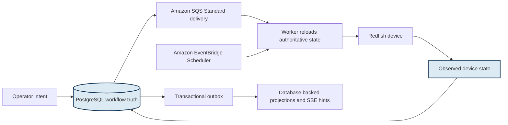

# 00 — Core Principles and Delivery Contract

## Purpose

This file defines constraints that every implementation phase must preserve. A feature is not acceptable merely because its happy path works. It must preserve the system's safety invariants under duplication, delay, reordering, worker loss, partial dependency failure, and operator races.

## Product and engineering thesis

FleetForge demonstrates that a small control plane can handle the same categories of correctness problem found in production fleet-management systems:

- long-running device operations;
- at-least-once work delivery;
- concurrency across shared failure domains;
- external side effects with ambiguous outcomes;
- event/poll reconciliation;
- controlled rollout and automatic pause;
- operational evidence and reproducible recovery.

The project succeeds when these properties are proved. A visually polished CRUD surface without those proofs is a failure.

## Non-negotiable invariants

| ID | Invariant | Required enforcement | Required proof |
|---|---|---|---|
| INV-01 | One target has at most one non-terminal firmware campaign | Database partial uniqueness plus domain guard | Concurrent integration test |
| INV-02 | Intent and attempt identity exist before a firmware side effect | Transaction boundary and step protocol | Crash-before-call test |
| INV-03 | An uncertain or stale-live-worker submission is never blindly resubmitted | Reconciliation-only recovery, external evidence hierarchy, and no late original request | Crash-after-accept and expired-live-worker fault tests |
| INV-04 | A campaign cannot release a later wave before the prior wave is terminal and evaluated | Campaign transition guard | Property and concurrent evaluator test |
| INV-05 | A committed pause/abort blocks every subsequently granted submission authorization | Transactional admission against command epoch; pre-commit authorizations remain visible and potentially in flight | Barrier test before and after admission grant |
| INV-06 | Running policy, artifact digest, and target snapshot do not mutate after readiness | Immutable snapshot columns and revision rules | API and database negative tests |
| INV-07 | Every lifecycle mutation produces audit evidence in the same transaction | Audit writer inside repository transaction | Mutation/audit count test |
| INV-08 | Queue/event delivery alone never defines workflow truth | PostgreSQL state reload on every worker command | Delete/replay queue test |
| INV-09 | A successful target requires expected version and configured health evidence | Verification policy | False-positive device-task test |
| INV-10 | Secrets and firmware bytes never enter logs, events, traces, or browser state | Allowlists, redaction, storage boundary | Automated leakage tests |
| INV-11 | No network call occurs while a database row lock is held | Repository/worker boundary | Instrumented integration test |
| INV-12 | Retry attempts are finite and budgeted by step, target, campaign, and failure domain | Retry policy and counters; observation retry preserves its resume step | Retry-storm and retry-state separation simulation |
| INV-13 | Physical side-effect concurrency remains bounded after handler lease expiry or ambiguity | Durable operation reservations independent of short work leases | Active-operation test across lease expiry and attention |
| INV-14 | Campaign terminality or target-update terminality cannot release unresolved target ownership | Readiness-time enrollment claim plus unresolved-operation quarantine | Concurrent campaign and late-observation test |

## Source-of-truth model

- PostgreSQL is authoritative for workflow intent, lifecycle, immutable snapshots, attempts, leases, audit, and due work.
- Redfish is authoritative for the device's observable present condition, subject to stale/missing data classification.
- Amazon SQS Standard is delivery transport. SQS message absence does not mean work absence; duplicate message delivery does not mean duplicate work.
- No event broker is used in the first portfolio release. Database-backed projections and SSE hints must remain rebuildable from PostgreSQL.
- Amazon EventBridge Scheduler supplies an external bounded repair wakeup when ECS Fargate worker capacity is zero.
- Object storage is authoritative for immutable firmware bytes. PostgreSQL retains digest, S3 version ID, verification, and compatibility metadata.

## Safety ordering

For every external side effect:

1. Validate current campaign/target state.
2. Acquire the short work lease and any target-enrollment or durable operation reservation required by the step.
3. Persist step intent and attempt identity.
4. In one transaction, recheck campaign epoch and safety policy and persist a single submission authorization. Pause/abort blocks new authorizations; an authorization committed earlier remains potentially in flight.
5. Perform one bounded external call outside the database transaction. An expired lease never proves the call was absent or cancels a late caller.
6. Persist response/evidence using the lease token and expected revision.
7. Schedule the next durable step only after the transition commits.
8. If the call may have been accepted, or a submitting worker outlived its lease, reconcile before any retry. Generic missing evidence is inconclusive rather than proof of absence.

This ordering may be expressed briefly in implementation documentation but should not be replaced by a long code sample.

## Phase-size rule

A phase should introduce one coherent risk surface. If a phase cannot be verified without waiting for several unrelated components, it is too broad. If it produces only file scaffolding without a behavior or evidence artifact, it is too shallow.

Each phase must end with:

- a runnable slice;
- automated tests;
- at least one failure-path demonstration;
- telemetry for the new behavior;
- documentation of limitations;
- a rollback or disable path;
- a reviewable evidence bundle.

## Definition of ready

A phase may begin only when:

- every upstream exit gate is green;
- required ADRs are accepted or explicitly marked provisional;
- secrets/accounts/services required by the phase are available;
- the test environment can be reset safely;
- no unresolved severity-1 risk blocks the phase;
- interfaces consumed from earlier phases have versioned contracts;
- acceptance criteria can be executed without subjective interpretation.

## Definition of done

A phase is complete only when:

1. All required micro-tasks are complete or intentionally removed through a Decision Log entry.
2. Formatting, static analysis, unit tests, integration tests, and phase-specific suites pass in CI.
3. Negative and concurrency tests pass, not only happy paths.
4. New metrics/log fields/traces are visible in the designated environment.
5. Secrets and sensitive payload scans pass.
6. Database migrations are forward-tested and, where applicable, application rollback compatibility is proved.
7. The phase demo is reproducible from a documented command or workflow.
8. Evidence is stored with commit SHA, environment, seed, timestamp, and tool versions.
9. Known limitations and deferred work are updated.
10. The project owner explicitly approves progression.

## Test-first interpretation

Test-first does not require writing every assertion before any design. It requires specifying the invariant, observable result, fault boundary, and acceptance oracle before implementing the behavior. For safety-critical transitions, the failing test should normally exist before the implementation change.

## Failure classification

| Class | Example | Default action |
|---|---|---|
| Validation | incompatible target, invalid selector, unverified digest | Fail closed; operator correction required |
| Authentication/authorization | invalid identity, expired worker token, insufficient role | Reject; audit safe metadata; no retry by domain worker |
| Proven transient transport | connect refused before request write, selected `429/503` | Bounded jittered retry |
| Proven absent side effect | device evidence proves no matching task/version/staged image | Retry only if remaining policy budget allows |
| Ambiguous side effect | timeout/reset after request may have been accepted | Reconcile; then adopt, prove absent, or `NEEDS_ATTENTION` |
| Terminal device rejection | signature failure, incompatible image, explicit task failure | Terminal or campaign pause according to policy |
| Internal consistency | illegal transition, counter underflow, audit/outbox transaction failure | Fail closed, page, and preserve evidence |
| Optional telemetry | exporter unavailable | Continue workflow with bounded buffer/drop accounting |

## No-go implementation shortcuts

- No in-memory-only workflow state.
- No `sleep` for minutes inside a request or worker.
- No retry loop around firmware submission without ambiguity classification.
- No automatic retry from an expired `SUBMITTING` lease unless the original transport produced durable pre-write proof or a target-specific fence excludes a late request.
- No release of a durable operation reservation because a work lease expired or a target entered `NEEDS_ATTENTION`.
- No queue acknowledgement before durable transition commit.
- No direct Redfish call from the browser or HTTP handler.
- No mutable campaign selector after target freezing.
- No raw database status updates that bypass transition guards and audit.
- No mock-only integration suite for PostgreSQL concurrency.
- No production path that disables TLS certificate validation.
- No unlimited worker concurrency or unbounded goroutine creation.
- No metrics labels containing unbounded target/campaign IDs in production configuration.
- No benchmark claim without workload, commit, environment, and observed result.

## Cloud and laptop contract

- The laptop may run the editor, browser, frontend, lightweight Go processes, and focused unit tests.
- PostgreSQL, queues, object storage, and the telemetry backend remain cloud-hosted when their phases require them.
- GitHub-hosted CI may run ephemeral PostgreSQL containers; this does not burden the laptop.
- The repository-owned virtual-BMC backend runs locally or in its release
  container; no specialized firmware-image build is part of the project.
- Every billable cloud resource has an owner, maximum instance/dispatch/storage setting, budget alert, retention rule, and teardown path.
- Free-tier limits are rechecked before the infrastructure phase and recorded with date/source.
- Free development resources are session-based where periodic work would otherwise prevent scale-to-zero. Retained demo state has an explicit paid budget and restore window.

## Documentation and code boundary

The phase plan describes exact modules, responsibilities, contracts, algorithms, and tests without embedding long business-logic code. Small examples are allowed only when they clarify ordering or schema. Implementation code is authored and reviewed in later low-thinking execution passes.
