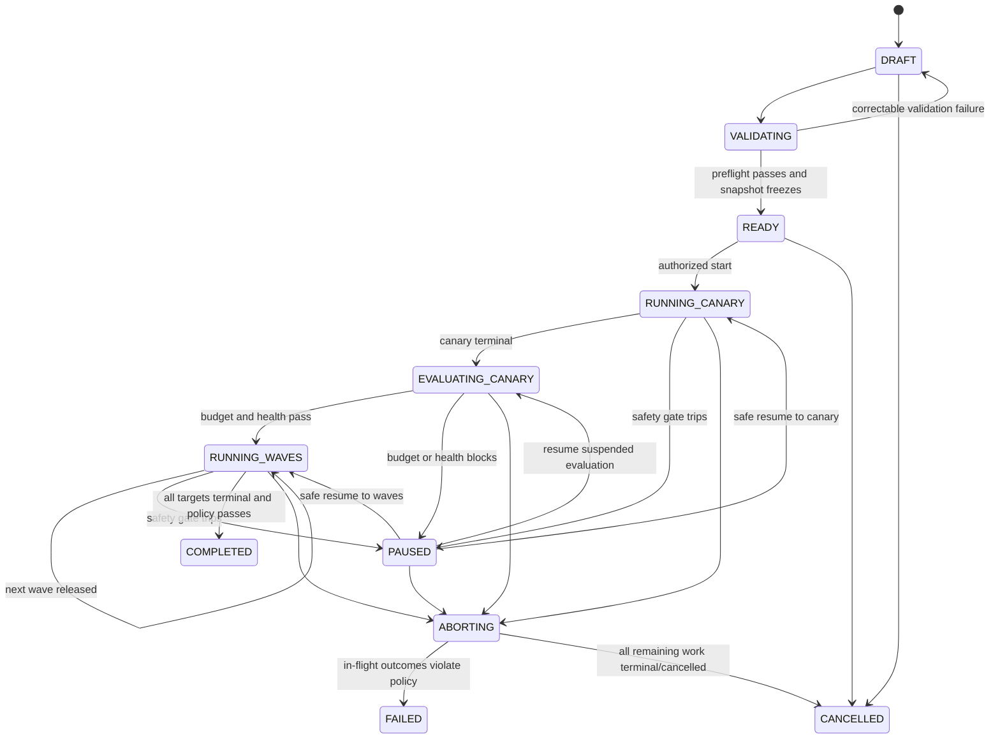
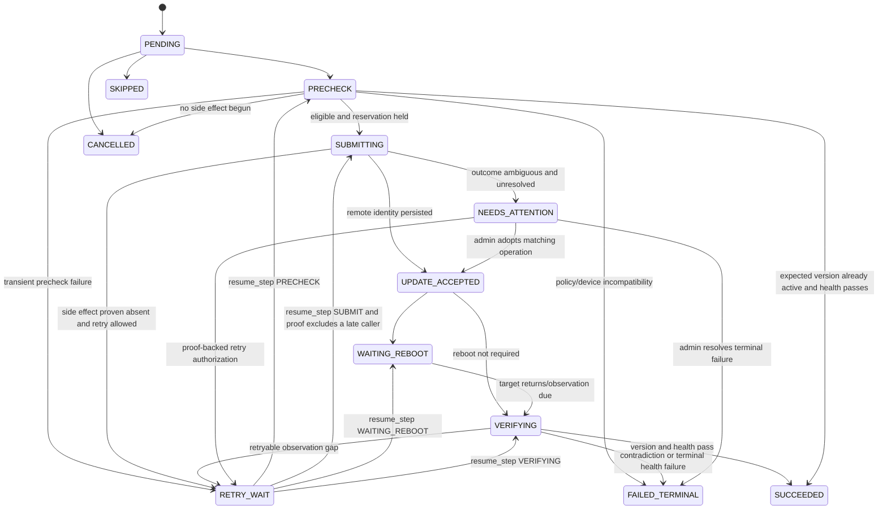

# Phase 02 — Domain Model and State Machines

## Outcome

Implement a pure, deterministic domain core for campaign, wave, target-update, artifact, and target lifecycles. Every legal transition, illegal transition, invariant, decision reason, and terminal behavior is testable without HTTP, PostgreSQL, queues, clocks, randomness, or Redfish.

The output is the correctness kernel used by later API and worker adapters.

## Entry criteria

- Phase 01 exit gate passes.
- Architecture state names and invariants are accepted.
- `INV-01` through `INV-12` are present in the Traceability Matrix.
- Terminology is consistent between the RFC and plan.

## Non-goals

- No database repositories or migrations.
- No asynchronous delivery.
- No Redfish JSON parsing.
- No wall-clock calls or global random generator inside domain decisions.
- No UI models.

## Domain package boundaries

| Package area | Owns | Must not own |
|---|---|---|
| campaign | Campaign lifecycle, command epoch, immutable snapshot identity | SQL, queue calls, HTTP status codes |
| wave | Ordered release/evaluation state and aggregate counts | Device communication |
| targetupdate | Per-target state, step intent, remote-operation evidence classification | Redfish transport details |
| artifact | Verification/compatibility lifecycle abstractions | Object-storage SDK |
| inventory | Target identity, labels, capabilities, administrative availability | Selector database query |
| policy | Canary/wave/failure/concurrency/health decision values | Runtime configuration lookup |
| evidence | Normalized observations and decision reasons | Raw secret-bearing payloads |

## State model

## Decision model

Every transition function consumes explicit values:

- current aggregate snapshot and revision;
- command type and command ID;
- actor/authorization decision already established by the application layer;
- logical current time supplied by caller;
- frozen policy version and values;
- normalized evidence;
- retry/failure/concurrency counters;
- expected command epoch.
- explicit retry `resume_step`, suspended campaign phase, submission-admission identity, enrollment ownership, and durable operation-reservation state where relevant.

It returns either:

- allowed transition, new state, reason code, domain events, counter deltas, and next-action intent; or
- rejected decision with stable reason code and whether rejection is conflict, invalid input, unsafe condition, or no-op.

No domain result contains an HTTP code, SQL error, queue message ID, SDK object, or raw Redfish document.

## Stable reason-code families

- `campaign.validation.*`
- `campaign.wave.*`
- `campaign.budget.*`
- `campaign.pause.*`
- `target.precheck.*`
- `target.submission.*`
- `target.ambiguity.*`
- `target.verification.*`
- `artifact.verification.*`
- `concurrency.reservation.*`
- `internal.invariant.*`

Reason codes are versioned contract values. Human messages may change; reason semantics may not silently change.

## Micro-task checklist

### Vocabulary and value objects

- [x] **P02-T01** Define canonical IDs for campaign, wave, target, target update, artifact, attempt, command, event, and policy version.
- [x] **P02-T02** Define state enumerations and one parser/validator per enumeration.
- [x] **P02-T03** Define UTC timestamp value and IANA maintenance-window value without embedding system-clock reads.
- [x] **P02-T04** Define failure-domain labels (`site`, `rack`, extensible labels) with normalized keys and size limits.
- [x] **P02-T05** Define digest, firmware version, remote task URI, endpoint identity, retry budget, failure budget, and concurrency-limit values.
- [x] **P02-T06** Define normalized evidence categories: task, firmware inventory, reachability, reboot, health, rejection, ambiguity.

### Transition tables

- [x] **P02-T07** Write the complete campaign transition matrix including no-op and prohibited transitions.
- [x] **P02-T08** Write the complete target-update transition matrix including retry/ambiguity paths.
- [x] **P02-T08A** Define `resume_step` for every retry transition; an observation retry must never return to a submission-capable state.
- [x] **P02-T08B** Define `NEEDS_ATTENTION` resolution transitions: adopt-and-observe, terminal failure, and proof-backed retry, including counter/reservation effects.
- [x] **P02-T08C** Define `suspended_phase` for campaign pause and resume, including `EVALUATING_CANARY`.
- [x] **P02-T08D** Define abort behavior separately for work with no possible side effect and accepted/ambiguous work that must continue observation.
- [x] **P02-T09** Define terminal-state immutability and the separate audited manual-retry command semantics.
- [x] **P02-T10** Define wave release/evaluation transitions and ordinal monotonicity.
- [x] **P02-T11** Define artifact readiness transitions and the conditions consumed by campaign validation.
- [x] **P02-T12** Define target administrative states such as active, disabled, unreachable, or maintenance-blocked without conflating them with campaign target state.

### Pure reducers and policies

- [x] **P02-T13** Implement campaign command reducer with explicit revision/epoch checks.
- [x] **P02-T14** Implement target-update evidence reducer with stale/duplicate evidence semantics.
- [x] **P02-T15** Implement canary-selection interface accepting injected deterministic ordering/seed.
- [x] **P02-T16** Implement wave plan representation and release eligibility decision.
- [x] **P02-T17** Implement failure-budget calculation using exact integer/rational rules; document rounding at boundaries.
- [x] **P02-T18** Implement retry classification input/output model without performing retry sleeps.
- [x] **P02-T19** Implement maintenance-window decision using injected logical time and timezone database.
- [x] **P02-T20** Implement post-update success decision requiring version plus configured health checks.
- [x] **P02-T21** Implement pause/abort epoch semantics as a persisted submission-admission decision: a commit blocks new admissions, while earlier admissions remain potentially in flight.
- [x] **P02-T22** Define ambiguity resolution outcomes: matching operation adopted, expected version observed, proven absent, contradicted, or inconclusive.

### Events and replay

- [x] **P02-T23** Define domain event names and minimum payloads without transport envelope fields.
- [x] **P02-T24** Make events carry aggregate revision and decision reason.
- [x] **P02-T25** Define a pure replay function over commands/evidence that reconstructs decisions but cannot execute external calls.
- [x] **P02-T26** Add canonical serialization fixtures for state and events to catch accidental contract drift.

### Defensive boundaries

- [x] **P02-T27** Reject unknown states, invalid counters, negative budgets, zero/negative concurrency, invalid wave ordinals, and impossible timestamps.
- [x] **P02-T28** Add invariant assertion functions used in tests and at persistence/application boundaries.
- [x] **P02-T29** Ensure errors do not contain secret-bearing values or unbounded raw evidence.
- [x] **P02-T30** Add package dependency test/lint rule preventing infrastructure imports into the domain.

## Required test matrix

### Table tests

- Every allowed campaign transition produces the expected new state and event.
- Every prohibited campaign transition returns a stable rejection and leaves input unchanged.
- Every target state follows the same completeness rule.
- Terminal states remain terminal under duplicate commands/evidence.
- Stale expected revision and stale command epoch reject before a side-effect authorization result can be produced.
- Pause after a submission admission does not revoke that admission; the result remains visible as potentially in flight and must be reconciled.
- Wave ordinal cannot skip, repeat release, or move backward.
- Failure percentage equality at threshold follows one documented inclusive/exclusive rule.
- Maintenance windows handle timezone offset changes and boundary timestamps deterministically.
- Success cannot result from task completion alone when version/health evidence is missing.

### Property tests

| Property ID | Generated sequence | Required invariant |
|---|---|---|
| P02-PT-01 | Random campaign commands | No illegal state and no revision decrease |
| P02-PT-02 | Commands mixed with duplicates | Duplicate command is stable/no extra event |
| P02-PT-03 | Wave completion/failure sequences | No later-wave release before prior evaluation |
| P02-PT-04 | Evidence reorder/duplicates | Terminal target never regresses |
| P02-PT-05 | Retryable and terminal failures | Attempts never exceed configured budget |
| P02-PT-06 | Pause/abort at every state | No post-epoch side-effect authorization |
| P02-PT-07 | Integer budget boundaries | Counts and percentages never disagree with specification |
| P02-PT-08 | Replay of stored inputs | Recomputed decisions and reasons match golden trace |
| P02-PT-09 | Retry failures from every resumable step | Retry returns only to its recorded step and cannot create an accidental submit path |
| P02-PT-10 | Pause/resume from every running/evaluating phase | Resumes the persisted suspended phase without skipping health evaluation |
| P02-PT-11 | Attention resolution sequences | Only adopt, terminal-failure, or independently proof-backed retry transitions occur |

### Concurrency/race relevance

The domain core is pure and does not lock; run the Go race detector anyway to prove no mutable global registries or caches were introduced. Concurrency ownership is tested in Phase 03/08.

## Observability contract

The domain returns stable state/reason values that later telemetry may record. It must not emit logs directly. This avoids duplicate logs on retries and keeps secrets/raw evidence outside generic formatters.

## Evidence artifacts

- Transition matrices in machine-readable fixture form.
- State diagrams aligned with code enumerations.
- Property-test seeds for any discovered bug.
- Coverage report specifically for transition guards and policy boundaries.
- Replay golden trace showing identical result across repeated executions.

## Exit criteria

- All legal/illegal transition cases are covered.
- Property tests execute a documented minimum sequence count in CI.
- All fourteen invariants have a domain-level enforcement or an explicit later-phase dependency.
- Replay is deterministic.
- Domain imports contain no infrastructure SDKs.
- Race test passes.
- No external I/O exists in the domain package.

## Rollback and stop conditions

- If state names or invariant semantics remain disputed, stop before persistence migrations freeze them.
- If a rule needs wall-clock/global randomness, redesign the input contract rather than hiding nondeterminism.
- If the reducer becomes a transport-aware service object, roll back and restore the pure boundary.
