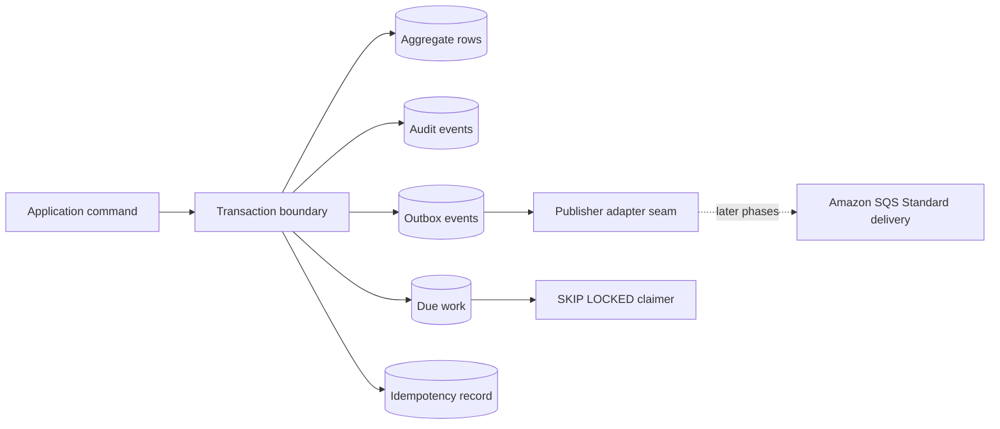
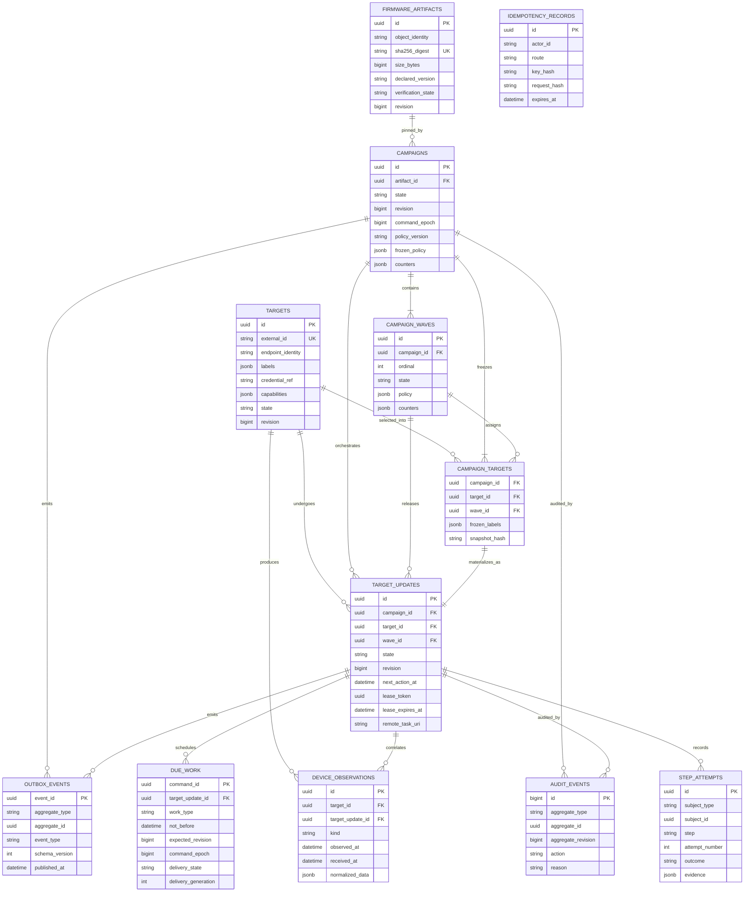

# Phase 03 — Persistence, Migrations, Idempotency, and Transactional Outbox

## Outcome

Create the PostgreSQL persistence layer that atomically stores aggregate transitions, enrollment claims, submission admissions, work leases, durable operation reservations, decision inputs, counters, audit records, idempotency records, generic due work, and outbox events. Prove behavior against real PostgreSQL under concurrency; mocks are not accepted as the primary database proof.

## Entry criteria

- Phases 01 and 02 pass.
- State/reason/event vocabulary is stable enough for migration version 1.
- Neon development project or equivalent managed PostgreSQL endpoint is available.
- CI is allowed to run an ephemeral PostgreSQL service container.
- Migration tool and query-generation/typing approach are selected in an ADR.

## Non-goals

- No cloud queue publication yet beyond an adapter seam.
- No Redfish calls.
- No campaign planning or artifact bytes.
- No long-running transaction around network I/O.
- No generic ORM repository that hides locking and SQL semantics.

## Persistence topology

## Initial schema responsibilities

This ER diagram is a planning model, not implemented DDL. Phase 03 implementation must resolve exact column types, nullability, foreign-key deletion behavior, check constraints, partition/retention details, and query plans through migrations and integration tests.

| Table | Critical fields | Primary access pattern | Essential constraint/index |
|---|---|---|---|
| `targets` | ID, external ID, endpoint identity, labels, credential ref, capabilities, state, revision | Resolve by external ID; select by labels/domain; inspect by ID | Unique external ID; label GIN only if query proves useful; site/rack/state index |
| `firmware_artifacts` | ID, object identity, digest, size, declared version, verification state, revision | Resolve verified digest; inspect readiness | Unique digest+object generation; verification-state index |
| `campaigns` | ID, state, revision, command epoch, policy version/snapshot, counters | Command by ID/revision; list active | State+updated keyset index; counter checks |
| `campaign_waves` | campaign ID, ordinal, state, policy, counters | Current/next wave | Unique campaign+ordinal; partial active-wave rule where feasible |
| `campaign_targets` | campaign, target, wave, frozen labels/capabilities reference | Enumerate wave/domain | Unique campaign+target; wave/state/domain indexes |
| `target_updates` | campaign/target/wave, state, revision, next action, resume step, work-lease fields, submission admission, remote task identity | Claim due work; list campaign state; reconcile target | `(state,next_action_at)`; lease expiry; campaign/state; unique active admission |
| `target_enrollments` | target, campaign, active ownership, acquired/released times, unresolved-operation quarantine | Enforce one campaign owner from readiness through campaign release and later unresolved operation | One active claim per target; release guard cannot ignore quarantine |
| `operation_reservations` | attempt, target, campaign/site/rack scopes, state, acquired/released times, ownership revision | Count physical side effects through update/reboot/health resolution | Unique active reservation per attempt/scope; no TTL-only deletion |
| `decision_inputs` | aggregate/revision, logical time, reducer/policy versions, normalized input, result/reason | Reconstruct decisions after observations expire | Unique aggregate+revision+decision sequence; audit-lifetime retention |
| `step_attempts` | update, step, attempt number, intent/result/evidence hashes, timings | Reconcile attempt; audit target | Unique update+step+attempt; remote task/correlation indexes |
| `device_observations` | target/update, type, observed/received time, normalized evidence, raw-object reference | Latest relevant evidence; timeline | target/type/time and update/time indexes |
| `idempotency_records` | actor, route, key hash, request hash, response reference/status, expiry | Resolve duplicate mutating request | Unique actor+route+key hash |
| `audit_events` | ID, aggregate, revision, sequence, actor, action, reason, before/after hashes | Reconstruct aggregate/campaign timeline | Unique aggregate+revision+sequence; append-only permission |
| `outbox_events` | event ID/type/version, aggregate, payload, created/published state, attempts | Publish oldest unpublished | Unique event ID; partial unpublished+created index |
| `due_work` | command ID, typed subject, work type/version, not-before, expected revision/epoch, delivery state/generation | Claim/schedule/repair target, artifact, validation, and campaign work | Unique semantic work key; due-time partial index; unique command+delivery generation |

## Transaction contracts

1. Aggregate mutation, revision increment, audit event, domain outbox events, counter deltas, and due-work intent commit together.
2. Idempotency claim and final response linkage follow an explicit two-stage protocol so concurrent identical requests converge and conflicting request hashes reject.
3. Publisher delivery status is updated in a separate short transaction after external publication.
4. Claimed work commits its lease before any network call.
5. Result persistence uses lease token plus expected revision; stale workers cannot commit.
6. Database serialization/deadlock errors are classified and retried only at a safe transaction boundary with a small bounded budget.
7. A readiness transaction creates enrollment claims for every frozen target before changing the campaign to `READY`; target-update terminality cannot release those claims.
8. A submission-admission transaction validates epoch/policy and creates the durable operation reservation. Work-lease expiry never releases that reservation.
9. All multi-row writers acquire campaign, wave, enrollment/target, operation-reservation, aggregate, and due-work rows in one documented deterministic order.

## Migration policy

- Immutable sequential migration files; never edit an applied migration.
- Schema history recorded in every environment.
- Migrations run through one dedicated job with advisory lock.
- Application startup checks compatible schema range but does not automatically mutate production schema.
- Expand/migrate/contract for changes used across deploy revisions.
- Destructive changes require backup/restore evidence and an ADR.
- Migration CI tests empty-database creation and upgrade from the last supported release snapshot.

## Micro-task checklist

### Database contract and connectivity

- [ ] **P03-T01** Select PostgreSQL driver/pool and typed-query approach; document why explicit SQL remains visible.
- [ ] **P03-T02** Define separate application, migration, and read-only diagnostic roles.
- [ ] **P03-T03** Use the Neon pooled endpoint for serverless roles and the direct endpoint for controlled migrations and session-sensitive administration. Do not use session-level advisory locks through transaction pooling.
- [ ] **P03-T04** Configure conservative pool max/min/lifetime/idle values per runtime role and ECS Fargate maximum instance count.
- [ ] **P03-T05** Add bounded connection acquisition and transaction timeouts.
- [ ] **P03-T06** Add readiness behavior that distinguishes transient connectivity from incompatible schema.

### Migrations

- [ ] **P03-T07** Create schema namespace and required extensions only after portability review.
- [ ] **P03-T08** Create enums/check constraints with a plan for adding values safely, or use text+checks when enum migration cost is higher.
- [ ] **P03-T09** Create core tables, foreign keys, uniqueness, check constraints, and timestamps.
- [ ] **P03-T10** Add partial uniqueness preventing a target from joining two non-terminal campaigns.
- [ ] **P03-T11** Add immutable/frozen-state protection where database enforcement is practical.
- [ ] **P03-T12** Add append-only permissions/triggers or repository restrictions for audit records; document the trust boundary.
- [ ] **P03-T12A** Create `target_enrollments`, `operation_reservations`, and `decision_inputs` with explicit lifecycle constraints and audit-lifetime retention.
- [ ] **P03-T13** Add index comments linking each nontrivial index to a named query/access pattern.
- [ ] **P03-T14** Create seed-free migration; test fixtures live outside production migrations.

### Repositories and unit-of-work

- [ ] **P03-T15** Define repository interfaces around aggregate use cases rather than one repository per table.
- [ ] **P03-T16** Implement load-by-ID with explicit not-found, conflict, corruption, and unavailable error classes.
- [ ] **P03-T17** Implement aggregate save with expected revision.
- [ ] **P03-T18** Implement transaction wrapper that accepts domain results and writes aggregate/audit/outbox/due work atomically.
- [ ] **P03-T19** Ensure no repository method performs remote/cloud I/O.
- [ ] **P03-T20** Map database values to domain values through strict validation; corrupt/unknown state fails closed.

### Idempotency

- [ ] **P03-T21** Normalize route identity and hash idempotency keys rather than storing raw keys.
- [ ] **P03-T22** Store request hash; same key with different request rejects deterministically.
- [ ] **P03-T23** Define concurrent in-progress behavior: short wait/poll or explicit conflict with retry guidance.
- [ ] **P03-T24** Store status/body reference necessary to replay the stable response without rerunning the command.
- [ ] **P03-T25** Define expiry/cleanup only after all client retry windows; cleanup must not affect active commands.

### Audit and outbox

- [ ] **P03-T26** Persist actor/correlation/causation, aggregate revision, policy version, reason, and safe hashes.
- [ ] **P03-T27** Ensure audit payload is allowlisted and redacted before transaction input.
- [ ] **P03-T28** Create outbox event envelope with schema version and unique event ID.
- [ ] **P03-T29** Implement `FOR UPDATE SKIP LOCKED` batch claim ordered by creation time.
- [ ] **P03-T30** Record publish attempts, last safe error class, published time, and next attempt without embedding SDK errors verbatim.
- [ ] **P03-T31** Define poison-event policy: retry budget, quarantine/dead-letter state, alert, and manual replay authorization.

### Due work and leases

- [ ] **P03-T32** Store typed subject, `not_before`, work type/version, expected aggregate revision, expected command epoch, semantic command ID, and delivery generation; due work must support target, artifact, validation, and campaign subjects.
- [ ] **P03-T33** Claim due work with `SKIP LOCKED`, lease token, owner, and expiry.
- [ ] **P03-T34** Implement lease result commit requiring token and expected revision.
- [ ] **P03-T35** Implement expired-lease repair and prove it cannot steal an unexpired lease.
- [ ] **P03-T36** Add query for oldest overdue work and oldest unpublished outbox record.
- [ ] **P03-T36A** Persist the independent submission-admission identity and prevent a second active admission for one target/campaign/artifact step.
- [ ] **P03-T36B** Implement enrollment acquisition/release and durable operation-reservation transfer/release; TTL alone cannot release either safety claim.
- [ ] **P03-T36C** Persist normalized decision inputs required for replay rather than only hashes of expired source records.

### Retention and integrity

- [ ] **P03-T37** Define retention classes for observations, idempotency records, audit, outbox, and artifacts.
- [ ] **P03-T38** Use a cleanup job that deletes bounded batches and never blocks hot tables for long periods.
- [ ] **P03-T39** Add integrity queries for counter mismatch, orphan due work, active-target duplicates, stale leases, and audit revision gaps.
- [ ] **P03-T40** Document backup/export and future restore-test inputs.

## Required integration tests

| Test ID | Setup/action | Required result |
|---|---|---|
| P03-IT-01 | Two transactions save same expected revision | Exactly one commits; one returns conflict |
| P03-IT-02 | Aggregate mutation fails after audit insert attempt | Entire transaction rolls back |
| P03-IT-03 | Outbox writer fails | Aggregate and audit do not commit |
| P03-IT-04 | Concurrent identical idempotency keys/request hash | One command result; all callers converge |
| P03-IT-05 | Same idempotency key/different hash | Conflict; no second command |
| P03-IT-06 | Ten claimers use `SKIP LOCKED` | Each row claimed once per valid lease |
| P03-IT-07 | Worker loses lease before result | Stale result rejected |
| P03-IT-08 | Lease expires | One repair claimant succeeds; work remains recoverable |
| P03-IT-09 | Partial unique active-target race | One enrollment commits |
| P03-IT-10 | Publisher crashes after external success before published mark | Event may redeliver but keeps same event ID |
| P03-IT-11 | Unknown persisted state | Load fails closed with integrity signal |
| P03-IT-12 | Upgrade last schema snapshot | Migration succeeds and old-compatible application checks pass |
| P03-IT-13 | Empty schema migration | Final schema matches expected fingerprint |
| P03-IT-14 | Cleanup with active rows | Active/referenced rows remain intact |
| P03-IT-15 | Target update becomes terminal while parent campaign remains active | Enrollment still blocks another campaign; unresolved operation keeps quarantine after parent terminality |
| P03-IT-16 | Work lease expires during active operation | Stale commit is rejected and durable operation reservations remain counted |
| P03-IT-17 | Completion races with abort/evaluator/repair | Complete lock order prevents deadlock or produces bounded safe retry without invariant loss |
| P03-IT-18 | Replay after raw observations expire | Retained decision inputs reproduce result/reason exactly |

Run database tests with real PostgreSQL in CI and with the Neon development project for connection/pooling smoke tests. Do not assert Neon-specific behavior from the local container.

## Performance checks

- Query plans captured for due-work claim, campaign target listing, active campaign listing, and audit timeline.
- No sequential scan on the planned 1,000-target due-work hot path unless measurement proves it harmless and the decision is documented.
- Measure lock wait and transaction duration under concurrent claimers.
- Pool saturation test confirms max instances × per-instance connections cannot exceed the configured database budget.

## Observability introduced

- Pool acquisition latency and timeout count.
- Transaction duration/retry/deadlock/conflict count by operation family.
- Oldest unpublished outbox age.
- Oldest due work and lease-expiry counts.
- Migration version/compatibility status.
- Integrity-check failure count.

## Security checks

- Application role cannot alter migration history.
- Read-only role cannot mutate operational data.
- Audit records cannot be updated/deleted through normal application role.
- DSNs are redacted from errors and telemetry.
- Test fixtures contain no live credentials or endpoints.

## Evidence artifacts

- Schema diagram and migration inventory.
- Index-to-query rationale table.
- Concurrent claim/idempotency test logs.
- Query plans and connection-budget calculation.
- Integrity query output on seeded valid and intentionally corrupt fixtures.

## Exit criteria

- All persistence integration tests pass repeatedly under race/concurrency load.
- Intent, enrollment/admission, audit, decision input, outbox, and due work are atomic where each transition requires them.
- Stale revision and stale lease commits are rejected.
- The active-target uniqueness invariant is database-enforced.
- Work-lease expiry cannot release a physical operation reservation, and campaign/target-update terminality cannot release unresolved target quarantine.
- Migration from empty and previous snapshot passes.
- Connection budget is compatible with selected Neon/ECS Fargate limits.
- No network I/O occurs inside repository transactions.

## Rollback and stop conditions

- Stop if a desired workflow cannot be represented without holding locks during external calls.
- Stop if idempotency behavior is still defined only at the HTTP layer.
- Roll back new indexes if measured write cost outweighs the named query benefit, recording evidence.
- Never down-migrate production data destructively as an application rollback mechanism; roll back application within the compatibility window.
