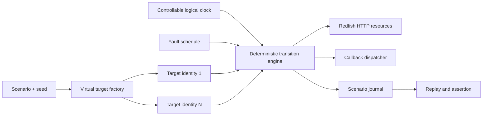

# Phase 04 — Deterministic Redfish Simulator

## Outcome

Build an isolated Go service on one on-demand EC2 VM that exposes the minimum Redfish resources required by FleetForge and can model hundreds or thousands of virtual BMC identities with reproducible timing and fault behavior. The simulator is a test instrument, not a convenient fake: each run is seeded, observable, resettable, contract-checked, and backed by persistent test-run state and an independent request/acceptance journal.

## Entry criteria

- Phase 01 passes; Phase 02 value/evidence vocabulary is available.
- Exact Redfish resources and versions required by the architecture are enumerated from current DMTF/OpenBMC references.
- The pre-Phase-04 QEMU capability spike has frozen the pinned image, update mechanism, apply-time behavior, image format/size, task/inventory evidence, and recovery procedure.
- Simulator trust boundary and isolation from any real-target environment are accepted.
- Fixture licensing/provenance is recorded.

## Non-goals

- No attempt to emulate all OpenBMC services or hardware.
- No vendor-specific behavior without a named fixture and rationale.
- No production credentials or routes.
- No simulator behavior that reads FleetForge database state.
- No random failure without a recorded seed and deterministic schedule.
- No simulator-side semantic deduplication that can hide repeated FleetForge update requests unless a separately named target profile is proving a real target idempotency facility.

## Required resource surface

| Resource | Simulator responsibility |
|---|---|
| Service root | Advertise supported Redfish version and links |
| Managers/Systems/Chassis subset | Stable identity, model/manufacturer, power/reachability, health inputs |
| UpdateService | Capability discovery and firmware update action used by selected OpenBMC path |
| TaskService | Long-running task identity, progress, completion, failure, disappearance behavior |
| SoftwareInventory | Current/staged firmware versions and activation state |
| EventService | Subscription registration and callback delivery with duplicate/loss/reorder controls |
| Session/auth subset | Basic/session behavior needed by adapter tests; never production-equivalent security claims |

## Simulation model

Each target holds simulator state: current/staged version, task state, reboot/reachability state, health flags, capability flags, event sequence, and configured faults. A persistent run store survives process restart and remains the single source for that test run. An independent append-only journal records every received update request before response handling and every accepted operation before injected response loss. It never uses FleetForge state or FleetForge's `PROVEN_ABSENT` classification as its oracle.

## Fault profile catalog

| Fault ID | Behavior | Critical use |
|---|---|---|
| RF-F01 | Duplicate identical response/event | Idempotency |
| RF-F02 | Event delivered late or out of order | Evidence monotonicity |
| RF-F03 | Event permanently dropped | Polling/reconciliation |
| RF-F04 | `429` with optional retry hint | Backoff/budget |
| RF-F05 | Selected `500/502/503/504` | Transient classification |
| RF-F06 | Connection closed before request body read | Proven pre-side-effect retry |
| RF-F07 | Connection closed after update acceptance before response | Ambiguous submission |
| RF-F08 | Task URI accepted, then task disappears after reboot | Inventory-based reconciliation |
| RF-F09 | Long reboot/unreachable interval | Durable wait and timeout |
| RF-F10 | Task says complete but version unchanged | False-success protection |
| RF-F11 | Version updated but health check fails | Post-update policy |
| RF-F12 | Signature/compatibility rejection | Terminal preflight/device outcome |
| RF-F13 | Stale inventory for configurable observations | Reconciliation evidence quality |
| RF-F14 | Noisy target producing callback burst | Backpressure/hot-target defense |
| RF-F15 | Clock skew/invalid timestamp in event | Received-time/observed-time handling |

## Micro-task checklist

### Standards and fixtures

- [ ] **P04-T01** Record exact DMTF Redfish schema/release references used.
- [ ] **P04-T02** Import the pinned QEMU capability-spike fixture and record the exact OpenBMC endpoint, upload/data path, apply-time, task/inventory, authentication, image, and recovery behavior targeted for integration.
- [ ] **P04-T03** Create minimal conformance fixture set with provenance and schema validation.
- [ ] **P04-T04** Separate normative Redfish fields from simulator-only control fields/endpoints.
- [ ] **P04-T05** Make simulator-control endpoints unavailable on the Redfish listener or protected by a separate admin secret/network.

### Deterministic engine

- [ ] **P04-T06** Define scenario schema: seed, target count, labels, initial versions, capabilities, timing profile, fault schedule.
- [ ] **P04-T07** Validate scenario size/ranges and reject unknown fault names.
- [ ] **P04-T08** Implement injected logical clock for tests and real-time clock adapter for interactive demo.
- [ ] **P04-T09** Derive target identities deterministically from scenario and index.
- [ ] **P04-T10** Implement per-target state with explicit transitions, persistent run snapshots, and immutable journal entries.
- [ ] **P04-T11** Guarantee identical seed+scenario+request sequence yields identical journal and responses, excluding declared wall-clock fields.
- [ ] **P04-T12** Add reset/snapshot controls that cannot race with active test execution silently; an unrecoverable restart marks the run invalid rather than presenting erased state as device truth.

### Redfish HTTP surface

- [ ] **P04-T13** Implement service root and resource discovery links.
- [ ] **P04-T14** Implement target inventory and capability resources.
- [ ] **P04-T15** Record every received update request independently, then create one remote task identity per actual acceptance. A repeated request in the non-idempotent profile is a second visible submission, not silently coalesced by semantic identity.
- [ ] **P04-T16** Implement task progress and terminal results.
- [ ] **P04-T17** Implement reboot/unreachable behavior without terminating the simulator process.
- [ ] **P04-T18** Implement software inventory activation/current-version changes.
- [ ] **P04-T19** Implement event subscription and callback delivery.
- [ ] **P04-T20** Add pagination/collection counts where the adapter consumes them.
- [ ] **P04-T21** Enforce request/body/header limits and reject malformed paths/methods consistently.

### Fault injection

- [ ] **P04-T22** Implement each RF-F01–RF-F15 fault as a composable scheduled action.
- [ ] **P04-T23** Distinguish failures before side-effect acceptance from failures after acceptance.
- [ ] **P04-T24** Permit target-, rack-, site-, wave-time-, and request-count-scoped fault activation.
- [ ] **P04-T25** Log fault activation in scenario journal with seed and trigger.
- [ ] **P04-T26** Ensure retries do not accidentally consume faults nondeterministically; document consumption semantics.

### Scale and isolation

- [ ] **P04-T27** Use lazy/compact target state so 1,000 targets fit comfortably in the frozen EC2 VM memory/disk budget.
- [ ] **P04-T28** Bound goroutines, callback workers, in-memory queues, journal size, and open connections.
- [ ] **P04-T29** Add max target count and max fault/event rate configuration.
- [ ] **P04-T30** Expose readiness only after scenario validation, persistent-store recovery, target initialization, and journal consistency checks.
- [ ] **P04-T30A** Enforce one active simulator process per retained run and reject accidental split ownership.
- [ ] **P04-T31** Add a clear banner/metric/resource marker identifying every endpoint as simulated.

### Diagnostics

- [ ] **P04-T32** Expose a safe scenario summary, target-state inspection, and journal export through the admin surface.
- [ ] **P04-T33** Correlate Redfish requests with target ID, semantic operation ID, and fault trigger without logging auth secrets or firmware bytes.
- [ ] **P04-T34** Emit request latency, active tasks, virtual target states, callback lag, injected-fault count, and dropped-event count.

## Required tests

| Test ID | Scenario | Required result |
|---|---|---|
| P04-CT-01 | Validate representative resources against selected schemas | Conformant fields/types for supported subset |
| P04-CT-02 | Unsupported resource/action | Redfish-consistent error; no state mutation |
| P04-DT-01 | Same seed and request trace twice | Byte-equivalent normalized journal/result |
| P04-DT-02 | Different seed | Predictably different selected fault/target pattern |
| P04-FT-01 | Drop all callbacks | Task/inventory polling still exposes truth |
| P04-FT-02 | Close connection after accept | Exactly one remote operation exists |
| P04-FT-03 | Task disappears after reboot | Software inventory retains configured outcome |
| P04-FT-04 | Duplicate/out-of-order event | Event IDs/sequences follow configured profile |
| P04-FT-05 | Task complete/version unchanged | Contradictory evidence is visible |
| P04-FT-06 | Deliberate duplicate firmware request in non-idempotent profile | Two received requests/acceptances are visible and the FleetForge safety oracle fails |
| P04-FT-07 | Simulator process restarts after acceptance | Run state, task, device version path, and independent journal recover consistently or the run is invalidated |
| P04-FT-08 | FleetForge marks accepted attempt `PROVEN_ABSENT` | Independent journal reports oracle mismatch and fails the test |
| P04-LT-01 | 1,000 idle targets | Memory/startup within declared budget |
| P04-LT-02 | Controlled concurrent update load | No unbounded goroutine/queue growth |
| P04-ST-01 | Simulator-control endpoint from Redfish/public path | Denied/unreachable |

## Contract discipline

The simulator must not be changed merely to make a FleetForge adapter test pass. When a mismatch occurs:

1. Compare with the selected Redfish schema and OpenBMC behavior.
2. Decide whether simulator, adapter, fixture, or assumption is wrong.
3. Record a decision when behavior is ambiguous/vendor-specific.
4. Add a regression fixture.

## Evidence artifacts

- Supported-resource matrix with schema links.
- Scenario schema and fault catalog.
- Determinism hash report for repeated traces.
- 1,000-target memory/concurrency measurement.
- Journal from ambiguous post-accept connection loss.
- List of known differences from QEMU/OpenBMC.

## Exit criteria

- Required Redfish subset passes contract checks.
- All fifteen fault profiles are deterministic and independently testable.
- 1,000 virtual targets run within declared EC2 VM memory, disk, and request limits.
- Admin controls are isolated from the Redfish interface.
- Scenario replay reproduces failures.
- A deliberate duplicate submission and false proof-of-absence classification fail the independent oracle.
- The adapter can later distinguish pre-accept, accepted, terminal, and unavailable observations.

## Rollback and stop conditions

- Stop if a simulator behavior cannot be traced to a standard, OpenBMC observation, or explicit synthetic-fault purpose.
- Stop if scale relies on disabling journals/visibility needed for fault proof; redesign compact evidence instead.
- Do not call the simulator Redfish-compliant beyond the tested subset.
