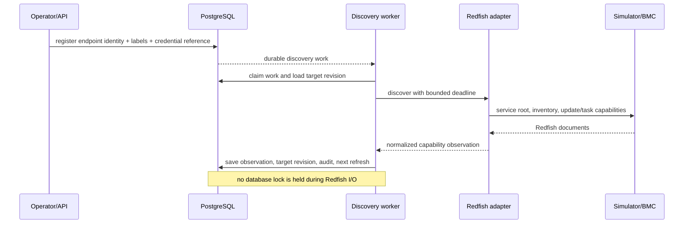

# Phase 05 — Target Inventory and Preflight

## Outcome

Implement safe target registration, Redfish capability discovery, normalized observations, label-based selection, and campaign preflight that freezes an explicit, conflict-free target snapshot. No firmware side effect is allowed in this phase.

## Entry criteria

- Phases 02–04 pass.
- Target schema, adapter-port boundary, and supported Redfish resource subset are accepted.
- Simulator provides healthy, incompatible, unreachable, stale, and malformed target profiles.
- Endpoint/credential security policy and the separate administrative AWS Secrets Manager provisioning path are defined.

## Non-goals

- No firmware submission.
- No wave execution.
- No browser UI beyond optional diagnostics.
- No vendor-specific policy in the domain.
- No selector that remains dynamic after campaign readiness.

## Discovery flow

## Normalized target model

| Field group | Examples | Rule |
|---|---|---|
| Identity | external ID, endpoint canonical form, manager/system IDs | Stable and uniqueness-checked |
| Failure domain | site, rack, optional chassis/group labels | Frozen into campaign target snapshot |
| Device metadata | manufacturer, model, serial surrogate, Redfish version | Raw source retained only as redacted evidence |
| Firmware state | current version, staged version, activation state | Timestamped observation with confidence/source |
| Capabilities | update mechanism, task support, event support, reboot behavior | Adapter-normalized flags plus raw evidence hash |
| Security posture | TLS policy, trust bundle reference, credential reference | Secrets never returned to API/web |
| Reachability | last success/failure, safe error class, next discovery | Not conflated with permanent administrative state |

## Selector rules

- Whitelisted keys and operators only.
- Bounded expression depth, term count, string length, and result size.
- Query plan must use named indexes or a documented bounded scan at demo scale.
- Selection returns a stable ordered set using deterministic tie-breaker.
- Validation freezes target IDs, revisions, failure-domain labels, relevant capabilities, and selection timestamp.
- Changes to inventory after freezing become observations/drift warnings; they do not silently change campaign membership.

## Preflight checks

1. Target exists, active, unique, and not already in a non-terminal campaign.
2. Endpoint is allowed by scheme, host/IP, port, DNS, redirect, and CIDR policy.
3. Credential reference resolves for the worker identity and was provisioned through the administrative CLI, not through FleetForge HTTP/browser state.
4. TLS trust succeeds; simulator-only trust cannot be used for real-target mode.
5. Required Redfish resources/actions/capabilities are present.
6. Current firmware and target model are observable enough for compatibility policy.
7. Artifact is verified and compatible once Phase 06 is connected.
8. Site/rack labels required by concurrency policy exist.
9. Target count, canary size, and wave configuration are internally consistent.
10. Maintenance window and policy version are valid.
11. No unresolved operation quarantine, ambiguity, or administrative disable state exists.
12. Snapshot hash is produced for audit/replay.

## Micro-task checklist

### Target registration boundary

- [ ] **P05-T01** Define target registration command separate from HTTP request shape.
- [ ] **P05-T02** Canonicalize endpoint scheme/host/port/path; reject credentials in URL.
- [ ] **P05-T03** Validate DNS/IP/CIDR policy and disable redirects in the Redfish client.
- [ ] **P05-T04** Store only a AWS Secrets Manager reference, never a credential value.
- [ ] **P05-T04A** Provide a separate administrative CLI contract for provisioning/rotating BMC credentials directly in AWS Secrets Manager; API, browser, Terraform state, and GitHub Actions never receive the value.
- [ ] **P05-T05** Validate label names/values and require configured failure-domain keys.
- [ ] **P05-T06** Make registration idempotent by external ID plus semantic request hash.
- [ ] **P05-T07** Audit endpoint/label/credential-reference changes without exposing secrets.

### Redfish adapter discovery

- [ ] **P05-T08** Define adapter port methods for service capabilities, identity, firmware inventory, task/event support, and health inputs.
- [ ] **P05-T09** Define normalized errors: unauthenticated, unauthorized, TLS, unreachable, rate-limited, malformed, unsupported, transient server, timeout.
- [ ] **P05-T10** Set connect, TLS-handshake, response-header, body-read, and total deadlines.
- [ ] **P05-T11** Bound response size, collection pages, redirects, and decompression.
- [ ] **P05-T11A** Validate every device-returned task/resource URI against the approved target origin, scheme, port, and CIDR policy; bind the validated address to the connection while preserving TLS hostname verification to close DNS rebinding.
- [ ] **P05-T12** Validate response content type and supported schema/resource fields.
- [ ] **P05-T13** Preserve raw evidence hash and optional redacted object-storage reference.
- [ ] **P05-T14** Add vendor-extension mapping interface without placing vendor checks in domain policy.

### Discovery scheduling

- [ ] **P05-T15** Create durable discovery work and revision-aware claim.
- [ ] **P05-T16** Add refresh interval with deterministic jitter to avoid synchronized polling.
- [ ] **P05-T17** Separate manual refresh from scheduled refresh while deduplicating active work.
- [ ] **P05-T18** Classify stale observation based on policy, not simply last error.
- [ ] **P05-T19** Preserve last known good observation alongside latest failure.
- [ ] **P05-T20** Add bounded retry for proven transient discovery failures.

### Selector compilation

- [ ] **P05-T21** Define selector grammar and canonical serialization.
- [ ] **P05-T22** Validate depth/terms/operators/keys before database compilation.
- [ ] **P05-T23** Compile selector to parameterized SQL only.
- [ ] **P05-T24** Add deterministic ordering and keyset pagination.
- [ ] **P05-T25** Produce selector explanation: normalized expression, target count, failure-domain distribution, excluded count/reasons.
- [ ] **P05-T26** Add maximum selected-target policy and explicit operator acknowledgement path if later expanded.

### Preflight and snapshot

- [ ] **P05-T27** Define preflight run lifecycle and immutable result.
- [ ] **P05-T28** Evaluate checks with stable codes and per-target/global severity.
- [ ] **P05-T29** Distinguish blocking errors, warnings requiring acknowledgement, and informational evidence.
- [ ] **P05-T30** Freeze explicit target IDs and relevant revisions/labels/capabilities.
- [ ] **P05-T31** Compute canonical snapshot hash and store policy/selector/compiler versions.
- [ ] **P05-T32** Recheck active-campaign and unresolved-operation conflicts and atomically acquire an enrollment claim for every frozen target when Phase 07 transitions the campaign to `READY`.
- [ ] **P05-T33** Add snapshot drift report for later operator visibility without mutating membership.

## Required tests

| Test ID | Scenario | Required result |
|---|---|---|
| P05-IT-01 | Register same external ID/same semantics twice | Stable target response; no duplicate |
| P05-IT-02 | Same external ID/different endpoint | Conflict requiring explicit update path |
| P05-ST-01 | Loopback/link-local/private endpoint outside allowlist | Rejected before network call |
| P05-ST-02 | Redirect from approved to disallowed host | Redirect denied |
| P05-ST-03 | Oversized/compressed response bomb | Bounded failure |
| P05-CT-01 | Simulator capability variants | Correct normalized flags/errors |
| P05-IT-03 | Lost discovery task | Due-work repair schedules refresh |
| P05-IT-04 | Concurrent discovery | One active semantic discovery result per target revision |
| P05-QT-01 | Complex/invalid selector | Rejected by limits; no string-built SQL |
| P05-QT-02 | Stable selector repeated on unchanged inventory | Same ordered IDs and snapshot hash |
| P05-QT-03 | Inventory changes after freeze | Membership unchanged; drift reported |
| P05-IT-05 | Two campaigns freeze same target concurrently, including a terminal target update inside a still-active campaign | Only one acquires the readiness enrollment claim; unresolved quarantine also blocks reuse |
| P05-IT-06 | Required rack label absent | Blocking preflight code |
| P05-IT-07 | Stale/unreachable target | Policy-specific block/warning with evidence |

## Performance and scale checks

- Generate at least 10,000 inventory rows in CI/load environment to inspect selector plans even though rollout proof is 1,000 targets.
- Measure selection time, capability refresh rate, HTTP connection reuse, and database writes.
- Ensure discovery concurrency is independently bounded from update concurrency.
- Prove one noisy target cannot monopolize all discovery workers.

## Observability introduced

- Discovery requests/latency/failure class by operation, not target ID label.
- Target reachability/capability counts.
- Observation staleness distribution.
- Selector evaluation duration and result size.
- Preflight failure/warning counts by stable code.
- Snapshot drift count.

## Evidence artifacts

- Supported capability matrix.
- Endpoint security test results.
- Selector grammar and query-plan report.
- Example preflight report with pass/warn/block targets.
- Snapshot hash reproducibility demonstration.
- Drift report after controlled inventory change.

## Exit criteria

- No firmware action exists in the phase implementation.
- Discovery works against simulator profiles and produces normalized evidence.
- Endpoint SSRF/TLS/redirect/body limits pass.
- Selector output is deterministic and bounded.
- Preflight freezes explicit targets and blocks conflicts atomically.
- Stale/missing capabilities produce documented outcomes.
- Required telemetry and evidence are visible.

## Rollback and stop conditions

- Stop if selector evaluation allows arbitrary SQL/JSON paths.
- Stop if browser/API can retrieve secret values.
- Stop if a returned Redfish URI or DNS re-resolution can send credentials outside the approved target origin/address policy.
- Stop if preflight readiness can be achieved from cached inventory without a documented freshness policy.
- Roll back a vendor mapping that changes normalized semantics without new contract fixtures.
