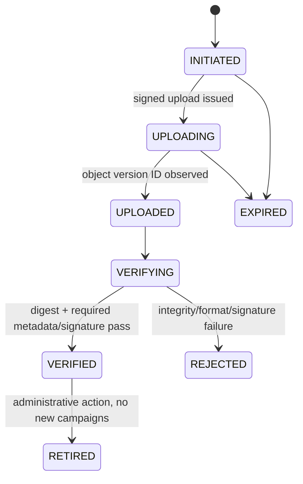

# Phase 06 — Firmware Artifact Integrity

## Outcome

Implement direct-to-object-storage artifact registration, immutable identity, digest verification, optional signature/manifest validation, compatibility metadata, and readiness policy. Firmware bytes do not flow through the Control API and cannot be used by a campaign until all configured integrity gates pass.

## Entry criteria

- Phases 01–03 pass; target/capability model from Phase 05 is stable.
- S3 exact-version semantics and the test adapter strategy are selected.
- Maximum artifact size, accepted content types, digest algorithm, retention, and demo firmware-source policy are decided.
- Signature verification scope is honest: cryptographic verification is supported only for declared formats/keys.

## Non-goals

- No firmware flashing.
- No claim that FleetForge proves vendor firmware safety.
- No storage of firmware bytes in PostgreSQL.
- No browser exposure of permanent object-store credentials.
- No production override that silently bypasses digest or required-signature policy.

## Artifact lifecycle

The immutable artifact identity binds object bucket/key/version ID, size, SHA-256 digest, verification-policy version, declared firmware version, supported target family constraints, and signature result.

## Upload flow

1. Authorized client initiates artifact metadata with expected size/digest/media type.
2. API creates an `INITIATED` record and short-lived signed upload URL restricted to one new object identity and permitted headers; version-ID preconditions prevent overwrite.
3. Client uploads directly to object storage.
4. Verification worker observes exact object version ID and metadata and uses that version-ID precondition for every subsequent read.
5. Worker streams object once through bounded digest/format/signature verification without loading the entire image into memory.
6. Result and safe evidence are persisted; object identity cannot change after verification.
7. Rejected/expired objects follow a retention/deletion policy and cannot be referenced by ready campaigns.

## Compatibility policy

Compatibility is a policy decision over verified artifact metadata and normalized target capabilities. It may use manufacturer/model family, update mechanism, image type, declared version constraints, and required signature policy. An override, if implemented, must be admin-only, reasoned, scoped to explicit targets, and audit-visible. It cannot override a digest mismatch.

## Micro-task checklist

### Artifact contract

- [ ] **P06-T01** Define artifact fields, states, revision, and stable verification reason codes.
- [ ] **P06-T02** Define canonical SHA-256 representation and reject unsupported digest algorithms initially.
- [ ] **P06-T03** Define maximum object size, filename/display-name separation, accepted media types, and metadata limits.
- [ ] **P06-T04** Define supported manifest/signature formats and explicitly label unsupported formats.
- [ ] **P06-T05** Define immutable object identity including S3 bucket/key/version ID, size, and digest; every read/delete uses the exact version-ID precondition.

### Signed upload

- [ ] **P06-T06** Authorize initiate operation and make it idempotent.
- [ ] **P06-T07** Generate non-guessable digest-derived or artifact-ID object path without user-controlled traversal.
- [ ] **P06-T08** Issue short-lived signed upload restricted to exact object, operation, and permitted headers.
- [ ] **P06-T09** Avoid returning bucket-wide permissions or service credentials.
- [ ] **P06-T10** Expire abandoned uploads and record cleanup eligibility.

### Verification worker

- [ ] **P06-T11** Claim verification as durable work with artifact revision/lease.
- [ ] **P06-T12** Head object and compare exact generation, size, and expected metadata.
- [ ] **P06-T13** Stream SHA-256 with deadline, byte cap, and cancellation.
- [ ] **P06-T14** Parse only the minimum safe manifest metadata using bounded input.
- [ ] **P06-T15** Verify signature against versioned trusted-key reference where required.
- [ ] **P06-T16** Persist verification tool/policy version, key identifier, safe failure code, digest, and timestamp.
- [ ] **P06-T17** Ensure rejected objects cannot transition to verified without a new explicit verification attempt and audit.
- [ ] **P06-T18** Make duplicate verification delivery resume/return stable result.

### Compatibility and campaign linkage

- [ ] **P06-T19** Define target-family compatibility rule input and deterministic result.
- [ ] **P06-T20** Evaluate compatibility during preflight for each frozen target.
- [ ] **P06-T21** Store artifact digest/version ID and compatibility-policy version in campaign snapshot.
- [ ] **P06-T22** Prevent object deletion/retirement from mutating already-running campaign evidence.
- [ ] **P06-T23** Prevent new campaign readiness from using retired/rejected/expired artifact.
- [ ] **P06-T24** Design explicit administrative override with reason, scope, expiry, and audit, but defer implementation unless necessary.

### Retention and cost

- [ ] **P06-T25** Apply automatic TTL only to temporary/abandoned objects. Verified artifact deletion is a database-aware exact-version workflow and cannot rely on an age-only bucket rule.
- [ ] **P06-T26** Add bounded orphan detection comparing database identity to object storage.
- [ ] **P06-T27** Add budget/size/count metrics and deletion dry-run.
- [ ] **P06-T28** Ensure teardown preserves evidence metadata even when deleting demo bytes; object holds/retention protect referenced versions until a release transaction makes deletion safe.

## Required tests

| Test ID | Scenario | Required result |
|---|---|---|
| P06-IT-01 | Correct object, size, digest | `VERIFIED` with immutable identity |
| P06-IT-02 | Same key replaced with new version | Verification/campaign linkage rejects mismatch |
| P06-IT-03 | Digest mismatch | `REJECTED`; cannot become ready |
| P06-IT-04 | Oversized/truncated upload | Bounded rejection |
| P06-ST-01 | Malicious filename/path/metadata | Stored as display data or rejected; no path escape |
| P06-ST-02 | Expired signed URL | Upload denied |
| P06-ST-03 | Invalid/untrusted signature | Terminal rejection under required policy |
| P06-IT-05 | Verification worker duplicate/crash | One stable result; no conflicting transition |
| P06-IT-06 | Artifact retired after campaign snapshot | Existing evidence stable; no new ready campaign |
| P06-IT-07 | Verified-object deletion races with campaign readiness/reference | Reference ownership or hold wins; the exact referenced generation remains available |
| P06-IT-08 | Lifecycle age reached by a referenced verified object | Bucket lifecycle does not delete it; database-aware retirement is required |
| P06-CT-01 | Target/model incompatibility | Preflight block with stable code |
| P06-CT-02 | Required signature unsupported | Fail closed; no misleading verified status |
| P06-LT-01 | Maximum-size allowed object | Streaming memory remains bounded |

## Observability introduced

- Upload initiation/completion/expiry counts.
- Verification duration, bytes streamed, outcome, and safe reason.
- Signature/manifest verification outcome.
- Object version-ID mismatch and orphan count.
- Stored bytes/object count and retention deletion count.
- Compatibility failures by bounded target-family classification.

## Security requirements

- Signed URLs and object credentials are redacted from all logs/audit/events.
- Firmware bytes never enter traces, asynchronous-message payloads, PostgreSQL, or frontend state.
- Verification parser is fuzzed against malformed/truncated inputs.
- Trusted keys are versioned references in AWS Secrets Manager/KMS or repository-approved public material, not ad hoc UI text.
- Object store blocks public access and enforces encryption/retention configuration; automatic lifecycle deletion is limited to temporary namespaces.

## Evidence artifacts

- Artifact lifecycle and immutable identity specification.
- Digest/signature negative-test report.
- Memory profile for maximum-size streaming verification.
- Compatibility matrix examples.
- Object lifecycle/cost policy and orphan dry-run report.

## Exit criteria

- Direct upload works without API proxying bytes.
- Version ID/size/digest identity is immutable and independently verified.
- Required signature policy fails closed.
- Campaign snapshot binds exact artifact evidence.
- Malformed input fuzz/negative tests pass.
- Storage retention and cost controls exist.
- No secret URL or firmware content appears in telemetry.

## Rollback and stop conditions

- Stop if provider API cannot bind or later verify object version ID; redesign identity before campaigns use artifacts.
- Stop if signature support would be overstated; label it unsupported or format-specific.
- Never roll back by weakening digest verification. Disable artifact ingestion instead.
