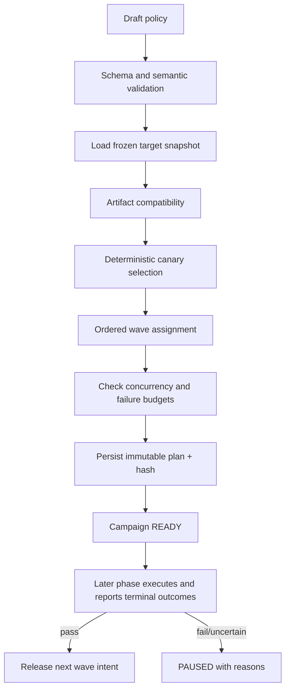

# Phase 07 — Campaign Planning, Canary, Waves, and Failure Budgets

## Outcome

Implement deterministic campaign authoring/validation, target assignment to canary and ordered waves, concurrency/failure/health policy snapshots, and advancement evaluation. This phase produces a complete rollout plan but does not yet call Redfish firmware-update actions.

## Entry criteria

- Phases 02, 03, 05, and 06 pass.
- Target snapshots and verified artifact identities are available.
- Campaign policy schema and rounding semantics are accepted.
- Failure-domain requirements (`site`, `rack`) are defined for all selected targets.
- Readiness-time target-enrollment claim and unresolved-operation quarantine repositories from Phase 03 are available.

## Non-goals

- No external update submission.
- No Amazon SQS Standard dispatch beyond test seams.
- No operator console.
- No policy mutation after `READY`.
- No machine-learning-based risk scoring; deterministic policy is the proof surface.

## Campaign policy snapshot

| Section | Required values |
|---|---|
| Artifact | artifact ID, digest, object generation, declared version, verification policy/version |
| Selection | selector canonical form/version, explicit target IDs/revisions, snapshot hash |
| Canary | absolute or percentage size, deterministic selection strategy/seed, minimum failure-domain diversity |
| Waves | ordered sizes/percentages, remainder rule, observation window, advancement condition |
| Concurrency | global, site, rack, endpoint/request-rate limits |
| Failure budget | absolute and percentage thresholds at canary, wave, campaign, optional failure-domain scope; observed-threshold admission rule and remaining active exposure |
| Health | expected version, reachability/task/inventory/sensor assertions, observation freshness |
| Time | IANA maintenance window, start/end behavior, maximum campaign duration |
| Governance | policy schema version, reducer version, creator, acknowledgements/change reference |

## Planning flow

## Deterministic canary strategy

Recommended baseline:

1. Validate all selected targets have required failure-domain labels.
2. Group by site/rack.
3. Choose at least one target from distinct racks/sites when canary size permits.
4. Order remaining candidates by stable hash of campaign seed + target ID.
5. Persist chosen IDs, order, algorithm version, and seed in the frozen plan.

This is not “smart” risk optimization. It is explainable, replayable, and demonstrates blast-radius reasoning. A later ADR may add stratification by model/version only after the baseline is measured.

## Failure-budget semantics

- Define whether threshold breach is `failures > threshold` or `failures >= threshold`; use one rule everywhere.
- Calculate percentage from integer counts with documented rounding.
- Treat `NEEDS_ATTENTION` as an unresolved operation: pause immediately, retain quarantine and durable operation reservation, and prohibit advancement.
- Separate terminal device failure from transient in-progress/retry wait.
- No wave evaluation while any included target is non-terminal, except maximum-duration policy that pauses rather than silently skipping.
- Campaign counters are updated transactionally with target transitions in later phases.
- The default guarantee stops new submission admissions when the observed threshold is reached. It reports all previously admitted/physically active operations still exposed; it does not claim to prevent those operations from failing.
- A strict-budget policy, if enabled, charges each physically active operation against remaining worst-case failure capacity before admission.
- Canary observation windows contain scheduled, freshness-bounded health observations. Elapsed time alone never passes evaluation.

## Micro-task checklist

### Policy contract

- [ ] **P07-T01** Define versioned campaign policy schema and canonical serialization.
- [ ] **P07-T02** Define numeric bounds and cross-field validation for canary, waves, limits, retries, windows, and budgets.
- [ ] **P07-T03** Reject policies where rack/site limit exceeds global limit or where wave/canary sizes cannot cover the snapshot deterministically.
- [ ] **P07-T04** Define default values explicitly; do not rely on omitted zero values.
- [ ] **P07-T05** Preserve user intent units (absolute/percentage) while computing a frozen effective plan.
- [ ] **P07-T06** Version health and compatibility policy inputs.

### Planning

- [ ] **P07-T07** Load target/artifact snapshot under expected revisions.
- [ ] **P07-T08** Atomically acquire an enrollment claim for every selected target and recheck active campaign/quarantine conflicts in the transaction that enters `READY`.
- [ ] **P07-T09** Implement deterministic canary stratification and stable hash ordering.
- [ ] **P07-T10** Assign every included target exactly once to canary or one wave.
- [ ] **P07-T11** Handle remainder targets with an explicit final-wave rule.
- [ ] **P07-T12** Validate per-wave failure-domain distribution and concurrency feasibility.
- [ ] **P07-T13** Persist plan, snapshot, algorithm versions, seed, target assignments, and plan hash atomically.
- [ ] **P07-T14** Make repeated validation on unchanged draft return an identical plan hash.
- [ ] **P07-T15** Invalidate a previous validation result when allowed draft revision changes.

### Lifecycle and commands

- [ ] **P07-T16** Implement draft creation/update using Phase 02 reducer and Phase 03 revision/idempotency rules.
- [ ] **P07-T17** Implement validation run lifecycle and per-target reason aggregation.
- [ ] **P07-T18** Transition to `READY` only after all blocking checks and snapshot persistence commit.
- [ ] **P07-T19** Implement start decision that releases only canary due-work intent.
- [ ] **P07-T20** Implement wave evaluation from terminal outcome counts and policy version.
- [ ] **P07-T21** Implement next-wave release intent atomically with evaluation/audit.
- [ ] **P07-T22** Implement automatic pause decision with exact triggering evidence.
- [ ] **P07-T22A** Persist active-operation exposure at each failure-budget decision and, when configured, reserve worst-case capacity before admission.
- [ ] **P07-T22B** Schedule and evaluate each required canary health observation with an explicit freshness window; no observation or stale observation cannot pass.
- [ ] **P07-T23** Implement campaign completion decision requiring every included target terminal and policy success.

### Explanations and audit

- [ ] **P07-T24** Generate machine-readable and human-readable plan explanation.
- [ ] **P07-T25** Record why each canary target was selected and each target's wave assignment.
- [ ] **P07-T26** Record effective thresholds/counts after percentage resolution.
- [ ] **P07-T27** Record every advancement/pause decision with counters, policy version, and input observation cut.
- [ ] **P07-T28** Support pure decision replay using stored snapshot/events without scheduling work.

## Required tests

| Test ID | Scenario | Required result |
|---|---|---|
| P07-UT-01 | Same target set/policy/seed repeated | Identical plan and hash |
| P07-UT-02 | Input ordering randomized | Same assignment/order |
| P07-UT-03 | Canary smaller than number of racks | Deterministic documented subset |
| P07-UT-04 | Canary can cover racks | Required diversity achieved |
| P07-UT-05 | Wave remainder | Every target assigned exactly once |
| P07-UT-06 | Boundary failure count/percentage | Exact documented pause/pass result |
| P07-PT-01 | Generated target counts/policies | No duplicate/missing assignment; limits coherent |
| P07-PT-02 | Generated terminal outcome sequences | No premature wave release |
| P07-IT-01 | Concurrent readiness for overlapping campaigns | One succeeds; conflict evidence for other |
| P07-IT-02 | Duplicate start command | One canary release intent |
| P07-IT-03 | Concurrent final target transitions/evaluator | One evaluation/release revision |
| P07-IT-04 | `NEEDS_ATTENTION` in canary | Campaign pauses before later wave |
| P07-IT-05 | Failure threshold reached while other operations are active | New admissions stop; active exposure remains visible and reservation counts remain intact |
| P07-IT-06 | Canary initially healthy then degrades inside observation window | Evaluation waits for scheduled evidence and pauses; no later wave releases |
| P07-RT-01 | Replay persisted campaign | Same decisions/reason codes as original |

## Observability introduced

- Campaigns by state.
- Validation duration and blocking reasons.
- Plan target count, canary/wave count, and failure-domain distribution.
- Failure budget remaining by bounded scope.
- Wave evaluation duration/result.
- Automatic pause reason count.
- Plan replay mismatch count, which should remain zero.

## Evidence artifacts

- Policy schema and validation matrix.
- Golden plans for representative 10/100/1,000-target fleets.
- Canary-selection explanation.
- Boundary table for failure budgets.
- Concurrent evaluator test result.
- Decision replay transcript.

## Exit criteria

- Complete immutable plan exists for 1,000 targets.
- Planning is deterministic under reordered inputs.
- Every target belongs to exactly one cohort.
- Failure budgets and advancement are boundary-tested.
- Only canary work is released on start.
- Overlapping active campaigns are rejected atomically.
- Every decision is explainable and replayable.

## Rollback and stop conditions

- Stop if planning depends on mutable live inventory after `READY`.
- Stop if percentage rounding differs across API, domain, and database projections.
- Stop if canary selection cannot be explained from persisted inputs.
- Roll back a planning algorithm change unless old campaigns retain their algorithm version and replayability.
