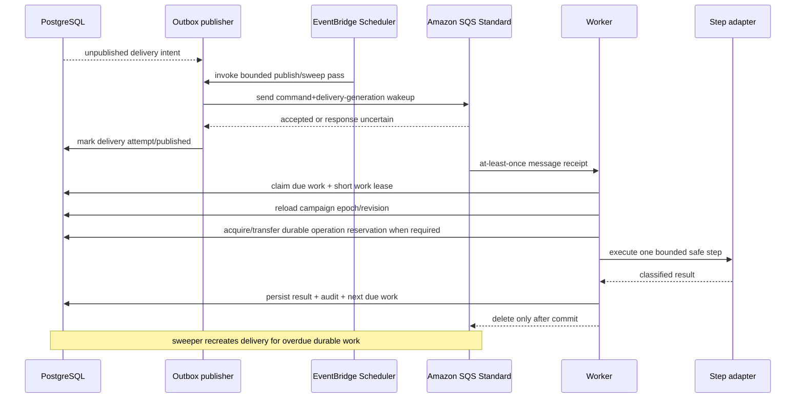

# Phase 08 — Orchestration, Leases, Queues, and Backpressure

## Outcome

Implement the durable work engine that converts committed generic due-work intent into short, idempotent worker executions. It must tolerate duplicate/lost delivery, Amazon SQS Standard duplicate receipt, visibility expiry, and uncertain publish, worker crashes and stalls, stale live workers, scale-to-zero, queue outages, and downstream throttling while enforcing physical global/site/rack concurrency and retry budgets.

This phase uses simulator-safe/no-op work types before real firmware submission is enabled in Phase 09.

## Entry criteria

- Phases 03, 04, and 07 pass.
- Amazon SQS Standard queues, an IAM-authorized Amazon EventBridge Scheduler repair task, or deterministic provider adapters are available.
- Queue access policy, ECS task role, SQS visibility timeout, and task shutdown deadline are defined.
- Database connection, queue backlog, and ECS task-concurrency budgets are calculated.

## Non-goals

- No blind firmware side effect.
- No queue as source of truth.
- No process sleeping until the next action.
- No unbounded goroutine pool or one goroutine per target indefinitely.
- No exactly-once delivery claim.

## Work lifecycle

## Queue classes

| Queue | Work | Dispatch policy |
|---|---|---|
| `control` | campaign evaluation, pause/abort propagation, projection refresh | Low latency, small concurrency |
| `discovery` | inventory/capability refresh | Moderate concurrency, target/rate limited |
| `artifact-verify` | object digest/signature verification | Low concurrency, longer deadline |
| `update-step` | precheck/submit/verify steps | Strict failure-domain reservations |
| `reconcile` | task/inventory/health polling and ambiguity work | Jittered, independently capped |

Queue names and count may be reduced for free-tier simplicity, but workload classes and limits must remain explicit.

## Lease and reservation model

- Work lease: exclusive database ownership of one handler execution until expiry; expiry cannot cancel or prove absence of a network request.
- Target lease: prevents concurrent step mutation for one target update.
- Durable operation reservation: consumes global/site/rack counters from submission admission until the physical update/reboot/health outcome reaches a defined safe-release condition.
- Lease token: unguessable identity required to commit result.
- Expected aggregate revision/command epoch: protects against stale delivery and pause races.
- Operation-reservation ownership may be transferred during reconciliation, but it has no TTL-only release. `NEEDS_ATTENTION` retains it and the target quarantine.

Database transactions acquire, transfer, and release operation reservations in a complete deterministic lock order. Amazon SQS Standard delivery and backlog settings are protective outer limits, not correctness enforcement. `command_id` remains the permanent semantic identity; `delivery_generation` changes when repair creates a new durable delivery series. SQS message IDs and receipt handles are provider-ephemeral and are never semantic identity.

## Micro-task checklist

### Delivery ports

- [ ] **P08-T01** Define command envelope version, IDs, expected state/revision/epoch, not-before time, and trace context.
- [ ] **P08-T02** Define queue publisher and worker-receipt interfaces independent of AWS SDK types.
- [ ] **P08-T03** Persist `command_id` plus delivery generation in the queue envelope; treat SQS message IDs and receipt handles as provider-ephemeral. An uncertain publish may be sent again; PostgreSQL state deduplicates it.
- [ ] **P08-T04** Keep command payload identifier-only; worker reloads policy/state from PostgreSQL.
- [ ] **P08-T05** Reject unknown work/envelope versions into quarantine/dead-letter handling.

### Outbox publisher

- [ ] **P08-T06** Claim unpublished rows in bounded batches with `SKIP LOCKED`.
- [ ] **P08-T07** Publish outside transaction with deadline and classified errors.
- [ ] **P08-T08** Mark attempt/success in short revision-safe transaction.
- [ ] **P08-T09** Treat `SendMessage` success as delivery acceptance only, and treat a timeout or unknown result as a safe-to-repeat wakeup. No queue response proves that semantic work completed.
- [ ] **P08-T10** Apply bounded jittered retry and poison-message threshold.
- [ ] **P08-T11** Support graceful shutdown without losing claimed rows; lease expiry repairs abandonment.
- [ ] **P08-T11A** Package one bounded publisher/sweeper ECS task and provision Amazon EventBridge Scheduler to launch it when worker capacity is zero.

### Worker authentication and boundary

- [ ] **P08-T12** Require a dedicated ECS task role and an SQS queue policy that grants receive/delete only to the worker role.
- [ ] **P08-T13** Validate queue class, payload size/schema, envelope version, `command_id`, delivery generation, and delivery metadata.
- [ ] **P08-T14** Keep worker handlers off public ingress; public/operator tokens cannot receive, delete, or invoke queue work.
- [ ] **P08-T15** Propagate correlation/trace context but create a new span for each delivery attempt.

### Work claim

- [ ] **P08-T16** Load command and reject/ack unknown, terminal, already-completed, or stale work without mutation.
- [ ] **P08-T17** Claim with lease token, owner, expiry, and expected due-work revision.
- [ ] **P08-T18** Reload campaign/target state after claim.
- [ ] **P08-T19** Recheck command epoch, pause/abort, maintenance window, retry budget, and expected state.
- [ ] **P08-T20** Acquire rows in the global complete lock order covering campaign, wave, enrollment/target, operation reservation, aggregate, and due work; every writer follows it.
- [ ] **P08-T21** Ensure the work lease and, when required, durable operation-reservation transaction commits before the step adapter call.

### Worker execution

- [ ] **P08-T22** Map each work type to one bounded step handler.
- [ ] **P08-T23** Set handler deadline shorter than the work lease and ECS task shutdown grace period.
- [ ] **P08-T24** Treat handler deadline and lease duration as liveness controls only. An expired submission lease transitions to reconciliation-only and never establishes safe retry.
- [ ] **P08-T25** Classify result as success, no-op/stale, retryable, terminal, ambiguous, or internal consistency failure.
- [ ] **P08-T26** Persist transition/evidence/attempt/audit/next work and any explicitly justified operation-reservation transfer/release atomically. A submit-step commit does not release physical capacity.
- [ ] **P08-T27** Acknowledge queue only after durable result commit; return retryable platform response when commit is uncertain.

### Capacity and backpressure

- [ ] **P08-T28** Implement global/site/rack durable operation-reservation rows/counters with attempt/admission identity, acquired/released evidence, and transferrable reconciliation ownership; no expiry-only release.
- [ ] **P08-T29** Enforce the complete cross-writer lock order and bounded retry for database-detected deadlocks.
- [ ] **P08-T30** Schedule capacity-wait retry with jitter rather than busy loop.
- [ ] **P08-T31** Add per-target and global Redfish request-rate token/budget seam.
- [ ] **P08-T32** Configure SQS visibility timeout, redrive policy, max receive count, producer/backlog limits, and ECS task concurrency below application safety limits.
- [ ] **P08-T33** Bound publisher/worker concurrency and database pools together.
- [ ] **P08-T34** Add circuit-breaker policy only for systemic transport protection; it must not replace target state.

### Repair and reconciliation of delivery

- [ ] **P08-T35** Implement sweeper selecting overdue durable work by indexed `next_action_at/not_before`.
- [ ] **P08-T36** Recreate missing delivery without changing command identity by incrementing delivery generation and sending a new queue wakeup.
- [ ] **P08-T37** Repair expired work leases and transfer operation-reservation ownership with audit evidence; never release physical capacity solely because time elapsed.
- [ ] **P08-T38** Detect permanently quarantined delivery and pause/alert affected campaign when correctness may stall.
- [ ] **P08-T39** Add manual redrive command with authorization and idempotency.

## Required fault/concurrency tests

| Test ID | Fault/race | Required result |
|---|---|---|
| P08-FT-01 | Duplicate SQS message received concurrently | One lease/transition; others no-op then delete |
| P08-FT-02 | Worker crash immediately after claim | Lease expires; same command recovers |
| P08-FT-03 | Worker crash after step result before DB commit | Queue redelivers; handler/repository remains idempotent |
| P08-FT-04 | DB commit succeeds but response to queue fails | Duplicate delivery sees completed state |
| P08-FT-05 | Publisher succeeds then crashes before published mark | Same event/task identity re-published safely |
| P08-FT-06 | Amazon SQS Standard unavailable | Due work remains; outbox/due age alerts; sweeper recovers later |
| P08-FT-07 | Queue loses/delays task | Sweeper recreates delivery |
| P08-FT-08 | Lease holder stalls beyond expiry | Stale commit rejected; recovery worker owns result |
| P08-CT-01 | 100 workers race for rack limit 2 | At most 2 valid reservations |
| P08-CT-02 | Mixed site/rack acquisition | No deadlock; deterministic backoff |
| P08-RT-01 | Downstream returns repeated `429/503` | Bounded jitter; no synchronized storm; budget eventually pauses/fails |
| P08-PT-01 | Random delivery/claim/crash schedule | Work never disappears and transition occurs at most once per revision |
| P08-FT-09 | Visibility timeout, receipt loss, or uncertain publish leaves database work overdue | Repair creates a new delivery generation/wakeup and worker dedupes by semantic command |
| P08-FT-10 | API/worker/publisher are all at zero instances | Amazon EventBridge Scheduler wakes a bounded pass and due work resumes |
| P08-FT-11 | Original submitter stalls past lease and remains alive | Recovery cannot authorize a second submit; stale caller is reconciled as potentially active |
| P08-CT-03 | Work lease expires or target enters attention during a physical operation | Simulator active operations never exceed global/site/rack limits; durable reservation remains counted |
| P08-CT-04 | Completion races with abort, evaluator, and repair | Complete lock order prevents cyclic waits or yields bounded safe transaction retry |
| P08-PT-02 | Deterministic concurrent delivery/lease/reservation schedules | Independent model preserves work, admission uniqueness, physical capacity, and fairness; failing schedules shrink and persist |

## Performance and capacity checks

- Measure due-work claim throughput and lock wait with 1,000 targets.
- Measure task-delivery-to-claim lag p50/p95/p99.
- Verify max worker instances × concurrency × pool size stays inside database connection budget.
- Verify queue dispatch caps cannot exceed global application limit even during autoscaling.
- Verify physical operation counts, rather than handler counts, remain within application limits across lease expiry and attention.
- Confirm sweeper query uses due-time partial index and bounded pages.
- Simulate one hot rack and ensure other racks make progress.

## Observability introduced

- Task publish/delivery/ack attempts and safe outcome.
- Outbox and due-work age.
- Lease acquisition/conflict/expiry/stale-commit counts.
- Reservation utilization/wait/expiry by bounded scope type.
- Handler duration/result and queue delivery age.
- Retry budget consumption and circuit state.
- Quarantine/dead-letter count and oldest age.

## Evidence artifacts

- Queue/envelope contract.
- Worker sequence trace including database and queue spans.
- Duplicate/crash fault report.
- Reservation concurrency proof.
- Queue outage and sweeper recovery transcript.
- Connection/dispatch budget worksheet.

## Exit criteria

- Duplicate/lost delivery cannot duplicate committed progress.
- Stale workers cannot commit.
- Concurrency limits hold under race tests.
- Queue outage cannot erase durable work; it may stall execution until Amazon SQS Standard recovers because the sweeper is a repair publisher, not an independent executor.
- No worker sleeps for future scheduling.
- Retries are jittered, finite, and budgeted.
- Worker endpoints accept only intended service identities.
- Simulator-safe work completes end-to-end through actual queue in staging or provider integration test.

## Rollback and stop conditions

- Stop if a queue acknowledgement can occur before result persistence.
- Stop if correctness depends on SQS duplicate suppression, message receipt, or any queue response as proof of live delivery.
- Stop if reservation acquisition holds locks during step execution.
- Disable queue dispatch and preserve durable due work rather than risk uncontrolled retry storms; resume through a new delivery generation after recovery.
