# Phase 10 — Control API, Identity, RBAC, and Audit

## Outcome

Expose the verified domain capabilities through a versioned, authenticated Control API. Every mutating command is idempotent, revision-aware, rate-limited, authorized, and audited. The API never performs long-running device work synchronously and never returns secret-bearing configuration.

## Entry criteria

- Phases 03, 07, 08, and 09 pass.
- Amazon Cognito User Pools with Google federation and the OIDC token/session adapter are selected.
- Role and high-risk command matrix is accepted.
- OpenAPI compatibility policy and error contract are accepted.
- Audit fields and retention are stable.

## Non-goals

- No custom password database.
- No API key as the primary human identity mechanism.
- No synchronous waiting for firmware completion.
- No direct object bytes or BMC credentials through API.
- No endpoint that mutates state outside application commands and transaction/audit rules.

## API boundary

```mermaid
flowchart LR
  Client[Web / CLI] --> TLS[TLS and request limits]
  TLS --> AuthN[Cognito OIDC authentication adapter]
  AuthN --> AuthZ[RBAC + resource authorization]
  AuthZ --> Rate[Rate and command risk limits]
  Rate --> Validate[OpenAPI + semantic validation]
  Validate --> Idem[Idempotency + expected revision]
  Idem --> App[Application command/query]
  App --> DB[(State + audit + outbox)]
  DB --> Response[Problem details or stable resource]
```

## Role matrix

| Capability | Viewer | Operator | Admin |
|---|:---:|:---:|:---:|
| Read targets/campaigns/audit | Yes | Yes | Yes |
| Draft/update campaign | No | Yes | Yes |
| Validate/start/pause/resume | No | Yes | Yes |
| Abort active campaign | No | Yes, with recent-auth policy | Yes |
| Register/disable target | No | No | Yes |
| Manage credential references/trust policy | No | No | Yes |
| Initiate/verify/retire artifact | No | Policy-limited | Yes |
| Resolve `NEEDS_ATTENTION` or authorize retry | No | No | Yes |
| View redacted raw evidence reference | No | Policy-limited | Yes |
| Execute diagnostic replay | Read-only replay | Read-only replay | Yes |

## Endpoint groups

### Platform

- `GET /health/live`
- `GET /health/ready`
- `GET /health/startup`
- `GET /version`

### Targets and observations

- `POST /v1/targets`
- `PATCH /v1/targets/{id}` with expected revision
- `POST /v1/targets/{id}:refresh`
- `POST /v1/targets/{id}:disable`
- `GET /v1/targets`
- `GET /v1/targets/{id}`
- `GET /v1/targets/{id}/observations`

### Artifacts

- `POST /v1/artifacts:initiate`
- `POST /v1/artifacts/{id}:verify`
- `POST /v1/artifacts/{id}:retire`
- `GET /v1/artifacts`
- `GET /v1/artifacts/{id}`

### Campaigns

- `POST /v1/campaigns`
- `PATCH /v1/campaigns/{id}` while draft
- `POST /v1/campaigns/{id}:validate`
- `POST /v1/campaigns/{id}:start`
- `POST /v1/campaigns/{id}:pause`
- `POST /v1/campaigns/{id}:resume`
- `POST /v1/campaigns/{id}:abort`
- `GET /v1/campaigns`
- `GET /v1/campaigns/{id}`
- `GET /v1/campaigns/{id}/targets`
- `GET /v1/campaigns/{id}/audit`
- `GET /v1/campaigns/{id}/stream`

### Attention/replay

- `POST /v1/target-updates/{id}:resolve`
- `POST /v1/target-updates/{id}:retry`
- `POST /v1/campaigns/{id}:replay-decisions`
- `GET /v1/replay-runs/{id}`

## Error contract

Use RFC 9457 problem details with:

- stable `type` URI and machine `code`;
- safe human title/detail;
- HTTP status;
- correlation ID;
- field violations where safe;
- current/expected revision for conflicts;
- `retryable` only when client retry is actually safe;
- optional `retry_after`;
- no stack, DSN, token, endpoint credentials, signed URL, or raw device payload.

Status guidance: `400` malformed, `401` unauthenticated, `403` unauthorized, `404` inaccessible/missing resource without enumeration leak, `409` revision/state/idempotency conflict, `413` size limit, `422` valid syntax but policy/preflight rejection, `429` rate limit, `503` safe dependency unavailability.

## Micro-task checklist

### Contract-first API

- [ ] **P10-T01** Create OpenAPI 3.1 source with version, tags, security schemes, common identifiers, pagination, problem details, and examples.
- [ ] **P10-T02** Define generated/server binding strategy; generated types cannot enter domain packages.
- [ ] **P10-T03** Add API linting and breaking-change detection against the latest released contract.
- [ ] **P10-T04** Define request IDs and accept/return W3C trace context safely.
- [ ] **P10-T05** Standardize UTC timestamps, opaque cursors, enum compatibility, and JSON unknown-field policy.
- [ ] **P10-T06** Bound body size, header count/size, query length, page size, stream connections, and request timeout per endpoint class.

### Authentication

- [ ] **P10-T07** Validate Cognito issuer, client audience, signature, expiry/not-before, subject, revocation policy, and required claims through an isolated identity adapter.
- [ ] **P10-T08** Cache Cognito signing keys/JWKS with safe refresh and bounded stale behavior; keep provider types outside domain/application authorization rules.
- [ ] **P10-T09** Map external subject to internal actor identity without storing access tokens.
- [ ] **P10-T10** Enforce Cognito `auth_time` age and an explicit reauthentication flow for abort, retry, and manual-resolution commands.
- [ ] **P10-T11** Distinguish human OIDC tokens from worker service identity.
- [ ] **P10-T12** Redact authorization headers and identity-provider errors.

### Authorization

- [ ] **P10-T13** Implement deny-by-default permission checks at application-command boundary.
- [ ] **P10-T14** Define roles/permissions centrally and test every endpoint/action combination.
- [ ] **P10-T15** Prevent existence leaks when actor cannot view a resource.
- [ ] **P10-T16** Require reason/change reference for start, pause, resume, abort, retire, and manual resolution as configured.
- [ ] **P10-T17** Audit authorization-relevant actor/role decision without logging token claims wholesale.

### Commands and idempotency

- [ ] **P10-T18** Require `Idempotency-Key` for all mutating endpoints.
- [ ] **P10-T19** Require expected revision/`If-Match` where state race is possible.
- [ ] **P10-T20** Hash normalized semantic request for idempotency conflict detection.
- [ ] **P10-T21** Return stable prior result for exact duplicate.
- [ ] **P10-T22** Reject same key/different request.
- [ ] **P10-T23** Map each handler to one application command; handlers perform no business transition logic.
- [ ] **P10-T24** Return `202` for asynchronous commands with operation/resource link; do not hold connection for device workflow.

### Queries and pagination

- [ ] **P10-T25** Use keyset pagination with signed/opaque cursor values.
- [ ] **P10-T26** Bound filters and sort keys to indexed access patterns.
- [ ] **P10-T27** Return campaign projections with explicit `as_of`/revision.
- [ ] **P10-T28** Expose audit timeline as immutable ordered entries with redaction.
- [ ] **P10-T29** Avoid N+1 target/observation queries and unbounded includes.

### Streaming

- [ ] **P10-T30** Implement resumable SSE using event/projection cursor, heartbeat, and max connection lifetime.
- [ ] **P10-T31** Authorize stream at connection and define behavior when authorization/resource state changes.
- [ ] **P10-T32** Bound per-user/overall streams and slow-client buffers.
- [ ] **P10-T33** On projection/event gap, instruct client to refetch authoritative snapshot.

### Audit and manual attention

- [ ] **P10-T34** Audit every successful lifecycle mutation in same transaction.
- [ ] **P10-T35** Audit denied high-risk attempts with safe metadata outside aggregate mutation transaction where appropriate.
- [ ] **P10-T36** Implement admin-only manual resolution requiring evidence note, expected revision, recent auth, and idempotency. Resolution separately records target-quarantine and operation-reservation release/transfer; terminal status alone cannot free them.
- [ ] **P10-T37** Never permit editing/deleting past audit entries through API.
- [ ] **P10-T38** Implement decision replay as read-only asynchronous analysis incapable of reaching Redfish adapter.

### Rate limiting and abuse safety

- [ ] **P10-T39** Apply separate limits for reads, writes, expensive selectors, streams, upload initiation, and high-risk commands.
- [ ] **P10-T40** Key limits by actor and bounded network context; avoid trusting raw spoofable headers.
- [ ] **P10-T41** Ensure rate-limit backend failure has documented fail-open/read and fail-closed/high-risk behavior.
- [ ] **P10-T42** Add anti-enumeration and response-timing review for protected identifiers.

## Required tests

| Test ID | Scenario | Required result |
|---|---|---|
| P10-CT-01 | OpenAPI examples/requests/responses | Contract validation passes |
| P10-CT-02 | Breaking schema change | CI blocks unless version/migration accepted |
| P10-AU-01 | Missing/expired/wrong-audience token | `401`, no mutation |
| P10-AU-02 | Every role × endpoint/action | Matches role matrix; deny by default |
| P10-AU-03 | Viewer guesses inaccessible ID | No existence leak |
| P10-ID-01 | Duplicate identical command | Same response; one mutation/audit event |
| P10-ID-02 | Same key/different request | `409`; no mutation |
| P10-RV-01 | Stale `If-Match` | `409` with safe current revision |
| P10-RC-01 | Oversized/invalid/unknown input | Bounded problem response |
| P10-RL-01 | Burst expensive commands | `429`; no worker/DB amplification |
| P10-SSE-01 | Disconnect/reconnect with cursor | Missed updates recovered or full refetch requested |
| P10-SSE-02 | Slow client | Bounded disconnect, no process memory growth |
| P10-AT-01 | Each successful mutation | Matching append-only audit entry |
| P10-MR-01 | Manual ambiguity resolution | Admin+recent auth+reason+revision required |
| P10-MR-02 | Admin marks target terminal without safe reservation disposition | Rejected; explicit supported release/transfer decision and evidence are required |
| P10-RP-01 | Decision replay | No Redfish calls by construction/test spy |
| P10-SEC-01 | Error/log fuzz | No token, signed URL, credential, firmware bytes, stack, or DSN leakage |

## Observability introduced

- Request count/latency/status by route template and method.
- AuthN/AuthZ/rate-limit outcomes by bounded reason.
- Idempotency hit/conflict/in-progress counts.
- Revision conflict and validation/policy rejection counts.
- Active/closed SSE connections and dropped slow clients.
- Audit write failures and replay runs/mismatches.

## Evidence artifacts

- Published OpenAPI document and generated client diff check.
- Role/action test matrix.
- Idempotency/revision race report.
- Redaction/leakage test report.
- SSE reconnect transcript.
- Example audit timeline for happy, pause, abort, and manual-attention flows.

## Exit criteria

- All public non-health endpoints require correct identity/permission.
- Every mutation is idempotent, revision-aware, and audited.
- No handler contains campaign transition or Redfish business logic.
- Long-running operations return asynchronously.
- Error responses are stable and safe.
- Pagination/streaming remain bounded.
- Manual ambiguity handling is admin-only and fully evidenced.

## Rollback and stop conditions

- Disable mutating routes if audit/idempotency transaction cannot be guaranteed.
- Stop if Cognito claims/session behavior cannot support application roles, revocation, and `auth_time` recent-auth policy; replace the identity adapter through an ADR before weakening authorization.
- Roll back a breaking API change unless compatibility/versioning is explicit.
