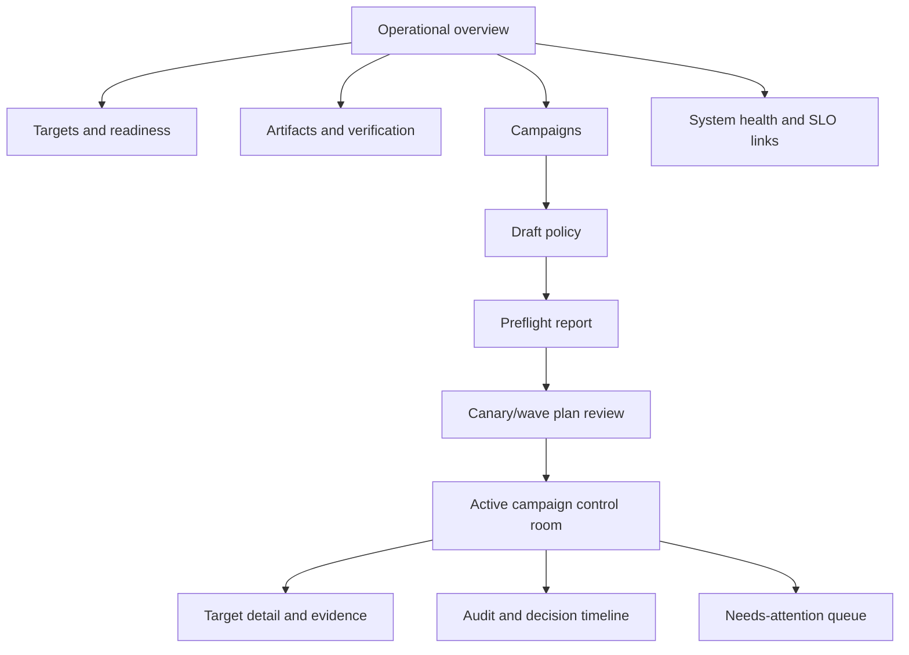

# Phase 11 — Operator Console and Live Progress

## Outcome

Build a safety-oriented web console that guides an operator through target/artifact readiness, campaign planning, validation, start, monitoring, pause/resume/abort, and ambiguity review. The UI is a projection and command client; it never owns workflow truth or talks directly to Redfish/object credentials.

## Entry criteria

- Phase 10 API contract and generated client are stable.
- Role matrix and problem/error codes are available.
- SSE/resync behavior is verified at API level.
- Design vocabulary for risk states, failure budgets, waves, and `NEEDS_ATTENTION` is accepted.

## Non-goals

- No business transition logic duplicated in TypeScript.
- No hidden “optimistic success” for high-risk commands.
- No firmware bytes held in general application state after direct upload.
- No glossy dashboard that hides failure evidence or uncertainty.
- No mobile-first claim; responsive desktop/tablet operation is sufficient.

## Information architecture

## Safety UX principles

- Always show authoritative revision and last refresh time.
- Distinguish target/device observation from FleetForge workflow state.
- Represent `NEEDS_ATTENTION` and stale evidence explicitly; never collapse them into generic failure.
- High-risk commands require confirmation containing actual impact summary, reason, and expected revision.
- Pause and abort explain that accepted firmware operations continue to be observed and may not be cancellable.
- Pause and abort show submissions admitted before the command commit as potentially in flight; they do not promise to revoke a network write already admitted.
- Failure-budget visualization shows numerator, denominator, threshold, scope, and evaluation time.
- UI never infers wave release from percentages; it renders server decisions/reasons.

## Primary screens

| Screen | Required content |
|---|---|
| Overview | active/paused/attention campaigns, overdue work, recent failures, links to SLOs |
| Targets | filterable readiness, site/rack, current version, observation freshness, administrative state |
| Target detail | normalized capabilities, observations, active update, safe evidence timeline |
| Artifacts | digest/version/size/generation, verification/signature/compatibility status, retention |
| Campaign draft | selector, artifact, canary/waves, budgets, concurrency, health, window |
| Preflight | target counts/distribution, blocking/warning codes, snapshot hash, acknowledgements |
| Plan review | exact canary IDs, wave sizes/domains, effective thresholds and limits |
| Active control room | campaign/wave state, target state distribution, observed budget, admitted/active exposure, durable reservations, lag, commands, event age |
| Attention detail | attempt chronology, evidence hierarchy, uncertainty explanation, admin actions |
| Audit | immutable actor/command/decision/attempt timeline and correlation links |

## State-management boundary

- Generated OpenAPI client is the transport boundary.
- Server snapshots include revision and `as_of` time.
- Query cache keys include resource/filter/cursor; invalidation follows successful commands and stream hints.
- SSE events are hints to refetch/update bounded projections; event payload does not become authoritative domain state.
- High-risk command buttons use current revision and disable while request is unresolved.
- Reconnect with last event ID; gap response triggers full resource refetch.

## Micro-task checklist

### Application shell and design system

- [ ] **P11-T01** Establish authenticated routing, role-aware navigation, error boundary, loading/empty/stale patterns.
- [ ] **P11-T02** Create semantic status tokens for campaign/target/artifact states; never rely on color alone.
- [ ] **P11-T03** Create reusable revision badge, freshness indicator, reason-code detail, risk callout, and confirmation dialog.
- [ ] **P11-T04** Define accessible table, pagination, filtering, timeline, progress, and chart primitives.
- [ ] **P11-T05** Show build/environment identity to avoid confusing staging with demo production.

### Identity/session

- [ ] **P11-T06** Integrate Amazon Cognito User Pools with Google federation through the selected provider SDK and server identity adapter.
- [ ] **P11-T07** Use a secure `HttpOnly`, `Secure`, `SameSite` server-managed session with CSRF protection, or an approved in-memory token flow; never use localStorage by default.
- [ ] **P11-T08** Handle expiry/refresh/logout and unauthorized route transitions.
- [ ] **P11-T09** Render permissions from server identity/claims but rely on server enforcement.
- [ ] **P11-T10** Trigger Cognito reauthentication and verify server-side `auth_time` for commands that require recent identity proof.

### Targets and artifacts

- [ ] **P11-T11** Build target list/detail with keyset pagination and bounded filters.
- [ ] **P11-T12** Distinguish current observation, last known good, latest error, and stale status.
- [ ] **P11-T13** Build target registration/disable/refresh forms available only to admins.
- [ ] **P11-T14** Build artifact direct-upload initiation, progress, completion, and verification status.
- [ ] **P11-T15** Never display signed upload URL or credential reference after use beyond safe identifier.
- [ ] **P11-T16** Show digest/generation/signature/compatibility evidence before allowing campaign selection.

### Campaign authoring and validation

- [ ] **P11-T17** Build stepwise draft editor for selector, artifact, canary, waves, budgets, limits, health, and maintenance window.
- [ ] **P11-T18** Perform client ergonomics validation while treating server policy validation as authoritative.
- [ ] **P11-T19** Preview selector count/failure-domain distribution from API.
- [ ] **P11-T20** Display preflight blocking/warning/information groups with stable codes and target drilldown.
- [ ] **P11-T21** Require explicit acknowledgement of configured warnings and show frozen snapshot hash/revision.
- [ ] **P11-T22** Display exact canary/wave assignments and effective threshold math before start.

### Active control room

- [ ] **P11-T23** Render campaign/wave lifecycle and target-state distribution from projection.
- [ ] **P11-T24** Show global/site/rack physical-operation reservations, observed failure budget, already admitted/active exposure, oldest due work, and reconciliation lag.
- [ ] **P11-T25** Connect resumable SSE and update/refetch bounded projections.
- [ ] **P11-T26** Show disconnected/stale mode prominently while preserving last snapshot timestamp.
- [ ] **P11-T27** Implement pause/resume/abort dialogs with impact summary, reason, revision, and idempotency key.
- [ ] **P11-T28** On `409`, refetch and explain changed state instead of retrying automatically.
- [ ] **P11-T29** Explain abort semantics for in-flight accepted work.
- [ ] **P11-T29A** Explain that pause blocks new admission while work admitted before the pause may still reach the BMC and remains under observation.

### Attention and audit

- [ ] **P11-T30** Build `NEEDS_ATTENTION` queue and target detail.
- [ ] **P11-T31** Visualize original attempt, unknown window, matching/contradictory evidence, and recommended safe options.
- [ ] **P11-T32** Restrict manual resolution controls to admin and recent-auth state.
- [ ] **P11-T33** Require evidence note and show exact state transition before confirmation.
- [ ] **P11-T33A** Show whether an attention resolution retains, transfers, or safely releases target quarantine and physical-operation reservation.
- [ ] **P11-T34** Render immutable audit entries and correlation links without exposing raw secret-bearing payloads.
- [ ] **P11-T35** Offer safe export of campaign report; avoid client-side inclusion of restricted fields.

### Accessibility and resilience

- [ ] **P11-T36** Meet WCAG-relevant keyboard, focus, labeling, contrast, live-region, and reduced-motion requirements.
- [ ] **P11-T37** Ensure status charts have equivalent tabular/text representation.
- [ ] **P11-T38** Test slow/offline/reconnected network and partial API failures.
- [ ] **P11-T39** Bound polling fallback and stop retries when page/background state makes them wasteful.
- [ ] **P11-T40** Add route-level error recovery without discarding unsaved draft unexpectedly.

## Required browser/E2E tests

| Test ID | Scenario | Required result |
|---|---|---|
| P11-E2E-01 | Viewer opens app | Read-only surfaces; no mutation controls |
| P11-E2E-02 | Operator creates/validates campaign | Server validation and frozen plan shown |
| P11-E2E-03 | Start with stale revision | Conflict explanation and refetch; no duplicate start |
| P11-E2E-04 | Live campaign SSE disconnect/reconnect | Updates resume or authoritative refetch |
| P11-E2E-05 | Pause while progress changes | Expected revision behavior; accurate result |
| P11-E2E-06 | Abort active campaign | In-flight caveat visible before confirmation |
| P11-E2E-07 | `NEEDS_ATTENTION` as operator | Evidence visible; admin action unavailable |
| P11-E2E-08 | Admin resolves attention | Recent auth, reason, revision, audit required |
| P11-E2E-09 | Signed upload | Direct object upload; URL not logged/persisted in app state |
| P11-E2E-10 | API unavailable/slow | Bounded loading/error/stale mode, no UI lockup |
| P11-A11Y-01 | Automated accessibility scan | No critical/serious findings on primary screens |
| P11-A11Y-02 | Keyboard-only core flow | Complete draft/preflight/start/pause navigation |
| P11-SEC-01 | XSS-shaped labels/reasons | Safely rendered as data |

## Performance budgets

- Initial route payload and JavaScript budget recorded before feature growth.
- Campaign list/detail paginated; no fetch-all target behavior.
- 1,000-target campaign uses server aggregation and virtualized/paginated target table.
- SSE processing is batched/bounded; one target event does not rerender entire console unnecessarily.
- Browser memory remains stable through a documented live-campaign soak.

## Observability introduced

- Web vitals and route/API timing without sensitive payloads.
- Client error/reconnect/stale-mode counts.
- SSE connection duration/gap/refetch behavior.
- Command initiation/result/conflict by action, not user PII.
- Accessibility/performance test artifacts in CI.

## Evidence artifacts

- Screen-flow diagram and annotated safety decisions.
- Browser E2E videos/screenshots for happy and failure paths.
- Accessibility report and keyboard checklist.
- Stale-revision and SSE reconnect transcript.
- 1,000-target rendering/network profile.

## Exit criteria

- Core workflow can be operated without direct API tooling.
- UI never owns transition truth or directly accesses Redfish/secrets.
- High-risk commands are revision-aware, confirmed, and accurately explained.
- `NEEDS_ATTENTION`, stale observation, and in-flight abort behavior are unmistakable.
- Primary flows pass E2E/accessibility/resilience tests.
- Target lists remain bounded at 1,000-target campaign scale.

## Rollback and stop conditions

- Disable a mutation control rather than ship it without accurate safety semantics.
- Stop if generated API contract drift is ignored through handwritten duplicate types.
- Stop if the console reports optimistic success before server command acceptance.
