# Phase 12 — Observability, SLOs, Alerts, and Runbooks

## Outcome

Make FleetForge operable: correlated traces, structured/redacted logs, bounded metrics, meaningful SLOs, actionable alerts, campaign audit views, and tested runbooks for the failure modes designed into the architecture.

Instrumentation has been added incrementally in earlier phases. This phase completes cross-service correlation, dashboards, alert tuning, evidence retention, and recovery drills.

## Entry criteria

- Phases 08–11 pass.
- Grafana Cloud Free is active as the single OpenTelemetry destination.
- Stable route/work/state/failure reason vocabularies exist.
- Metrics cardinality and free-tier retention budgets are documented.

## Non-goals

- No alert for every metric.
- No CPU-only operational story.
- No target/campaign IDs as unbounded production metric labels.
- No raw request/response bodies in logs.
- No SLO claim before a measurement window exists.

## Telemetry correlation

```mermaid
flowchart LR
  HTTP[Operator HTTP span] --> Command[Application command span]
  Command --> DB[PostgreSQL transaction span]
  DB --> Outbox[Outbox and delivery publication span]
  Outbox --> Delivery[SQS message delivery span]
  Delivery --> Step[Worker step span]
  Step --> Redfish[Redfish operation span]
  Redfish --> Observe[Observation/reconcile span]
  Observe --> Decision[State transition/audit]
  Decision --> UI[SSE/projection refresh]
```

Correlation fields belong primarily in logs/traces: correlation ID, causation ID, campaign ID, target-update ID, attempt ID, command/event ID, aggregate revision, from/to state, policy version, safe outcome/reason. Metrics use bounded dimensions such as role, operation, state, step, outcome class, failure class, and scope type.

## SLO catalog

| SLO ID | Indicator | Initial target | Important exclusion/qualification |
|---|---|---|---|
| SLO-01 | Non-device command API latency | p95 < 500 ms at a frozen endpoint mix, arrival rate, sample count, and warm/cold profile | Excludes external upload/device duration; errors remain reported rather than discarded |
| SLO-02 | Runnable due-work start delay | 99% within 60 s in staging profile | Eligibility excludes paused/capacity-blocked work by explicit rule; every eligible item, including never-started items, remains in the denominator |
| SLO-03 | Duplicate destructive submissions | Zero in deterministic fault suite, including stale-live-worker and false-proof-of-absence schedules | Independent device journal is the oracle; FleetForge state cannot waive a duplicate |
| SLO-04 | Audit completeness | 100% lifecycle mutations with required evidence in tests | Audit unavailable causes mutation failure |
| SLO-05 | Reconciliation freshness | Page if oldest overdue target > 5 min in demo production | Threshold revisited from measured virtual-target workloads |
| SLO-06 | Outbox publication health | Alert if oldest unpublished > 2 min | Workflow remains durable in DB |
| SLO-07 | Restore readiness | Isolated restore passes integrity checks | Required before portfolio-complete label |

Targets remain marked `design target` until measured. Published evidence states workload, window, environment, commit, region, cold-start/min-instance configuration, and sample count.

## Dashboard set

1. **Fleet overview:** campaigns/targets by state, active waves, failure budget, attention count.
2. **Workflow health:** due-work age, queue delivery age, step duration/outcomes, retries, leases, reservations.
3. **Device/Redfish:** request latency/error class, task/reboot/verification age, capability/reachability, correlated faults.
4. **Persistence:** pool use/wait, transaction latency/conflicts/deadlocks, outbox age, integrity failures.
5. **API/web:** route latency/errors, auth/rate limits, SSE connections/gaps, client stale mode.
6. **Cost/capacity:** ECS Fargate instances/time, simulator container/process resources, queue/scheduler operations, database CU/storage, object bytes, telemetry usage.
7. **Test/demo:** simulator seed/faults, accepted-operation counts, load profile, virtual-target run status.

## Alert policy

| Alert | Trigger concept | Required operator action |
|---|---|---|
| Ambiguous update | New unresolved `NEEDS_ATTENTION`/ambiguous result | Freeze relevant rollout, inspect evidence hierarchy |
| Failure-budget breach | Campaign/wave/domain threshold reached | Confirm automatic pause, assess common cause |
| Overdue reconciliation | Oldest due target exceeds threshold | Inspect queue, worker, DB, target reachability |
| Outbox stalled | Oldest unpublished exceeds threshold | Inspect publisher/cloud dependency; avoid manual duplicate effects |
| Queue quarantine | Unknown/poison work exceeds zero/age threshold | Inspect schema/version/corrupt payload; controlled redrive |
| Lease/reservation leak | Expired count/rate exceeds baseline | Run repair and inspect worker shutdown/crash |
| Database pool saturation | Sustained wait/timeouts | Cap ECS Fargate/worker concurrency; inspect slow transactions |
| Audit/integrity failure | Missing audit, counter mismatch, active-target duplication | Stop mutations; severity-1 investigation |
| Telemetry drop | Exporter drop/buffer saturation | Restore visibility; workflow may continue according to policy |
| Cost budget | Spend/usage reaches warning thresholds | Scale down, shorten retention, stop nonessential tests |

Every page alert must map to a runbook and a real user-impact/safety failure. Informational anomalies belong in dashboards, not pages.

## Micro-task checklist

### Telemetry SDK and propagation

- [ ] **P12-T01** Centralize OpenTelemetry resource attributes: service role/version, environment, region, commit.
- [ ] **P12-T02** Propagate W3C trace context through HTTP, outbox, Amazon SQS Standard, Amazon EventBridge Scheduler repair invocations, and Redfish adapter.
- [ ] **P12-T03** Start new linked trace when provider semantics make parent continuation misleading.
- [ ] **P12-T04** Instrument database, queue, worker step, object storage, and Redfish operations with safe attributes.
- [ ] **P12-T05** Record sampling policy and force/retain traces for rare safety outcomes where backend supports it.

### Structured logging and redaction

- [ ] **P12-T06** Define canonical event names/fields and severity usage.
- [ ] **P12-T07** Use allowlisted context injection; prohibit dumping arbitrary request/domain structs.
- [ ] **P12-T08** Add redaction for authorization, cookies, signed URLs, credentials, DSNs, firmware bytes, and raw Redfish bodies.
- [ ] **P12-T09** Add deterministic leakage tests with canary secret values.
- [ ] **P12-T10** Define log retention and high-volume sampling without sampling away audit records.

### Metrics

- [ ] **P12-T11** Implement metric names/units/help text and ownership catalog.
- [ ] **P12-T12** Add CI check/allowlist for label keys and cardinality review.
- [ ] **P12-T13** Export the RFC-required workflow/Redfish/outbox/reconcile/budget/concurrency metrics.
- [ ] **P12-T14** Add database pool/transaction and queue publish/delivery metrics.
- [ ] **P12-T15** Add telemetry self-observation: export errors, dropped spans/logs/metrics, buffer utilization.

### Dashboards

- [ ] **P12-T16** Provision/version dashboard definitions where possible.
- [ ] **P12-T17** Build seven dashboard groups with environment/time-range filters.
- [ ] **P12-T18** Add links from campaign/attention UI to trace/log queries using safe IDs.
- [ ] **P12-T19** Annotate deployments, campaign start/pause, simulator fault activation, and load-test windows.
- [ ] **P12-T20** Verify empty/no-data states are distinguishable from zero errors.

### SLOs and alerts

- [ ] **P12-T21** Define exact numerator/denominator/window for availability/latency SLOs.
- [ ] **P12-T21A** Freeze SLO-01 request mix/rate/sample/warm-cold/error treatment and SLO-02 runnable eligibility/never-started handling before measuring.
- [ ] **P12-T22** Create recording rules/queries and validate with controlled synthetic data.
- [ ] **P12-T23** Create alert thresholds, duration, severity, owner, runbook URL, and notification policy.
- [ ] **P12-T24** Test each alert by injecting its triggering condition.
- [ ] **P12-T25** Tune to avoid duplicate pages for one root cause and document inhibition/grouping.
- [ ] **P12-T26** Label SLOs as target until a valid measured window is stored.

### Runbooks

- [ ] **P12-T27** Write ambiguous-update runbook.
- [ ] **P12-T28** Write failure-budget/automatic-pause runbook.
- [ ] **P12-T29** Write queue/outbox/due-work stall runbook.
- [ ] **P12-T30** Write database unavailable/pool saturation runbook.
- [ ] **P12-T31** Write lease/reservation repair runbook.
- [ ] **P12-T32** Write lost-event/reconciliation-lag runbook.
- [ ] **P12-T33** Write bad deployment rollback and schema compatibility runbook.
- [ ] **P12-T34** Write credential/key/certificate rotation runbook.
- [ ] **P12-T35** Write cloud-cost budget/teardown runbook.
- [ ] **P12-T36** Write evidence export and isolated restore runbook.

### Operational drills

- [ ] **P12-T37** Execute one drill per page alert in staging with simulator faults.
- [ ] **P12-T38** Record detection time, diagnosis path, action, recovery time, false/missing signals.
- [ ] **P12-T39** Revise dashboard/alert/runbook based on actual operator friction.
- [ ] **P12-T40** Store sanitized trace/log/dashboard evidence by commit and scenario seed.

## Required tests

| Test ID | Scenario | Required result |
|---|---|---|
| P12-OT-01 | HTTP → task → worker → Redfish flow | Correlated trace/link reconstructs lifecycle |
| P12-OT-02 | Duplicate delivery | Separate attempt spans linked to one command; no false duplicate transition |
| P12-LG-01 | Inject canary secrets in every boundary | No value appears in logs/traces/events |
| P12-MT-01 | Generate 1,000 unique target IDs | Metrics cardinality does not grow by target ID |
| P12-AL-01 | Trigger every alert condition | Alert fires once with valid runbook link/context |
| P12-AL-02 | Recover condition | Alert resolves and recovery visible |
| P12-ND-01 | Telemetry backend unavailable | Workflow follows defined degraded mode; drops counted locally/safely |
| P12-SLO-01 | Known synthetic series | SLO query produces expected numerator/denominator |
| P12-SLO-02 | Eligible due work never starts before measurement ends | It remains a failed SLO-02 sample rather than disappearing from the denominator |
| P12-SLO-03 | Duplicate plus false `PROVEN_ABSENT` fixture | SLO-03 fails from the independent device journal |
| P12-RB-01 | Operator follows runbook from alert only | Correct safe diagnosis/action without undocumented knowledge |

## Evidence artifacts

- Telemetry field/cardinality catalog.
- Dashboard exports/screenshots for normal and failure scenarios.
- Alert test matrix and runbook links.
- End-to-end correlated trace.
- Secret leakage test output.
- SLO measurement record labeled target/observed.
- Operational drill reports.

## Exit criteria

- Critical workflow can be reconstructed across API, DB, queue, worker, and Redfish.
- Required metrics exist with bounded labels.
- Every page alert is actionable, tested, and linked to a runbook.
- Secret leakage tests pass.
- No-data and telemetry outage are visible.
- SLO claims are correctly labeled and reproducible.
- Operator drills produce documented improvements.

## Rollback and stop conditions

- Remove/rework a metric before shipping if cardinality is unbounded.
- Stop production mutations if audit/integrity visibility is lost beyond accepted degraded policy.
- Do not increase telemetry retention/volume beyond budget without cost review.
