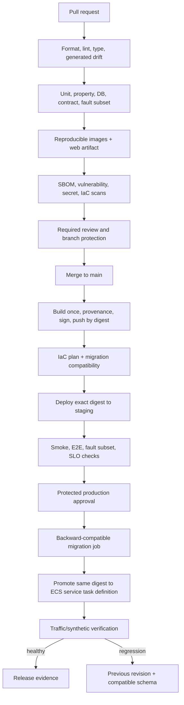

# Phase 13 — Cloud Infrastructure and CI/CD

## Outcome

Provision reproducible development bootstrap, staging, and demo-production environments and implement secure build, test, migration, deployment, verification, promotion, rollback, cost controls, and teardown. The bootstrap slice is required before provider-dependent Phase 08/12 gates; the later hardening slice completes promotion and rollback. The same immutable application artifact is promoted; environments differ through validated configuration and secret references.

## Entry criteria

- Bootstrap slice: Phases 01 and 03 pass and the frozen service map is accepted.
- Hardening/promotion slice: Phases 10–12 pass.
- AWS account with IAM administration and AWS Budgets, Neon, Amazon Cognito, and Grafana Cloud tenants are available.
- Current free-tier/pricing limits are reverified from official sources and dated.
- Domain names/auth redirect URLs/regions/environment names are decided.
- Infrastructure-as-code state backend and ownership are accepted.
- Database migration compatibility policy from Phase 03 is implemented.

## Non-goals

- No Kubernetes cluster.
- No long-lived GitHub AWS access key.
- No building separate binaries from different commits per environment.
- No automatic production firmware campaign during application deployment.
- No EC2 simulator host; the custom backend remains locally runnable and any
  staging deployment is a bounded container task that can scale to zero.

## Environment model

| Environment | Purpose | Data/targets | Controls |
|---|---|---|---|
| Developer | Unit/UI/light process work | No required local DB; cloud dev resources optional | Personal, minimum privileges, easy reset |
| CI | Deterministic verification | Ephemeral PostgreSQL, in-process/container simulator | No production secrets/routes |
| Staging | Full cloud integration/fault drills | Custom synthetic target container and synthetic artifacts only | Automatic deploy after main; destructive tests allowed only against simulator |
| Demo production | Stable portfolio demo | Scale-to-zero synthetic target container using the accepted synthetic contract | Protected approval, strict budgets, no destructive fault injection by default |

## Deployment flow

## Infrastructure inventory

| Resource | Key controls |
|---|---|
| ECS Fargate API service | ALB/private-ingress decision, desired/min/max tasks, CPU/memory, health check, task role, readiness |
| ECS Fargate worker service/task | SQS polling only, desired/min/max tasks, task deadline, no public ingress, dedicated task role |
| Synthetic target simulator role | locally runnable; optional scale-to-zero Fargate task; one run owner, bounded state/journal, explicit synthetic banner, no external credentials/routes |
| EventBridge Scheduler + publisher/sweeper ECS task | IAM-invoked bounded batches, external wakeup at zero worker capacity, same immutable worker image/task role |
| SQS Standard queues | per-class visibility/redrive/backlog/retry policy, worker IAM role, delivery-generation envelope, quarantine policy |
| S3 with Versioning | non-public bucket, exact version ID, lifecycle, CORS only if needed, signed upload identity |
| AWS Secrets Manager | Cognito/provider/config secrets and target credential references; worker-task-role access; administrative CLI provisioning and rotation audit |
| Neon | session-based Free development project; retained staging/demo on Launch with seven-day restore window; pooled app endpoints, direct migration endpoint, role separation, compute/storage limits |
| Amazon Cognito User Pools | Google federation, callback/session configuration, OIDC provider adapter, application RBAC, recent-auth policy |
| Grafana Cloud/OTel | one telemetry destination, API keys/ingestion endpoints, dashboards/alerts, 14-day live retention/cardinality budgets |
| Amazon ECR | immutable image digests, retention, cleanup, vulnerability data |
| IAM/OIDC | GitHub OIDC trust restricted by repository/branch/environment claims and least privilege |
| Budget/monitoring | billing alerts, max instances, queue caps, storage retention, telemetry usage |

## Micro-task checklist

### Early development bootstrap

- [ ] **P13-B01** Provision a disposable AWS development account/environment, Neon project, SQS Standard queues, EventBridge Scheduler repair task, private versioned S3 bucket, AWS Secrets Manager resources, ECR repository, and minimal ECS Fargate API/worker shells after Phase 03.
- [ ] **P13-B02** Package the synthetic target backend as the same immutable
  container used locally. If staging needs remote access, deploy one
  scale-to-zero private Fargate task with bounded storage/export and teardown;
  do not provision an EC2 simulator host.
- [ ] **P13-B03** Prove the worker ECS task role can receive/delete only its SQS queue messages, EventBridge Scheduler can launch a zero-worker-capacity repair pass, and duplicate/uncertain SQS delivery is repaired through a new delivery generation.
- [ ] **P13-B04** Prove pooled application and direct migration Neon connections, record connection budgets, and stop scheduler work when the disposable session ends.
- [ ] **P13-B05** Verify the accepted synthetic target contract records before packaging or deploying
  the Phase 04 Redfish-shaped routes.
- [ ] **P13-B06** Store a dated cost/source ledger and capture a bootstrap exit report; defer public promotion permissions until the hardening slice.

### IaC foundation

- [ ] **P13-T01** Select Terraform/OpenTofu version and provider lock/update policy.
- [ ] **P13-T02** Separate reusable modules from environment composition without creating a module for every resource.
- [ ] **P13-T03** Configure remote state, locking, encryption, access, backup, and recovery ownership.
- [ ] **P13-T04** Prevent secrets and generated credentials from entering state where provider design allows; document unavoidable sensitive state.
- [ ] **P13-T05** Add formatting, validation, lint, security scan, and plan artifact to CI.
- [ ] **P13-T06** Add tags/labels for project, environment, owner, cost center/purpose, and expiration where supported.

### Identity and access

- [ ] **P13-T07** Create separate IAM task roles for API, worker, an optionally
  deployed simulator container, migration, and CI deployer where privilege
  differs.
- [ ] **P13-T08** Grant API only needed DB/object metadata/auth permissions.
- [ ] **P13-T09** Grant worker queue invocation, secret access, object read/signing path, and telemetry permissions at minimum scope.
- [ ] **P13-T10** Isolate any deployed simulator task from external credential
  secrets and unrestricted routing; configure bounded retained-run
  state/journal export and enforce one active owner per run.
- [ ] **P13-T11** Configure GitHub OIDC trust to AWS IAM roles, restricted by immutable repository/owner IDs plus branch/ref, workflow, and protected environment claims.
- [ ] **P13-T12** Prove a fork/untrusted PR cannot obtain cloud credentials.
- [ ] **P13-T13** Add periodic IAM review and credential/key rotation runbook.

### Network and service configuration

- [ ] **P13-T14** Configure API ingress/TLS/custom domain decision and CORS allowlist.
- [ ] **P13-T15** Configure worker task roles and SQS queue policies so only the worker can receive/delete queue messages; expose no public worker endpoint.
- [ ] **P13-T16** Configure workers to reach only the accepted private
  synthetic target origin in staging. Validate every returned URI and resolved
  connection address; no NAT Gateway or fixed public egress is required for
  the synthetic boundary.
- [ ] **P13-T17** Configure per-service min/max instances, concurrency, CPU/memory, deadlines, and startup probes from measured staging behavior.
- [ ] **P13-T18** Verify max instance × connection-pool and max instance × Redfish concurrency budgets.
- [ ] **P13-T19** Disable or protect all debug/admin/simulator-control endpoints.

### Queues, events, storage, secrets

- [ ] **P13-T20** Provision SQS Standard queue classes with visibility timeout, redrive/max-receive policy, delay/backlog alarms, and producer/worker caps below application budgets.
- [ ] **P13-T21** Configure worker IAM task roles, queue policies, and dead-letter queue access.
- [ ] **P13-T22** Provision EventBridge Scheduler to launch the bounded publisher/sweeper ECS task. Prove it wakes repair while worker capacity is zero.
- [ ] **P13-T23** Provision private artifact bucket, lifecycle, version ID settings, size/CORS/signing prerequisites.
- [ ] **P13-T24** Provision secret resources as references/placeholders; a separate administrative CLI writes/rotates target credential values directly, and plaintext never enters committed variables, Terraform state, FleetForge API/browser, or GitHub Actions.
- [ ] **P13-T25** Configure telemetry endpoints/keys and rotation.

### PostgreSQL environments

- [ ] **P13-T26** Create a session-based disposable Neon Free development project and retained Launch staging/demo projects with distinct migration/application/read-only roles.
- [ ] **P13-T27** Configure pooled connection strings for serverless roles and direct migration path only if required.
- [ ] **P13-T28** Set compute/storage/branch limits and auto-suspend consistent with demo latency/cost tradeoff; disable periodic scheduler work when a Free development session ends so it can scale to zero.
- [ ] **P13-T29** Configure the retained environment's seven-day restore window, encrypted logical evidence exports, and isolated restore destination; do not describe Neon's six-hour Free history as portfolio recovery coverage.
- [ ] **P13-T30** Store DSNs only in AWS Secrets Manager/environment secret injection.

### Pull-request CI

- [ ] **P13-T31** Enforce format, static analysis, generated-contract drift, unit/property tests.
- [ ] **P13-T32** Run PostgreSQL migration/integration/concurrency tests.
- [ ] **P13-T33** Run Redfish contract and deterministic fault subset.
- [ ] **P13-T34** Run frontend typecheck/unit/component/accessibility tests.
- [ ] **P13-T35** Build all containers/web artifact reproducibly.
- [ ] **P13-T36** Generate SBOM, dependency/container/IaC scans, license report, and provenance inputs.
- [ ] **P13-T37** Define severity/exception expiry policy so scans are meaningful rather than decorative.
- [ ] **P13-T38** Upload test/coverage/fault artifacts with retention and no secrets.

### Main and staging deployment

- [ ] **P13-T39** Build once from reviewed commit and push immutable digests.
- [ ] **P13-T40** Sign images/attest provenance where tooling/account allows.
- [ ] **P13-T41** Produce IaC plan and block unexpected destroy/privilege expansion.
- [ ] **P13-T42** Run migration compatibility checks against current staging version.
- [ ] **P13-T43** Run migration as one-shot job with advisory lock and captured logs.
- [ ] **P13-T44** Deploy exact digest to staging.
- [ ] **P13-T45** Run health, schema, API, queue, object, simulator, E2E, and selected fault smoke tests.
- [ ] **P13-T46** Check staging telemetry and SLO guardrails before promotion.

### Demo-production promotion and rollback

- [ ] **P13-T47** Require protected environment approval.
- [ ] **P13-T48** Promote the same image digest/config schema, not rebuild.
- [ ] **P13-T49** Deploy the new ECS task definition behind the chosen ALB/private ingress with synthetic read and safe write checks.
- [ ] **P13-T50** Automatically or manually restore the previous ECS task definition on defined regression.
- [ ] **P13-T51** Verify old application revision remains compatible with expanded schema.
- [ ] **P13-T52** Separate application deploy from firmware campaign start; deployment has no campaign-start credentials/action.
- [ ] **P13-T53** Record release digest, schema version, IaC revision, tests, approver, and rollback result.

### Cost and teardown

- [ ] **P13-T54** Record current free-tier/pricing sources/date and estimated workload.
- [ ] **P13-T55** Configure billing alerts and service-specific usage alerts.
- [ ] **P13-T56** Set ECS desired/min/max tasks, SQS backlog/redrive caps, database limits, S3 lifecycle, ECR cleanup, and telemetry budgets.
- [ ] **P13-T57** Add preview/staging resource expiration where safe.
- [ ] **P13-T58** Create dry-run and explicit teardown procedure that protects evidence and production-like data.
- [ ] **P13-T59** Execute teardown/recreate in a disposable environment.

## Required tests and drills

| Test ID | Scenario | Required result |
|---|---|---|
| P13-CI-01 | Fresh PR | All required checks run without cloud production credentials |
| P13-CI-02 | Generated API/schema drift | CI fails |
| P13-CI-03 | Known critical secret/vulnerability fixture | Scan gate fails as policy states |
| P13-IAM-01 | Untrusted PR/fork requests cloud token | Denied |
| P13-IAM-02 | API role requests worker-only secret | Denied |
| P13-DP-01 | Deploy staging | Exact digest and config/schema compatibility verified |
| P13-DP-02 | Two migration jobs race | Advisory lock permits one migrator |
| P13-DP-03 | New revision health regression | Traffic rolls back to prior compatible revision |
| P13-DP-04 | App rollback after expand migration | Prior app remains functional |
| P13-DP-05 | Telemetry unavailable | Defined degraded behavior; workflow truth preserved and exporter drops remain bounded/visible locally |
| P13-DP-06 | All ECS Fargate worker capacity at zero with overdue work | EventBridge Scheduler launches a bounded sweep that starts delivery and advances a new delivery generation where needed |
| P13-DP-07 | Optional synthetic target container restarts during an accepted operation | Persistent run/target/journal state recovers consistently or the run fails closed as invalid |
| P13-COST-01 | Synthetic runaway traffic | Max instances/queue/application budgets cap amplification |
| P13-COST-02 | One-minute sweep on disposable Neon Free project | Session shutdown disables sweep; measured CU-hours and retained-environment budget remain explicit |
| P13-DR-01 | Disposable environment teardown/recreate | Recreated services pass smoke tests; protected evidence retained |

## Evidence artifacts

- IaC module/environment map and plan output.
- IAM permission matrix and untrusted-PR denial proof.
- Image digest, SBOM, scan, provenance/signature records.
- Staging deployment/E2E report.
- Application and migration rollback rehearsal.
- Free-tier/cost ledger and budget configuration.
- Disposable teardown/recreate report.

## Exit criteria

- Staging and demo production are reproducible from IaC.
- The early bootstrap slice provides provider resources before any phase requires an actual SQS/EventBridge Scheduler/S3/Neon integration gate.
- CI uses short-lived federated credentials only.
- Same immutable digest is promoted.
- Migrations and app rollback compatibility are proved.
- Queue/service/database/runtime limits are mutually consistent; database connection budget sums per-role maximum pools rather than multiplying a shared pool again by HTTP concurrency.
- Public/private endpoints and service identities are correct.
- Cost alerts/caps/retention/teardown exist.
- Deploying the application cannot start a firmware campaign.

## Rollback and stop conditions

- Stop promotion on unexpected IaC destroy, IAM expansion, migration incompatibility, failed fault/smoke tests, or missing telemetry.
- Prefer traffic rollback over destructive database down-migration.
- Disable workers/update queue before scaling through a systemic failure.
- Tear down or scale the simulator and load resources to zero when not actively
  used; disable disposable-environment scheduler jobs so Neon can suspend.
