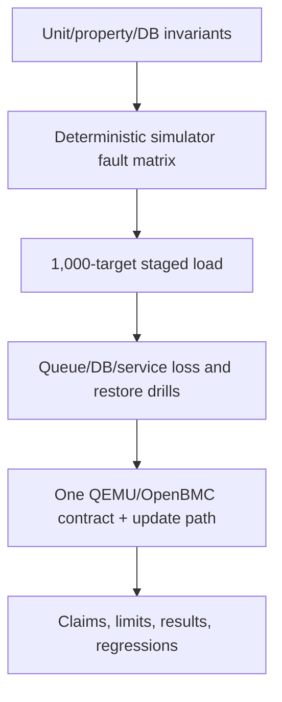

# Phase 14 — Load, Fault, Recovery, and QEMU/OpenBMC Validation

## Outcome

Produce defensible evidence that FleetForge meets its stated 1,000-target design goal, preserves safety invariants under failure, restores from durable state, and interoperates with one real QEMU/OpenBMC target for the supported Redfish subset.

This phase validates claims; it does not silently tune tests until they pass or extrapolate to enterprise scale.

## Entry criteria

- Phases 04, 09, 12, and 13 pass.
- The Pre-04 QEMU/OpenBMC capability spike has pinned the supported image, Redfish surface, and artifact-transfer path; Phase 14 validates that frozen subset rather than discovering it for the first time.
- Staging environment and cost budgets are active.
- Load/fault tool and scenario schema are selected.
- OpenBMC image provenance, QEMU host, supported update workflow, and credentials/trust are documented.
- Baseline SLO targets and measurement methodology are frozen for the first run.

## Non-goals

- No claim of production data-center certification.
- No permanent 1,000-QEMU fleet.
- No full OpenBMC image build on the 8 GB laptop.
- No hiding failed/slow runs.
- No result without commit, configuration, seed, workload, and environment metadata.

## Validation layers

## Load profiles

| Profile | Targets | Concurrency/faults | Purpose |
|---|---:|---|---|
| L0 smoke | 10 | 2 global, healthy | Fast deployment verification |
| L1 functional | 100 | 10 global, 2/rack, mixed normal delays | Daily E2E confidence |
| L2 scale baseline | 1,000 | 25 global, 2/rack, no injected terminal failure | Throughput/lag/resource baseline |
| L3 realistic mixed | 1,000 | Same caps; lost events, reboots, transient 429/503, slow targets | Recovery and SLO behavior |
| L4 canary stop | 1,000 selected; canary configured | Systemic bad artifact in canary | Prove later waves never release |
| L5 storm defense | 1,000 | Correlated transport failure/recovery | Retry jitter, budgets, backpressure |
| L6 soak | 100–1,000 based on budget | Extended campaigns/refresh/streams | Leak, stale work, retention, cost |

## Measurements

- Campaign planning and validation duration.
- Targets entering terminal state per minute.
- API p50/p95/p99 for named non-device endpoints.
- Queue publish/delivery and runnable due-work start delay.
- Redfish request/step/task/reboot/verification latency distributions.
- Reconciliation lag and recovery time after event/task/service loss.
- PostgreSQL pool wait, transaction duration, locks/deadlocks/conflicts, query plans.
- ECS Fargate instances, CPU/memory, cold starts, concurrency.
- Duplicate accepted operations, ambiguity outcomes, budget/pause decisions.
- Current physical-operation reservations and already-admitted exposure at each scope.
- Browser campaign-view performance at 1,000 targets.
- Cloud usage/cost estimate for the run.

## Micro-task checklist

### Harness and reproducibility

- [ ] **P14-T01** Define versioned load scenario including seed, targets, racks/sites, timings, faults, policy, limits, duration.
- [ ] **P14-T02** Record application/image digests, schema/IaC versions, region, service sizing/concurrency, database plan, telemetry config.
- [ ] **P14-T03** Generate deterministic target/campaign/artifact fixtures with no live secrets.
- [ ] **P14-T04** Automate environment preflight and budget/cap verification.
- [ ] **P14-T05** Automate run start/stop/cleanup and retain raw machine-readable results.
- [ ] **P14-T06** Prevent load tool from bypassing API/auth/idempotency unless a test explicitly targets an internal component.

### Baseline and capacity

- [ ] **P14-T07** Run L0 and verify metrics/traces/test data cleanup.
- [ ] **P14-T08** Run L1 repeatedly and establish variance/noise.
- [ ] **P14-T09** Run L2 with no faults and capture resource/latency/throughput.
- [ ] **P14-T10** Identify first bottleneck from evidence, not assumption.
- [ ] **P14-T11** Change one tuning variable at a time and record before/after.
- [ ] **P14-T12** Verify connection and queue caps remain within planned budgets during autoscaling.
- [ ] **P14-T13** Verify no hot rack/starvation, physical-operation reservations never exceed global/site/rack limits, and keyset/UI behavior remains bounded.

### Fault and safety validation

- [ ] **P14-T14** Run full Phase 09 fault matrix at scale-representative concurrency.
- [ ] **P14-T15** Run L3 mixed faults and compare recovery/SLOs to baseline.
- [ ] **P14-T16** Run L4 and prove zero new submission admissions after the canary pause commit; separately account for operations admitted before that commit and still able to reach a target.
- [ ] **P14-T17** Run L5, inspect jitter distribution/retry budgets/queue and DB load.
- [ ] **P14-T18** Kill and stall worker instances at every documented persistence/network boundary, including a stale live worker after work-lease expiry, using deterministic hooks.
- [ ] **P14-T19** Interrupt Amazon SQS Standard delivery, the Amazon EventBridge Scheduler wakeup path, telemetry export, and database connectivity separately.
- [ ] **P14-T20** Validate no queue/event outage erases workflow truth.
- [ ] **P14-T21** Verify the simulator's independent receive/acceptance journal, not controller state or `command_id` deduplication, satisfies the no-blind-duplicate oracle.
- [ ] **P14-T21A** Make the suite fail when the reconciler falsely reports `PROVEN_ABSENT` after the simulator accepted the original request.
- [ ] **P14-T21B** Make the suite fail when the controller sends a deliberate duplicate to the simulator's non-idempotent profile.
- [ ] **P14-T22** Preserve every failing seed and add it to regression suite.

### Restore and reconstruction

- [ ] **P14-T23** Create isolated backup/logical export from known campaign state.
- [ ] **P14-T24** Restore to a separate environment in recovery mode: submission admission disabled and no real target routes/credentials.
- [ ] **P14-T25** Run schema and integrity checks: revisions, audit gaps, counters, active uniqueness, outbox/due work, leases.
- [ ] **P14-T26** Rebuild projections and create fresh delivery generations from durable state without reissuing unsafe side effects.
- [ ] **P14-T26A** Restore an older database snapshot while the simulator journal/device state is newer; require reconciliation to preserve the newer physical truth or quarantine the target.
- [ ] **P14-T27** Run decision replay and compare expected decisions.
- [ ] **P14-T28** Record recovery point, recovery time, manual steps, and limitations.

### QEMU/OpenBMC release preparation

- [ ] **P14-T29** Re-verify the machine/image, source, commit, checksum, and capability matrix frozen by the Pre-04 spike.
- [ ] **P14-T30** Provision the frozen on-demand EC2 VM profile for prebuilt QEMU execution; build images separately only when the spike documented that requirement.
- [ ] **P14-T31** Restrict network access, create dedicated credentials/trust, and ensure simulator config cannot reach it accidentally.
- [ ] **P14-T32** Verify QEMU boot, BMC reachability, service root, inventory, UpdateService, TaskService, SoftwareInventory, artifact-transfer path, reboot/version evidence, and the exact event support claimed by the adapter.
- [ ] **P14-T33** Capture actual response fixtures after redaction and compare with simulator/adapter assumptions.

### QEMU/OpenBMC integration

- [ ] **P14-T34** Run target registration/discovery/preflight against QEMU.
- [ ] **P14-T35** Verify current-version/idempotent no-op behavior where safe.
- [ ] **P14-T36** Execute supported firmware-update flow only with a known reversible/test image and explicit approval.
- [ ] **P14-T37** Observe task/reboot/inventory/health lifecycle and record timelines.
- [ ] **P14-T38** Test lost-event/polling fallback without corrupting the target.
- [ ] **P14-T39** Reconcile any task-disappearance or vendor difference conservatively.
- [ ] **P14-T40** Update adapter fixtures/simulator limitations; never change simulator to invent unsupported behavior.
- [ ] **P14-T41** Shut down VM/resources and record cost.

### Soak and regression

- [ ] **P14-T42** Run budget-compatible L6 soak.
- [ ] **P14-T43** Check memory/goroutine/connection/queue/outbox growth and cleanup/retention behavior.
- [ ] **P14-T44** Compare to baseline and define regression thresholds for future CI/nightly/manual runs.
- [ ] **P14-T45** Add small smoke/fault subset to normal CI; keep costly full load/QEMU runs manually scheduled.

## Required validation assertions

| Assertion | Pass condition |
|---|---|
| Scale | 1,000-target plan and campaign complete within measured/declared limits without redesign |
| Safety | Zero blind duplicate accepted operations in all deterministic schedules |
| Canary isolation | No new later-wave submission admission after the canary pause commit; every earlier admission is enumerated as residual exposure |
| Concurrency | Global/site/rack physical-operation reservations never exceeded, including while work leases expire or workers die |
| Delivery recovery | Lost/duplicate/delayed queue work converges from PostgreSQL |
| Event recovery | Lost/out-of-order events cannot prevent polling reconciliation or regress state |
| Ambiguity | Every ambiguous attempt adopts, proves absence, or becomes attention; never generic resubmit |
| Restore | Recovery-mode restore disables admission, creates fresh delivery generations, and reconciles any newer device/simulator truth before resuming |
| QEMU compatibility | Supported discovery/update/task/inventory path is demonstrated or limitation is explicitly documented |
| Honesty | Report includes failures, caveats, cost, environment, and non-extrapolation statement |

## Result report structure

1. Executive result and pass/fail by claim.
2. Exact commit/artifact/schema/IaC versions.
3. Environment/resource configuration and cost.
4. Workload/scenario/fault seed.
5. Latency/throughput/resource distributions.
6. Safety invariant results.
7. Bottleneck analysis and one-variable tuning experiments.
8. Recovery/restore/QEMU evidence.
9. Failed runs and regressions.
10. Known limitations and next experiments.

## Exit criteria

- L2–L5 required runs complete with reproducible artifacts.
- All safety assertions pass; failing seeds are retained and fixed/retested.
- Restore/reconstruction drill passes.
- At least one genuine QEMU/OpenBMC update, task, reboot, and version-verification flow within the frozen capability subset is documented; discovery alone cannot satisfy this gate.
- First bottleneck and scale boundary are evidence-backed.
- Costs remain inside approved budget.
- Full results distinguish design targets from observations.

## Rollback and stop conditions

- Stop load immediately on cost alert, uncontrolled autoscaling, data/target boundary breach, or missing safety telemetry.
- Stop QEMU update if image/recovery/trust assumptions are unclear.
- Scale down/disable workers before testing database/queue recovery to avoid uncontrolled catch-up.
- Never discard an unfavorable valid result; fix and append a new run.
