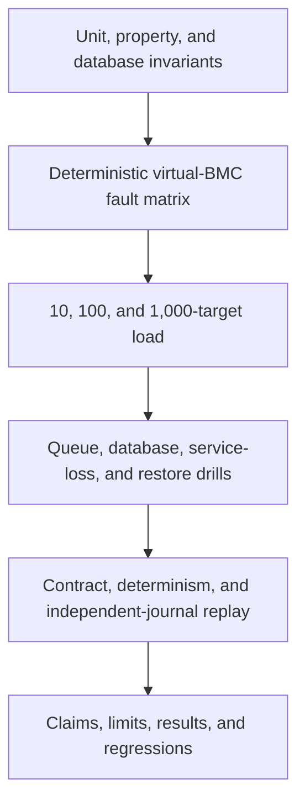

# Phase 14 — Load, Fault, Recovery, and Virtual-BMC Validation

## Outcome

Produce defensible evidence that FleetForge meets its stated 1,000-target
design goal, preserves safety invariants under failure, restores from durable
state, and remains deterministic against the accepted repository-owned
virtual-BMC contract.

This phase validates claims. It does not tune tests until they pass, hide
failed runs, or extrapolate measurements beyond the recorded environment.

## Entry criteria

- Phases 04, 09, 12, and 13 pass at recorded commits.
- ADR-032, ADR-038, and ADR-039 accept the synthetic target contract.
- The supported-resource matrix and canonical fixtures are frozen.
- Staging or the local release-test environment has explicit resource and cost
  budgets.
- Baseline SLO targets, workload schema, evidence format, and comparison method
  are frozen before the first retained run.

## Non-goals

- No production data-center certification.
- No external-device, vendor, or complete Redfish compatibility claim.
- No external firmware image execution.
- No hidden reruns that discard an unfavorable valid result.
- No result without commit, configuration, seed, workload, and environment
  metadata.

## Validation layers

## Load profiles

| Profile | Targets | Concurrency/faults | Purpose |
|---|---:|---|---|
| L0 smoke | 10 | 1 and 5, healthy | Fast deployment verification |
| L1 functional | 100 | 1, 5, 25; normal delays | Repeatability and serial/parallel comparison |
| L2 scale baseline | 1,000 | 25 global, 2/rack, no terminal fault | Throughput, lag, and resource baseline |
| L3 realistic mixed | 1,000 | Lost events, reboots, `429/503`, slow targets | Recovery and SLO behavior |
| L4 canary stop | 1,000 selected | Systemic canary failure | Prove later waves never release |
| L5 storm defense | 1,000 | Correlated transport failure/recovery | Retry jitter, budgets, and backpressure |
| L6 soak | 100–1,000 as budget permits | Extended campaigns and streams | Leak, retention, and cleanup evidence |

## Measurements

- Campaign planning and validation duration.
- Targets reaching terminal state per minute.
- Serial versus bounded-parallel elapsed time.
- API and virtual-target request p50/p95/p99 latency.
- Queue publish/delivery and due-work start delay.
- Task, reboot, verification, and reconciliation latency.
- PostgreSQL pool wait, transaction duration, lock/deadlock/conflict counts,
  and representative query plans.
- Active workers, engine queue depth, callback backlog, open connections,
  goroutine count, heap/RSS, and journal fsync latency.
- Accepted operations, ambiguity outcomes, retries, budget/pause decisions,
  and independent-oracle duplicate count.
- Current operation reservations and already-admitted exposure at each scope.
- UI campaign-view performance at 1,000 targets.
- Cloud usage and cost only for components actually deployed during the run.

## Micro-task checklist

### Harness and reproducibility

- [ ] **P14-T01** Define a versioned scenario with seed, targets, racks/sites,
  timings, faults, policy, concurrency, limits, and duration.
- [ ] **P14-T02** Record application/image digests, schema/IaC versions,
  runner resources, service sizing, database plan, and telemetry configuration.
- [ ] **P14-T03** Generate deterministic virtual targets, campaigns, and
  synthetic artifacts with no live secrets.
- [ ] **P14-T04** Automate environment preflight, callback/route isolation, and
  resource-budget verification.
- [ ] **P14-T05** Automate run start, stop, cleanup, and retention of raw
  machine-readable results.
- [ ] **P14-T06** Prevent the load tool from bypassing API, authorization,
  idempotency, or adapter boundaries unless a named component test requires it.

### Baseline and capacity

- [ ] **P14-T07** Run L0 and verify metrics, traces, journals, and cleanup.
- [ ] **P14-T08** Run L1 repeatedly and establish variance/noise.
- [ ] **P14-T09** Run L2 and capture resource, latency, throughput, and journal
  measurements.
- [ ] **P14-T10** Identify the first bottleneck from evidence.
- [ ] **P14-T11** Change one tuning variable at a time and record before/after.
- [ ] **P14-T12** Verify connection, database, queue, worker, simulator-engine,
  and callback caps remain within budgets.
- [ ] **P14-T13** Verify no hot rack/starvation, operation reservations never
  exceed global/site/rack limits, and keyset/UI behavior remains bounded.

### Fault and safety validation

- [ ] **P14-T14** Run the complete Phase 09 fault matrix at
  scale-representative concurrency.
- [ ] **P14-T15** Run L3 and compare recovery/SLOs with baseline.
- [ ] **P14-T16** Run L4 and prove zero new submission admissions after the
  canary pause commit while enumerating earlier admitted exposure.
- [ ] **P14-T17** Run L5 and inspect jitter, retry budgets, queue load, and
  database load.
- [ ] **P14-T18** Kill or stall workers at every documented persistence/network
  boundary, including a stale live worker after lease expiry.
- [ ] **P14-T19** Interrupt queue delivery, scheduler wakeup, telemetry export,
  virtual-target availability, and database connectivity separately.
- [ ] **P14-T20** Verify no queue, event, or simulator-process outage erases
  workflow truth.
- [ ] **P14-T21** Verify the independent receive/acceptance journal, rather than
  controller state or command deduplication, satisfies the no-blind-duplicate
  oracle.
- [ ] **P14-T21A** Fail the suite when the reconciler reports
  `PROVEN_ABSENT` after the backend accepted the original request.
- [ ] **P14-T21B** Fail the suite when the controller sends a deliberate second
  request to the non-idempotent virtual target.
- [ ] **P14-T22** Preserve every failing seed and add it to regression tests.

### Restore and reconstruction

- [ ] **P14-T23** Create an isolated backup/export from known campaign state.
- [ ] **P14-T24** Restore into recovery mode with submission admission disabled
  and only isolated virtual-target routes available.
- [ ] **P14-T25** Check schemas, revisions, audits, counters, active uniqueness,
  outbox/due work, leases, reservations, and journal links.
- [ ] **P14-T26** Rebuild projections and fresh delivery generations without
  reissuing unsafe side effects.
- [ ] **P14-T26A** Restore an older database snapshot while the retained
  virtual-target journal is newer; preserve newer target truth or quarantine.
- [ ] **P14-T27** Run decision replay and compare expected decisions.
- [ ] **P14-T28** Record recovery point, recovery time, manual steps, and limits.

### Virtual-BMC contract and determinism

- [ ] **P14-T29** Re-verify pinned schema checksums, accepted ADRs, canonical
  fixtures, and supported-resource matrix.
- [ ] **P14-T30** Run the backend locally and in its release container with the
  same canonical scenario and compare normalized results.
- [ ] **P14-T31** Verify target/admin listener isolation, distinct credentials,
  callback allowlisting, redirect denial, and bounded returned URIs.
- [ ] **P14-T32** Validate Service Root, identity resources, UpdateService,
  TaskService, FirmwareInventory, EventService, authentication, and all bounded
  error responses against the selected contract fixtures.
- [ ] **P14-T33** Run identical seed/scenario/request traces twice and require
  normalized byte-equivalent journals and results.
- [ ] **P14-T34** Run discovery, preflight, current-version no-op, update,
  task/reboot/inventory/health verification, and event fallback end to end.
- [ ] **P14-T35** Crash after receipt and after acceptance; require exact replay
  or explicit run invalidation.
- [ ] **P14-T36** Exercise pre-accept failure and prove zero acceptances.
- [ ] **P14-T37** Exercise post-accept response loss and prove one acceptance
  without controller resubmission.
- [ ] **P14-T38** Exercise lost events and task disappearance while polling and
  inventory evidence remain authoritative.
- [ ] **P14-T39** Exercise version contradiction and failed health; neither may
  become rollout success.
- [ ] **P14-T40** Run the deliberate duplicate and false-absence negative
  mutations and require the independent oracle to fail.
- [ ] **P14-T41** Record the exact contract limits and state clearly that no
  external-device behavior was evaluated.

### Soak and regression

- [ ] **P14-T42** Run budget-compatible L6 soak.
- [ ] **P14-T43** Check memory, goroutine, connection, queue, outbox, task, and
  journal growth plus cleanup/retention behavior.
- [ ] **P14-T44** Compare with baseline and define measured regression
  thresholds for future CI/scheduled/manual runs.
- [ ] **P14-T45** Add a small deterministic smoke/fault subset to normal CI and
  retain full load/soak runs as protected scheduled or release workflows.

## Required validation assertions

| Assertion | Pass condition |
|---|---|
| Scale | The 1,000-target campaign completes within measured limits without redesign |
| Parallelism | Bounded concurrency improves elapsed time over serial execution when target latency is non-zero |
| Safety | Zero blind duplicate accepted operations in all passing deterministic schedules |
| Canary isolation | No new later-wave admission after the pause commit; earlier admissions are enumerated |
| Concurrency | Global/site/rack reservations are never exceeded during lease expiry or worker loss |
| Delivery recovery | Lost, duplicate, or delayed queue work converges from PostgreSQL |
| Event recovery | Lost/out-of-order events cannot prevent polling reconciliation or regress state |
| Ambiguity | Every ambiguous attempt adopts, proves absence under the narrow rule, or becomes attention |
| Restore | Recovery mode disables admission and reconciles newer target truth before resuming |
| Determinism | Identical scenario, seed, and request trace produce identical normalized evidence |
| Backpressure | Worker, engine, callback, connection, and journal bounds prevent unbounded growth |
| Honesty | Reports include failures, caveats, environment, cost, and non-extrapolation wording |

## Result report structure

1. Executive pass/fail by claim.
2. Exact commit, artifact, schema, scenario, and IaC versions.
3. Environment and resource configuration.
4. Workload, seed, request trace, and fault schedule.
5. Latency, throughput, parallel speedup, and resource distributions.
6. Safety-oracle results.
7. First bottleneck and one-variable tuning experiments.
8. Recovery, restore, and deterministic replay evidence.
9. Failed runs and retained regressions.
10. Known limits and next experiments.

## Exit criteria

- L2–L5 complete with reproducible artifacts.
- Safety assertions pass and failing seeds are retained and fixed/retested.
- Restore/reconstruction and newer-target-truth reconciliation pass.
- The complete accepted virtual-BMC update/task/reboot/inventory/health path is
  demonstrated from documented commands.
- Serial and bounded-parallel results identify the first measured bottleneck.
- Costs remain inside the approved budget.
- Reports distinguish design targets from observations and external-device
  behavior from the synthetic contract.

## Rollback and stop conditions

- Stop load on a cost alert, uncontrolled scaling, boundary breach, missing
  safety telemetry, or unbounded resource growth.
- Scale down workers before database/queue recovery tests to avoid uncontrolled
  catch-up.
- Do not weaken journal durability or safety checks to improve throughput.
- Never discard an unfavorable valid result; fix and append a new run.
