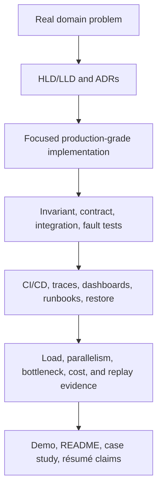

# Phase 15 — Portfolio Release and Engineering Narrative

## Outcome

Package FleetForge as a reproducible, technically honest portfolio project that demonstrates systems design, correctness, scalability, DevOps, observability, security, and domain learning. A reviewer should be able to understand the difficult problem, reproduce a safe simulator demo, inspect evidence, and see limitations without reading every source file.

## Entry criteria

- Phases 01–14 pass or any unresolved external blocker is explicitly accepted and scoped.
- Public/private data, credentials, licenses, and artifact redistribution rights are reviewed.
- Stable demo environment or reproducible on-demand deployment exists.
- Load, parallel-efficiency, fault, restore, and deterministic-replay reports are finalized.

## Non-goals

- No inflated enterprise-scale or production-safety claim.
- No tool-name list without why/measurement.
- No fabricated user adoption, uptime, cost savings, recruiter response, or hardware validation.
- No hiding simulator limitations or failed experiments.
- No résumé bullet until evidence supports every claim.

## Portfolio evidence hierarchy

## Required public documentation

| Artifact | Reviewer question answered |
|---|---|
| Main README | What is FleetForge, why is it difficult, how do I run/inspect it? |
| Architecture overview | What are the boundaries, source-of-truth decisions, and failure model? |
| State/sequence diagrams | How are long-running updates and ambiguous outcomes handled? |
| ADR set | Which alternatives were considered and why were these decisions made? |
| Demo guide | How do I run normal, lost-event, and canary-failure scenarios? |
| Test strategy/results | What behavior is actually verified? |
| Load report | What scale was measured, in what environment, with what bottleneck? |
| Chaos/fault report | What failures were injected and what recovered? |
| Restore report | Can durable state be reconstructed safely? |
| Virtual-BMC contract report | Which synthetic routes, fields, extensions, faults, and limits were tested? |
| Security model | How are auth, secrets, SSRF, artifact integrity, and audit handled? |
| Operations guide | Which SLOs, alerts, dashboards, and runbooks exist? |
| Limitations | What does the project not prove? |

## Core demo script

The portfolio demo should remain under approximately 10–15 minutes and expose the engineering core:

1. Show 100 or 1,000 deterministic simulated targets organized by site/rack.
2. Show a verified artifact and campaign policy: canary, waves, rack/global concurrency, failure budget, health checks.
3. Validate and freeze the exact target/plan snapshot.
4. Start canary and show durable work, leases/reservations, state transitions, and correlated trace.
5. Inject a lost event; show polling/reconciliation reaches correct result.
6. Inject post-accept connection loss; show one accepted operation and adoption/attention rather than blind retry.
7. Inject a canary-wide bad result; show the pause commit blocks new admission and display any operations admitted before that boundary as residual exposure.
8. Show audit/decision replay, SLO dashboard, fault test evidence, and declared load result.
9. Show the independent acceptance journal, deterministic replay record, and serial-versus-parallel measurement.
10. End with limitations and what would change for vendor fleets/multi-region operation.

## Micro-task checklist

### Repository hygiene

- [ ] **P15-T01** Remove generated secrets, local paths, unused dependencies, temporary dumps, and private data from tracked/public artifacts.
- [ ] **P15-T02** Verify secret scan across complete publishable history.
- [ ] **P15-T03** Verify license attribution for code, schemas, fixtures, screenshots, images, and firmware artifacts.
- [ ] **P15-T04** Pin/release supported toolchain and dependency lockfiles.
- [ ] **P15-T05** Tag immutable release and retain image digests/SBOM/provenance.

### README and architecture story

- [ ] **P15-T06** Write outcome-first README with problem, demo, architecture, difficult invariants, quick start, evidence, limitations.
- [ ] **P15-T07** Include architecture and state/ambiguity diagrams rendered from Mermaid source.
- [ ] **P15-T08** Explain why Go, Neon PostgreSQL, Amazon SQS Standard plus
  Amazon EventBridge Scheduler, and the local/containerized virtual-BMC backend
  were selected; state that no event broker is used in v1 because it carried
  no correctness-critical role.
- [ ] **P15-T09** Explain modular-monolith/deployable-role choice and rejected Kubernetes/Kafka/Temporal alternatives.
- [ ] **P15-T10** Link the approved RFC and implementation-plan index.

### Reproducible demo

- [ ] **P15-T11** Create one documented setup path for hosted demo and one CI/simulator path where practical.
- [ ] **P15-T12** Provide seeded scenario files for happy, lost-event, ambiguous-submit, and canary-stop demos.
- [ ] **P15-T13** Create reset/cleanup procedure that cannot touch real targets.
- [ ] **P15-T14** Verify demo on a clean machine/runner by following only public instructions.
- [ ] **P15-T15** Record expected duration, cost, limitations, and troubleshooting.

### Evidence index

- [ ] **P15-T16** Create evidence manifest mapping claim → test/report → commit → environment → date.
- [ ] **P15-T17** Publish machine-readable summaries plus concise human interpretation.
- [ ] **P15-T18** Include valid failed runs and fixes where educational.
- [ ] **P15-T19** Link traces/dashboard snapshots without exposing credentials or expiring-only URLs as the sole evidence.
- [ ] **P15-T20** Preserve benchmark raw data or documented derivation.

### Technical case study

- [ ] **P15-T21** Write problem framing from BMC/Redfish and distributed-workflow perspective.
- [ ] **P15-T22** Explain the ambiguous side-effect impossibility boundary and conservative resolution.
- [ ] **P15-T23** Explain transactional outbox, generic due-work repair, delivery generations, short work leases, durable physical-operation reservations, submission admission epochs, target enrollment, and failure-domain budgets with measured examples.
- [ ] **P15-T24** Explain first bottleneck and why unused scale technologies were intentionally excluded.
- [ ] **P15-T25** Explain the synthetic target boundary, why it supports
  deterministic fault/scale proof, and why external-device behavior remains
  outside the evidence.
- [ ] **P15-T26** Include one postmortem from a real fault discovered during implementation.

### Operations/security presentation

- [ ] **P15-T27** Publish bounded telemetry design, SLO definitions, alert/runbook examples, and restore result.
- [ ] **P15-T28** Publish threat model summary: auth/RBAC, SSRF, TLS, secrets, signed URLs, firmware integrity, audit.
- [ ] **P15-T29** Remove or redact all internal URLs/account/project IDs if not intended public.
- [ ] **P15-T30** Demonstrate cost caps and current observed demo cost rather than “free forever.”

### Resume/interview material

- [ ] **P15-T31** Draft résumé bullets using only measured evidence and exact scale.
- [ ] **P15-T32** Prepare 30-second, 2-minute, and 10-minute explanations.
- [ ] **P15-T33** Prepare system-design discussion: requirements, invariants, tradeoffs, bottleneck, failure/recovery, future scale.
- [ ] **P15-T34** Prepare debugging story from one complex fault and how evidence isolated it.
- [ ] **P15-T35** Prepare limitations/future-work answer without apologetic or exaggerated language.

### Final verification

- [ ] **P15-T36** Run full release CI and required manual validation from tagged commit.
- [ ] **P15-T37** Verify every README command/link and all Mermaid diagrams render.
- [ ] **P15-T38** Verify hosted demo health, budget, credentials, retention, and teardown.
- [ ] **P15-T39** Ask an external technical reviewer to reproduce the demo and record friction.
- [ ] **P15-T40** Fix/document reproduction issues and finalize release notes.

## Claim discipline

Acceptable claim pattern:

> Orchestrated firmware campaigns across 1,000 deterministic Redfish targets with canary/wave safety gates; fault tests verified zero blind duplicate submissions across the documented crash matrix, and measured queue/reconciliation latency is reported for the tagged staging environment.

Only use this pattern after every clause is evidenced. Replace numbers/results with the actual measurements. Do not state “production-ready,” “enterprise-scale,” “zero downtime,” or “exactly once.”

## Release test matrix

| Test | Required result |
|---|---|
| Clean-run reproduction | Independent environment completes documented simulator demo |
| Link/diagram check | All documentation links and Mermaid blocks valid |
| Evidence traceability | Every quantitative/safety claim maps to retained evidence |
| Secret/privacy scan | No credential/token/private target/user data in publishable content/history |
| License/provenance | All redistributed assets permitted/attributed |
| Hosted demo | Health, auth, budgets, telemetry, reset/teardown verified |
| Device-boundary claim review | Wording matches the exact synthetic update/task/reboot/version subset exercised and explicitly excludes external-device compatibility |
| Resume claim review | No unsupported metric or result |

## Exit criteria

- Tagged release passes complete CI/manual gate.
- Clean reproduction succeeds using documentation only.
- Demo covers normal, lost-event, ambiguity, and canary-stop scenarios.
- Evidence manifest supports every important claim.
- Architecture, tests, CI/CD, observability, security, scale, cost, and limitations are visible.
- The virtual-BMC claim is precise, measured, sourced, and limited to the accepted synthetic contract.
- External reviewer feedback is incorporated or documented.
- Project owner approves portfolio publication.

## Rollback and stop conditions

- Do not publish if secret/license/provenance checks fail.
- Remove or weaken any claim not supported by retained evidence.
- Disable hosted mutations if budgets, auth, telemetry, or reset isolation are unreliable.
- Preserve the tagged evidence release even as future development continues on main.
