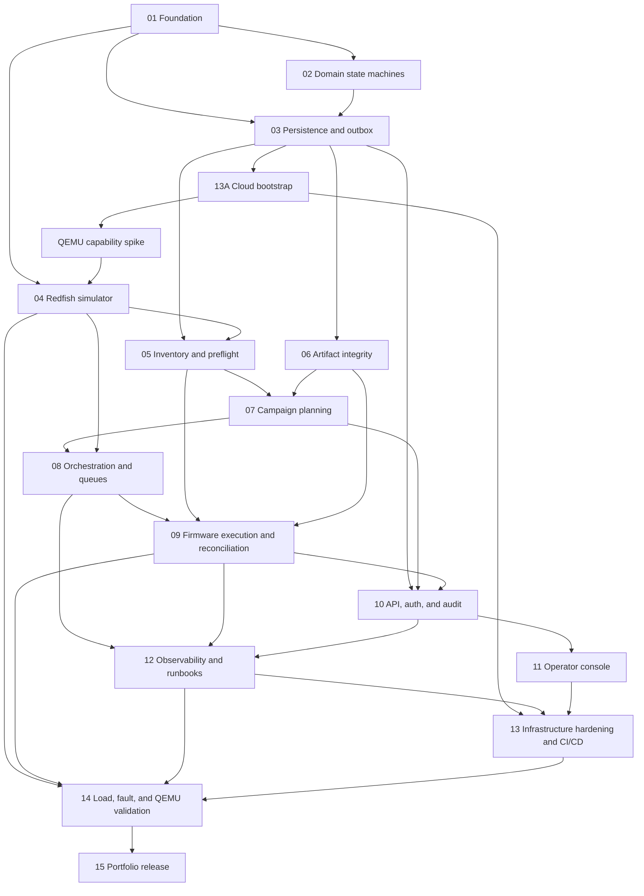

# FleetForge Implementation Plan

## Purpose

This directory converts the approved FleetForge architecture into a gated delivery program. It is deliberately more granular than a normal roadmap: every phase identifies the exact responsibilities introduced, affected packages and artifacts, test obligations, operational evidence, failure cases, rollback path, and approval gate.

This is not a calendar estimate. Progress is evidence-based. A phase is complete only when its behavior is reproducible and its exit gate passes.

## Architecture baseline

- Approved design: [FleetForge System Architecture RFC](../../FleetForge_System_Architecture_RFC.docx)
- Normative corrections: [FleetForge Architecture Freeze](architecture-freeze.md)
- System type: cloud-first firmware-rollout control plane for Redfish/OpenBMC targets
- Implementation style: Go modular monolith with separately deployed API, worker, and simulator roles
- Authoritative state: PostgreSQL
- Delayed command delivery: Amazon SQS Standard, with PostgreSQL due-work repair and Amazon EventBridge Scheduler wakeups
- First-release fan-out: database-backed projection/SSE hints; no event broker is used
- Simulator runtime: one on-demand EC2 VM with persistent test-run state and journal
- Device boundary: normalized Redfish adapter
- Scale proof: at least 1,000 deterministic simulated targets
- Realism proof: one QEMU/OpenBMC integration target
- Core safety rule: uncertain firmware submission is reconciled or moved to `NEEDS_ATTENTION`; it is never blindly repeated

## Core principles

Read [00-core-principles-and-delivery-contract.md](00-core-principles-and-delivery-contract.md) before changing any implementation plan. The abbreviated rules are:

1. Safety before rollout speed.
2. Persist intent before external side effects.
3. PostgreSQL owns workflow truth; queues deliver work; Redfish owns observed device state.
4. At-least-once internal execution must not become duplicate firmware submission.
5. Every long wait is durable scheduled state, never a sleeping process.
6. Every phase includes tests, telemetry, failure behavior, and rollback.
7. The simulator must be deterministic and adversarial; QEMU is the compatibility proof, not the load generator.
8. Claims remain targets until measured evidence exists.
9. Cloud services must have spend limits and replaceable boundaries; billing budgets are alerts unless a separately tested shutdown control is configured.
10. No service, abstraction, or dependency is added only for résumé vocabulary.

## Dependency graph

## Delivery tracks

| Track | Phases | Meaning |
|---|---|---|
| Correctness core | 02, 03, 07, 08, 09 | State, transactions, rollout decisions, work ownership, ambiguity safety |
| Device realism | 04, 05, 06, 09, 14 | Redfish behavior, inventory, firmware artifacts, updates, QEMU proof |
| Operator surface | 10, 11 | Secure API, audit trail, campaign control, progress visualization |
| Production readiness | 01, 12, 13, 14 | CI, telemetry, runbooks, cloud deployment, failure and recovery evidence |
| Portfolio proof | all, consolidated in 15 | Reproducibility, measurements, diagrams, limitations, technical narrative |

## Phase gate summary

| Phase | Gate question | Required proof |
|---:|---|---|
| 01 | Can a fresh runner build and verify the repository without hidden state? | Green CI, locked toolchain, health smoke test, secret scan |
| 02 | Can all state transitions be decided deterministically without I/O? | Table tests, property tests, race-free pure reducer |
| 03 | Are intent, audit, and outbox atomic under concurrency? | Real-PostgreSQL integration and concurrent-claim tests |
| Pre-04 | Does the pinned QEMU/OpenBMC image support the update and evidence path assumed by the design? | Redacted capability/update fixtures, artifact-path decision, recovery proof, and accepted ADR |
| 04 | Can failures be reproduced exactly from a seed without the simulator masking duplicate requests? | Contract suite, persistent journal, deliberate-oracle-failure check, and deterministic replay report |
| 05 | Can FleetForge freeze a valid, conflict-free target set? | Discovery/selector/preflight integration report |
| 06 | Can only immutable, verified, compatible artifacts become rollout-ready? | Digest/signature/compatibility negative tests |
| 07 | Is campaign planning deterministic and safety-budgeted? | Golden plans plus failure-budget property tests |
| 08 | Can duplicate delivery and worker loss preserve semantic work, physical concurrency, and repairability? | Lease, delivery-generation, operation-reservation, queue-redelivery, sweeper, and backpressure fault tests |
| 09 | Can uncertain update outcomes be resolved without a blind or late duplicate submission? | Ambiguous-window and stale-live-worker crash matrix plus independent accepted-operation proof |
| 10 | Are every command, permission, conflict, and mutation safe and auditable? | OpenAPI contract, auth matrix, idempotency and audit tests |
| 11 | Does the UI communicate safety state and recover from disconnected updates? | Browser E2E, accessibility, reconnect, stale-revision tests |
| 12 | Can an operator detect, diagnose, and recover from designed failures? | Dashboards, alerts, traces, and runbook drills |
| 13 | Can the same artifact be securely promoted and rolled back? | Staging deployment, migration compatibility, rollback rehearsal |
| 14 | Do scale, fault, restore, and real-protocol claims hold under measurement? | Load report, chaos report, restore evidence, QEMU transcript |
| 15 | Can another engineer reproduce and critique the project honestly? | Release bundle, demo, limitations, evidence index |

## Phase document contract

Every phase file contains:

- Outcome and non-goals
- Entry criteria and dependencies
- Affected repository areas
- Contracts and data/control flow
- Micro-task checklist with stable task IDs
- Test matrix and failure injections
- Security, observability, CI/CD, and cost impact
- Demonstration and evidence artifacts
- Exit criteria, rollback criteria, and stop conditions

## Change-control policy

- Update the [Decision Log](decision-log.md) before changing a decision classified as locked.
- Update the [Traceability Matrix](traceability-matrix.md) when a requirement, invariant, test, or phase owner changes.
- Update the [Risk Register](risk-register.md) when evidence changes likelihood or impact.
- Never modify a past benchmark result. Add a new dated run and retain the previous result.
- Interface-breaking changes require a migration/compatibility note, not only a code change.

## Document code policy

The plan intentionally avoids long business-logic implementations. Permitted code-like material is limited to:

- Mermaid diagrams
- Short interface or schema fragments
- Example commands and environment-variable names
- Compact request/event shapes when a field contract would otherwise be ambiguous
- Pseudocode of at most a few lines for a safety-critical ordering rule

Actual Go, SQL, TypeScript, Terraform, and workflow logic belongs in the implementation passes.
