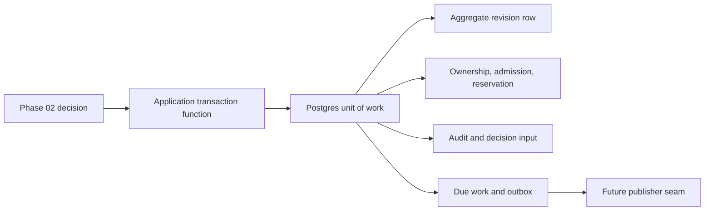

# Phase 03 Execution Plan

## Scope and authority

This execution plan implements the Phase 03 persistence contract in
`03-persistence-and-transactional-outbox.md`. It resolves the obsolete Neon
entry criterion in favor of the architecture freeze: correctness is proved by
an ephemeral real PostgreSQL service in pull-request CI; Neon pooled/direct
smoke is deferred to the cloud-bootstrap slice. Local development does not
require Docker or a database.

PostgreSQL becomes workflow truth for durable intent, aggregate revisions,
ownership claims, audit, replay inputs, due work, and outbox records. This plan
does not add provider calls, API business routes, firmware activity, or any
network operation inside a database transaction.

## Delivery runs

| Run | Cards | Deliverable | Independent proof |
|---|---|---|---|
| 1 | P03-00 to P03-04 | ADRs, real-PostgreSQL CI harness, direct migration path, core and safety-claim schema | document links; CI ping; concurrent migration; schema constraint and enrollment race tests |
| 2 | P03-05 to P03-09 | durable records, explicit SQL/sqlc, atomic unit of work, idempotency, readiness enrollment | malformed-record rejection; mapper corruption failure; rollback, idempotency, and READY-race integration tests |
| 3 | P03-10 to P03-14 | admissions/reservations, due-work leasing, outbox seam, audit/replay, retention and integrity queries | pause/admission barrier, lease fencing, duplicate publish identity, replay, bounded cleanup proofs |
| 4 | P03-15 to P03-18 | role privileges, readiness/budget, migration compatibility, transactional history, closeout audit | privilege-negative tests, schema fingerprint, concurrent migrators/history, hosted Linux race evidence |

Each card is tested before proceeding to the next card within its run. Related
cards may share a commit only after all of their focused proofs pass; commits
never mix a database correctness change with unrelated work.

## Package and data flow

- `internal/platform/config` owns safe role-specific configuration; DSNs are
  never logged.
- `internal/persistence/postgres` owns pooled application access, direct
  migrations, transaction handling, SQLSTATE classification, and strict
  persistence/domain mapping.
- `db/migrations` contains immutable sequential SQL; it has no seed data.
- `db/queries` contains named access patterns. `sqlc` generated code remains
  inside persistence and cannot enter `internal/domain`.
- `test/integration/postgres` owns CI-only database setup with an exact
  generated schema namespace per test. Cleanup may only drop that namespace.

## Transaction and error rules

Every mutation uses a short transaction and the ADR-021 row-family order.
Expected-revision, lease-token, and command-epoch predicates are included in
the mutating SQL; zero affected rows map to conflict or stale-lease errors.
SQLSTATE drives classification for conflict, serialization/deadlock retry,
unavailable connectivity, constraint, and corruption cases. Retried
transactions have a bounded outer retry budget. No database callback invokes a
network client, queue, storage API, or log exporter.

## Schema evolution and safety boundaries

Migrations use UUID identities, `timestamptz`, bounded text, named text-state
checks, non-negative counters, explicit foreign-key actions, and query-backed
indexes. Target enrollment, admission, and durable operation reservation have
separate lifecycles: neither a work lease nor target-update terminality can
release a safety claim. Audit is append-only by database grant; decision input
is retained through audit lifetime so replay is possible after raw observation
retention expires.

## Verification and evidence

The GitHub PostgreSQL gate runs the real integration suite for relevant files,
while all local Go unit and property tests remain database-free. Every run also
executes the Phase 02 unit, directed property, architecture, and build gates.
Windows cannot produce the required race binary because of the installed C
toolchain; final acceptance requires a passing Linux `go test -race ./...` CI
run. The closeout records exact commit, CI URL, migration inventory, schema
fingerprint, lock schedules, index rationale, privilege proof, query plans,
connection-budget arithmetic, and known provider-smoke limitation.
