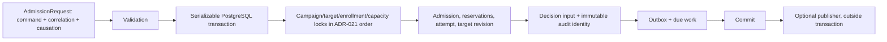

# Phase 03 Audit Remediation Plan — 2026-09-20

## Objective

Close every implementation-controlled finding from
`phase-03-audit-2026-09-20.md` without expanding Phase 03 into a provider,
queue, Redfish, or firmware phase. The acceptance target is a new candidate
commit with deterministic real-PostgreSQL integration evidence, a complete
query and lock-order trace, captured 1,000-target query plans, and a hosted
Linux race/PostgreSQL run at that exact SHA.

The implementation remains on `codex/phase-03-persistence-outbox`. Migrations
are append-only and forward-only. PostgreSQL CI remains correctness proof;
Neon configuration and provider claims stay deferred.

## Design decisions

1. **Audit identity is explicit.** Add immutable `correlation_id` and
   `causation_id` UUID columns to `audit_events`; `command_id` remains the
   command identity, not an undocumented substitute. Admission requests carry
   all three identifiers and validate them before a transaction starts.
2. **Concurrency tests force database interleavings, not scheduler luck.** A
   test-owned transaction holds the target row/campaign row or an injected test
   barrier; competing operations are released only after the intended lock
   boundary is reached. Tests record fixed UUIDs, timestamps, owners, lease
   tokens, expected revisions/epochs, and the final durable row model.
3. **The history oracle is relational and independent of implementation
   helpers.** It derives expected rows from the scenario descriptor and reads
   each table directly. It never reuses persistence-package mutation logic to
   decide expected final state.
4. **One lock-order authority.** ADR-021 is normative. The query README and
   writer comments will repeat its exact row-family sequence, including the
   special ordering of global/site/rack scope capacity. No code relies on a
   wave row lock for admission because the current admission path has no wave
   row access.
5. **Crash-after-publish proves at-least-once delivery, not exactly-once
   effects.** A publisher records a successful call, then the worker returns
   before `MarkOutboxPublished`. A lease-expiry/repair claim demonstrates that
   a second publication is possible, documenting consumer idempotency as the
   required downstream boundary.
6. **Performance evidence is reproducible fixture data.** A tagged PostgreSQL
   integration test seeds exactly 1,000 target-update/outbox/due-work records,
   executes `EXPLAIN (ANALYZE, BUFFERS, FORMAT JSON)` for each oldest-work
   query, parses the JSON, and writes no mutable repository artifact. A
   deterministic compact JSON result is emitted in CI logs and copied into the
   closeout audit only after the exact candidate CI run succeeds.

## Files and changes

| Area | Files | Change |
|---|---|---|
| Schema | `db/migrations/00007_audit_correlation_causation_and_work_indexes.sql` | Add non-null correlation/causation UUIDs using a safe backfill from `command_id` for existing rows, then enforce `NOT NULL`; add Q24 expired-outbox and Q25 oldest-due/outbox support indexes with index comments. |
| Named SQL | `db/queries/q24_repair_expired_outbox.sql`, `q25_oldest_due_work.sql`, `q26_oldest_outbox.sql`, `db/queries/README.md` | Complete query numbering and one-file-per-access-pattern catalog. Generate sqlc and confirm zero drift. |
| Persistence | `internal/persistence/postgres/admission.go` | Extend `AdmissionRequest` with `CorrelationID`/`CausationID`; validate and insert them into immutable audit rows. Keep all I/O after transaction commit. |
| Lock authority | ADR-021 file, query README, writer comments | Replace the contradictory shorthand with the exact canonical sequence and document that absent row families are skipped, never reordered. |
| Test support | `test/integration/postgres/harness.go` plus a new `history_oracle_test.go` | Add direct table readers, deterministic fixture builders, barrier helpers, and scenario descriptors. Helpers live in `_test.go` so production API is not widened for test orchestration. |
| Admission/concurrency tests | `admission_integration_test.go`, `transactional_history_integration_test.go`, `enrollment_integration_test.go` | Add readiness-vs-readiness, admission-vs-pause (epoch commit wins), admission-vs-duplicate, hot-rack vs other-rack, and complete durable-history scenarios. |
| Due-work tests | `due_work_integration_test.go` | Add ten simultaneous claimers with unique tokens, ordering/non-overlap checks, and expired repair vs live stale completion/worker fencing. |
| Outbox tests | `outbox_integration_test.go` | Add successful publisher then simulated process stop before mark; expire/reclaim and show the duplicate delivery envelope explicitly. |
| Query-plan evidence | new `query_plan_integration_test.go`, workflow output handling, connection-budget doc | Seed 1,000 records, assert index-oriented plans and bounded resource settings; record machine-readable plans in the CI test log and stable documented command. |
| Documentation/audit | connection budget, traceability, phase execution plan, fresh dated audit | Update requirement mapping and exact reproduction commands. Replace failed closeout only after final hosted evidence is available. |

## Data and control flow

For forced schedules, a test transaction acquires the relevant durable row
lock, starts the competing operation, confirms it is blocked through a channel,
commits the winning mutation, then releases the competitor. Every schedule
asserts both the returned error class and the direct SQL durable-history oracle.

## Scenario matrix

| ID | Forced schedule | Expected durable outcome |
|---|---|---|
| C-01 | two readiness enrollments for one target | exactly one active enrollment and one corresponding audit/outbox pair |
| C-02 | campaign pause/epoch update commits while admission waits on campaign row | zero admission/reservation/step/outbox/due rows; `ErrAdmissionBlocked` |
| C-03 | duplicate admission competitors | one committed admission history; loser is duplicate or bounded serialization conflict |
| C-04 | same rack at limit versus different rack | saturated rack is rejected; different rack can admit if global/site capacity permits |
| C-05 | completion vs repair/evaluator/abort-like epoch change | exactly one terminal durable transition; stale revision/token/epoch fails closed |
| C-06 | expired repair races live stale worker completion | repair changes lease state; stale completion cannot overwrite it |
| C-07 | ten due-work claimers | each due row appears at most once, deterministic oldest order across the union, all tokens/owners fence results |
| C-08 | publisher succeeds then worker stops before mark | row remains claimed until expiry; reclaim can redeliver same event ID, proving at-least-once contract |

“Abort/evaluator” here is represented only by the Phase-03 durable campaign
state/epoch fence; no later-phase evaluator or external effect is introduced.

## Error handling and constraints

- Keep SQLSTATE serialization/deadlock mapping to bounded conflict errors; test
  assertions report the received wrapped error and scenario identifier.
- Use transaction context timeouts and cleanup cancellation in every barrier
  test so a failed schedule does not strand a PostgreSQL connection.
- Never interpolate test data into SQL except fixed table names held inside
  helpers; all values remain parameters.
- Do not backfill audit identity with random values. Existing audit rows use the
  already-persisted `command_id`; rows with a null command identity must fail
  migration rather than silently receiving invented causality.
- Query-plan assertions accept planner variation only where the intended index
  remains in the plan tree and the candidate row count is bounded; exact costs
  are recorded, not hard-coded.

## Verification sequence

1. Focused PostgreSQL integration tests for schema, admission, history,
   due-work, outbox, migration compatibility, and query plans with an ephemeral
   `FLEETFORGE_TEST_POSTGRES_DSN`.
2. `sqlc generate` followed by generated-code diff; `gofmt`, `go vet`, unit,
   property, build, and full-history secret scan.
3. Push the candidate without touching unrelated untracked files.
4. Confirm GitHub Actions at the exact candidate SHA: PostgreSQL integration,
   wrong-DSN negative control, sqlc drift, Linux race, builds, and secret scan.
5. Capture workflow URL, final schema fingerprint, 1,000-target plan results,
   connection budget, seeds/tokens/schedules, and update the dated audit.
6. Perform a new independent acceptance pass. Merge only if every matrix row
   is PASS and the user-authorized conditional merge condition is then met.

## Non-goals

No Neon project, credentials, provider configuration, queue integration,
Redfish I/O, or hardware claim is added. No migration is altered or removed;
no destructive Git operation is permitted.
