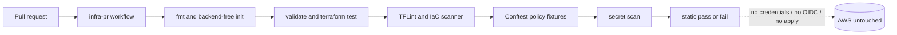

# Terraform Foundation Implementation Plan

## Status

**Proposed; no AWS operation is authorized or required by this document.**

This is the first implementation slice of the infrastructure plan. It starts
from the current remote `main` commit, rather than the locally checked-out,
already-merged Phase 03 feature branch. It creates a plan-only Terraform
foundation and static CI gates. It does not create an AWS identity, invoke
Terraform against AWS, create a state bucket, or provision a resource.

## Scope and explicit boundary

### Included in this slice

- Terraform version and provider constraints with a committed lock file.
- A root environment shape under `infra/environments/v1-dev` whose feature
  flags default to disabled and whose default configuration represents no
  customer-managed runtime resources.
- Naming, tag, expiry, region, and zero-scale input validation.
- Rego policies and Terraform native tests that fail closed for forbidden
  resource classes, unowned names, public ingress, and non-zero default
  runtime scale.
- A pull-request-only IaC workflow that has no AWS credentials, no GitHub OIDC
  token, and no deployment environment access.
- PowerShell plan/preflight helpers that are local/static only in this run,
  plus documentation and redacted example evidence.
- Ignore rules which prevent state, plans, credentials, real backend files,
  real tfvars, and evidence scratch data from being committed.

### Excluded until later gated runs

- Every `terraform apply`, `destroy`, import, state migration, or backend
  creation.
- AWS IAM, GitHub OIDC provider/roles, S3, SQS, EventBridge, ECR, ECS, VPC,
  Cognito, Secrets Manager, Neon, or Google OAuth resources.
- Cloud credentials, account IDs, billing data, live screenshots, DSNs,
  client secrets, API tokens, and unredacted fixtures.
- Changes to the merged Phase 03 persistence semantics or its PostgreSQL CI.

## Preconditions and branch procedure

1. Preserve unrelated user-owned and untracked files; do not stage or delete them.
2. Fetch `origin/main`; inspect its status and fast-forward only if the local
   worktree is clean apart from those preserved untracked files. Do not reset,
   force-push, or delete any user material.
3. Create a dedicated infrastructure branch from verified `origin/main`.
4. Before changing files, read the V1/Phase-13 sources if present in `main`.
   The supplied infrastructure handoff is authoritative for this run if those sources
   have not yet been added to the repository.

## Target file map

| Path | Responsibility |
| --- | --- |
| `.gitignore` | Exclude Terraform state, plans, override files, real backend/tfvars, and IaC scratch evidence while retaining examples and `.terraform.lock.hcl`. |
| `infra/README.md` | State the plan-only boundary, safety defaults, command matrix, no-credential rule, and Run-02 handoff. |
| `infra/naming.md` | Define `ps-fleetforge-v1-dev-` names, required tags, constrained-name exception procedure, and owner/expiry contract. |
| `infra/environments/v1-dev/{versions,providers,main,variables,outputs}.tf` | Create the root module, provider default tags, validations, feature-flag locals, and zero-resource/default outputs. |
| `infra/environments/v1-dev/{terraform,dev.auto}.tfvars.example` | Supply synthetic examples only; no account IDs, credentials, or live endpoints. |
| `infra/policy/{ownership,free-plan,iam}.rego` | Reject unsafe plan JSON before any future apply-capable workflow exists. |
| `infra/environments/v1-dev/tests/{naming,zero-scale,network,ownership}.tftest.hcl` | Exercise default-safe configuration and input/resource safety expectations without a provider call. |
| `scripts/infra/{preflight,plan,redact-evidence}.ps1` | Provide testable, read-only local validation and deterministic command wrappers; AWS discovery is deferred to Run 00/02. |
| `docs/evidence/infrastructure/{README,account-preflight.example,cost-ledger,iam-matrix,resource-inventory}.md` | Define redacted evidence shapes and account-owner gates, not real evidence. |
| `.github/workflows/infra-pr.yml` | Run formatting, backend-free initialization/validation/testing, TFLint, IaC scan, Conftest, and secret scan with `contents: read` only. |
| `.tflint.hcl`, `trivy.yaml`, `conftest.toml` (only if each tool needs repository configuration) | Pin and constrain checks without suppressing high-risk findings. |

## Design decisions

### Terraform root

Use one `v1-dev` environment root but no resource module invocation in its
default configuration. `enable_runtime`, `enable_scheduler`, and
`enable_cognito_google` are booleans and default to `false`. The synthetic target
backend has no cloud-infrastructure feature flag because it is locally runnable;
a future optional container deployment belongs to the runtime module. A future
module must be conditionally instantiated only after its matching gated run;
this pass must not add placeholder AWS resources merely to make a plan look
complete.

The root requires non-empty `owner`, `environment`, `region`, and
`apply_expires_at` for any non-default feature activation. `apply_expires_at`
must parse as UTC, be in the future, and be at most seven days ahead. Non-zero
desired ECS scale must require a session expiry, but the actual ECS resource is
a later-run concern.

### Provider and lock policy

Pin Terraform `1.16.3`, the current stable patch selected on implementation
day, and a compatible reviewed AWS provider minor range. Run backend-free
initialization solely to generate the lock file and commit it. Provider
configuration must not read environment credentials during `validate` or
`terraform test`; region and default tags are plain variables. No backend block
is configured with a real bucket in this foundation.

### Policy model

Conftest evaluates Terraform plan JSON fixtures and future plan output. It
denies:

- NAT gateways, load balancers, Elastic IPs, RDS, EKS, Marketplace purchases,
  reserved capacity, paid support, and unbounded autoscaling;
- resource names without the required prefix or full ownership tags;
- `0.0.0.0/0` or `::/0` inbound security-group rules;
- non-zero ECS desired counts without a bounded expiry;
- unsupported region changes or resource enablement without required expiry;
- `freetier:UpgradeAccountPlan`, AWS Organizations, and Control Tower actions
  in future IAM documents.

Policies accept explicit positive and negative JSON fixtures. They report the
resource address and violated invariant but never echo sensitive values.

### CI trust boundary

`infra-pr.yml` runs on pull requests only, including forks. It declares only
`permissions: contents: read`, omits `id-token: write`, accesses no GitHub
environment, consumes no AWS secret, and never runs `terraform apply` or
`destroy`. Tool releases/actions are pinned to immutable revisions. The
existing Foundation workflow gets `infra/**`, `scripts/infra/**`, IaC config,
and `infra-pr.yml` path coverage only if needed to preserve repository-wide
secret scanning; IaC validation remains its own workflow to avoid granting
cloud capabilities to general tests.

### PowerShell scripts

Scripts are written for the user’s Windows workflow and support `-WhatIf` or a
strict local/static mode. `preflight.ps1` validates required tool versions and
example/fixture structure only in this foundation. It must reject missing values,
expired test records, wrong account fixtures, and ownership collisions without
calling AWS. Live `aws` CLI inspection is deferred until an administrator has
created the dedicated operator/bootstrap identity and Run 00 is explicitly
approved.

## Data and control flow

On a later Run 02, a separately reviewed bootstrap route creates remote state
and GitHub OIDC. Only then may an apply workflow consume an ID token. This
separation makes an untrusted PR incapable of obtaining a cloud session.

## Test plan

| Test ID | Mechanism | Expected result |
| --- | --- | --- |
| `INFRA-PLAN-01` | Terraform test plus Conftest fixture with a non-`ps-` name | Fails with ownership/naming violation. |
| `INFRA-PLAN-02` | One fixture per forbidden service family | Each plan is denied. |
| `INFRA-PLAN-03` | Non-zero scale without expiry fixture | Denied before a provider call. |
| `INFRA-PLAN-04` | IPv4 and IPv6 public-ingress fixtures | Denied. |
| `INFRA-PLAN-05` | Default `terraform test` | Passes while planning zero runtime resources. |
| `INFRA-PLAN-06` | Invalid/too-distant expiry values | Terraform variable validation fails. |
| `INFRA-SECRET-01` | Canary fixture and repository secret scan | Canary fails scanning; normal examples remain clean. |
| `INFRA-CI-01` | Workflow inspection/test | Workflow has `contents: read` only, no `id-token`, no environment, apply, or destroy step. |

Local verification is limited to `terraform fmt -check`, backend-free init,
`terraform validate`, `terraform test`, TFLint, the chosen IaC scanner,
Conftest, PowerShell script tests, `git diff --check`, and the existing
Docker-free Go/web checks affected by workflow path coverage. GitHub Actions
is the authority for the final PR workflow result. Docker is not used locally.

## Completion gate for this slice

This foundation is complete only when all static checks pass, the default environment
remains zero-scale and provider-unauthenticated, no sensitive or account
material is tracked, and the PR visibly establishes that untrusted PR CI cannot
obtain AWS credentials. It does **not** prove AWS provider behavior, billing,
IAM permissions, remote state, synthetic-target behavior, or any runtime resource.

## Later-run handoff

Run 02 requires explicit administrator action to create the dedicated
FleetForge bootstrap/operator identities, policies, GitHub OIDC boundary, and
state backend after reviewing a concrete Terraform plan and cost gate. No such
operation is included in this branch’s initial implementation.
