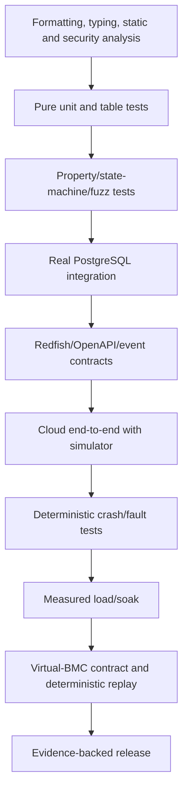

# Testing Strategy

## Purpose

This document defines how FleetForge proves behavior. It complements phase-specific tests and prevents three common failures: testing only handlers, mocking away the database/queue/device semantics, and publishing performance or safety claims without reproducible evidence.

## Quality model

Fast layers run on every pull request. Expensive cloud, load, soak, and restore
layers run on protected main, scheduled/manual workflows, or release gates as
identified below.

## Test layers

| Layer | Primary subject | Dependencies | Frequency | Failure meaning |
|---|---|---|---|---|
| Formatting/type/static | Source/contracts/IaC | Toolchain only | Every PR | Build quality or known defect pattern |
| Unit/table | Domain, validation, mapping, redaction | None/in-memory values | Every PR | Local rule broken |
| Property/state model | Transition sequences, budgets, idempotency model | Deterministic generator | Every PR with fixed budget; deeper scheduled | Invariant counterexample |
| Fuzz | Parsers, selectors, Redfish/manifest/error inputs | Corpus + random seed | Bounded PR; deeper scheduled | Crash, leak, unbounded behavior, invalid acceptance |
| PostgreSQL integration | Transactions, constraints, locks, leases, outbox, migrations | Real PostgreSQL | Every PR | Persistence semantics broken |
| Contract | OpenAPI/events/Redfish subset | Schemas + simulator/fixtures | Every PR | Boundary drift/incompatibility |
| Component | One runtime with real adapters where practical | PostgreSQL/simulator/provider emulator | Every PR or main | Wiring/behavior mismatch |
| Cloud E2E | API→DB→queue→worker→simulator→UI | Staging services | Main/protected PR/release | Deployment/integration failure |
| Fault/chaos | Crashes, loss, duplication, outage, ambiguity | Deterministic hooks + simulator | Core subset PR; full main/release | Safety/recovery failure |
| Load/soak | Capacity, latency, leaks, cost | Staging + simulator | Manual/release | Claim unsupported or bottleneck/regression |
| Virtual-BMC contract/replay | Selected fields, extensions, deterministic behavior, independent oracle | Pinned schemas + canonical fixtures + retained journal | Every PR subset; full release | Adapter/backend drift or nondeterminism |
| Restore/recovery | Backups, reconstruction, replay | Isolated restore environment | Release/periodic | Durability/recovery claim unsupported |

## Environment matrix

| Environment | Database | Queue/events | Device | Permitted tests |
|---|---|---|---|---|
| Developer laptop | None required; optional remote dev | In-memory/remote opt-in | In-process or local virtual-BMC container | Unit, property, focused contract, frontend |
| CI PR | Ephemeral PostgreSQL service | Deterministic adapters; provider contract where safe | Simulator container/in-process | Full fast suite and fault subset |
| Staging | Neon staging | Amazon SQS Standard + EventBridge Scheduler | Private scale-to-zero virtual-BMC container | E2E, provider, faults, load, restore target |
| Demo production | Neon demo | Amazon SQS Standard + EventBridge Scheduler | Scale-to-zero virtual-BMC container | Smoke/synthetic and controlled demo only |

## Test-data rules

- All target identities, labels, credentials, artifacts, events, and firmware effects are synthetic.
- Fixtures declare schema version and provenance.
- Seeds are printed and stored for generated/fault tests.
- Time is injected; tests do not wait real minutes when a logical clock can advance.
- UUID/ID generation is injectable or recorded where determinism matters.
- No test depends on execution order or another test's database state.
- Every integration test uses isolated schema/database/tenant-equivalent namespace and cleans up safely.
- Test cleanup identifies resources by explicit test-run ID and environment; never broad globs.

## Safety-critical test ordering

For external update logic, tests are written around boundaries:

1. Before intent commit.
2. After intent commit but before lease/epoch recheck.
3. Immediately before and after persisted submission admission, including a pause commit between admission and request write.
4. During/after request write but before response.
5. After accepted response but before durable result.
6. After durable result but before queue acknowledgement.
7. During later task/reboot/version/health observation.

Each boundary has an injected crash/failure case. The acceptance oracle includes both FleetForge state and simulator accepted-operation journal.

## Required invariant suite

| Invariant | Minimum test forms |
|---|---|
| One active campaign per target | DB concurrent insert + domain conflict |
| Persist intent before side effect | Instrumented order assertion + crash test |
| No blind or late repeat after ambiguity | Deterministic post-accept crash, stale-live-worker schedule, false-proof-of-absence oracle, and randomized schedules |
| No wave overlap/premature release | Property sequences + concurrent evaluator integration |
| Pause epoch fences new admission | Barrier-controlled pre-admission and post-admission race tests; previously admitted work remains reported as in flight |
| Snapshot immutability | API negative + database/repository enforcement |
| Audit with mutation | Transaction rollback + mutation/audit completeness query |
| Queue not truth | Queue delete/loss + due-work reconstruction |
| Success needs version+health | Contradictory device fixtures |
| Secret exclusion | Canary-secret fuzz through logs/traces/events/errors/UI |
| No lock during network | Instrumentation/barrier verifies concurrent DB access while adapter blocks |
| Finite retries | Generated failure sequences and attempt/deadline assertions |
| Physical concurrency | Independent simulator active-operation count across work-lease expiry, attention, restart, and reconciliation |
| Target ownership | Readiness-time enrollment race plus terminal-target/non-terminal-campaign and unresolved-operation cases |

## Concurrency-test design

- Use synchronization barriers/hooks, not probabilistic sleeps, to place workers at race boundaries.
- Repeat race tests and run Go race detector.
- Record worker/lease/attempt IDs and revisions.
- Assert maximum observed reservations over time, not only final counters.
- Include stale-worker commits and expired-lease recovery.
- Include deadlock-prone mixed site/rack claims and verify deterministic lock ordering.
- Include one noisy target/hot rack and verify other domains progress.
- Use one deterministic lock order across campaign, wave, target, enrollment, operation-reservation, due-work, and repair writers; barrier-test completion against abort/evaluation/repair.
- Distinguish work-lease ownership from durable operation-reservation ownership in every oracle.

## Property and model-based test architecture

- Phase 02 owns an independent sequential reference model, command/evidence generators, shrinking, transition coverage, and retained counterexamples.
- Phase 03 extends the model with transactional histories, enrollment ownership, audit/counter invariants, and stale lease commits.
- Phase 08 adds a deterministic concurrent scheduler for duplicate delivery, worker stalls, lease expiry, delivery generations, Amazon SQS Standard visibility-timeout redelivery and uncertain publish, reservations, and fairness.
- Phase 09 adds an independent external acceptance model for ambiguous transport, late original requests, pause admission, proof of absence, reboot/task loss, and restore interleavings.
- Pull-request suites publish sequence/time budgets and transition coverage. Deeper scheduled/release suites use larger budgets; neither is described as exhaustive proof.
- Every bug retains the original seed and a minimized schedule, and the regression suite proves the harness fails for one deliberate duplicate-submission mutation.

## Contract testing

### OpenAPI

- Lint source and examples.
- Validate server responses and generated client types.
- Detect breaking changes against released specification.
- Test unknown fields/enums/version behavior.

### Events/work commands

- Canonical envelope fixtures for every version/type.
- Unknown version goes to quarantine/dead-letter.
- Missing/oversized/malformed fields fail boundedly.
- Duplicate event/command identity is stable.
- Amazon SQS Standard provider integration covers duplicate receipt, visibility-timeout redelivery, uncertain publish, and successful repair through a new delivery generation.

### Redfish

- Validate selected resource subset against official schemas/fixtures.
- Compare simulator responses with canonical fixtures derived from the pinned
  selected schemas and accepted synthetic contract.
- Treat simulator extensions as explicit adapter-contract fixtures.
- Do not label untested surface as compliant.
- Record each capability as selected-standard, simulator-extension,
  admin-only, or unsupported.
- Freeze the synthetic update mechanism and fixtures before simulator/adapter
  behavior becomes contractual.

## Migration testing

Every migration change must pass:

- empty database → latest;
- previous supported release snapshot → latest;
- current app against expanded schema;
- previous app against expanded schema for rollback window;
- query/index/constraint integration suite;
- representative data backfill in bounded batches where applicable;
- concurrent migrator advisory-lock test;
- backup/restore impact review for destructive changes.

## Fault-injection policy

Fault hooks are explicit, test-only or simulator-only, disabled in demo production by default, and protected from public invocation. Each fault specifies trigger, scope, duration/count, seed, expected observation, expected recovery, and cleanup.

Minimum full matrix:

- duplicate/lost/delayed SQS message;
- publisher success before DB mark;
- worker crash at each submission boundary;
- database timeout before/after remote acceptance;
- Redfish pre-send failure, post-accept disconnect, `429`, `503`;
- lost/duplicate/out-of-order event;
- task disappearance after reboot;
- version contradiction and health failure;
- pause/abort race;
- telemetry outage;
- database restore and due-work reconstruction.
- work lease expires while the original submitter remains alive and later writes;
- operation reservation remains counted while update/reboot/attention is unresolved;
- ECS Fargate worker capacity is zero until EventBridge Scheduler launches repair;
- an SQS message is redelivered after visibility timeout or publish result is uncertain;
- older database snapshot is restored against newer persistent simulator/device state;
- deliberate duplicate request and false `PROVEN_ABSENT` classification make the independent oracle fail.

## Performance methodology

- Warm-up and measurement windows are separate.
- Report sample count and latency distribution, not only average.
- State cold-start/min-instance behavior.
- Capture application, database, queue, simulator, browser, and cost signals.
- Run baseline before tuning.
- Change one variable per tuning experiment.
- Preserve failed runs.
- Do not extrapolate beyond tested target count/concurrency/environment.
- Define API request mix, arrival rate, sample count, warm/cold configuration, exclusions, and error treatment before reporting p95.
- Define runnable-work eligibility and include due items that never start in start-delay reporting.
- Define regression thresholds only after stable repeated baseline.

## Flakiness policy

- A flaky test is a defect, not a reason to rerun until green.
- CI may retry only infrastructure setup failures classified independently from test failure.
- Quarantining a test requires owner, issue, reason, expiry, and non-safety-critical classification.
- Safety-invariant tests may not be quarantined to permit merge.
- Store failing seed, timing, environment, logs/traces, and artifacts.

## Evidence format

Every material run stores:

| Field | Required |
|---|---|
| Test/report name and version | Yes |
| Git commit and image digest | Yes |
| Schema/IaC version | Integration/cloud runs |
| Timestamp/timezone and duration | Yes |
| Environment/region/resources | Integration/load/restore |
| Scenario/config/seed | Generated/fault/load |
| Tool versions | Yes |
| Pass/fail and exact assertion | Yes |
| Raw machine-readable output | Where practical |
| Human interpretation | Material portfolio results |
| Known limitations/anomalies | Yes |
| Sanitization verification | Before publication |

## CI gate allocation

| Gate | PR | Main/staging | Release/manual |
|---|:---:|:---:|:---:|
| Format/lint/type/build | Required | Required | Required |
| Unit/table/property bounded | Required | Required | Required |
| Race test | Required or path-based | Required | Required |
| PostgreSQL integration/migrations | Required | Required | Required |
| OpenAPI/event/Redfish contract | Required | Required | Required |
| Fault critical subset | Required | Required | Required |
| Full cloud E2E | Optional protected PR | Required | Required |
| Full fault matrix | No | Scheduled/manual | Required |
| 1,000-target load/soak | No | Manual/scheduled | Required for claim |
| Restore | No | Periodic | Required |
| Full virtual-BMC contract/replay | Required subset | Required | Required for synthetic target claim |
| Secret/license/SBOM/provenance | Required subset | Required | Required |

## Completion rule

No phase is complete because “tests pass locally.” The applicable required tests must pass in the declared environment, evidence must be stored, and known limitations must be updated.
