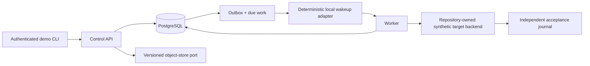

# v1 — Safe Local Synthetic-Target Demo

## Outcome

v1 delivers a small, authenticated, API-driven FleetForge demonstration: an
operator registers deterministic synthetic targets, registers a verified
synthetic artifact, freezes a canary-and-one-wave campaign, starts it through
durable work, and observes success or a conservative `NEEDS_ATTENTION` outcome
in an immutable audit timeline.

The v1 implementation is local-first. PostgreSQL remains workflow truth, while
versioned object storage, queue wakeups, credential resolution, and OIDC are
accessed through provider-neutral ports with deterministic local adapters. The
AWS Terraform and production adapters remain in the repository for later
staging work; v1 neither provisions AWS nor presents local adapter results as
AWS evidence.

## Scope and proof boundary

| Included | Deferred to later version |
| --- | --- |
| Local/CI execution with explicit limits, reset, and retained evidence. | Live AWS resources, provider IAM evidence, and hosted staging deployment. |
| One frozen synthetic target contract before route implementation. | External-device and vendor compatibility proof. |
| Simulator scenarios for a small fleet, healthy campaign, lost event, post-accept disconnect, and canary stop. | 1,000-target load/soak and the full fault matrix. |
| Target discovery/preflight, immutable synthetic artifact identity, deterministic plan, durable work, one supported update path, and reconciliation. | Full selector language, signature formats, vendor extensions, and all long-tail policy options. |
| Local synthetic HS256 identity adapter for the authenticated API and CLI demo. | Live Cognito federation, JWKS validation, browser console, SSE, and the complete Phase 10 authorization surface. |
| Static, zero-resource IaC validation. | Terraform apply, AWS billing/IAM/runtime verification, promotion, and rollback rehearsal. |

v1 must never take a retry shortcut after a possibly accepted update request.
The independent synthetic-target journal is the oracle for duplicate
acceptance. A lost result must lead to adoption, independently proven absence
with late-caller exclusion, or `NEEDS_ATTENTION`.

## Implementation order

| v1 phase | Source-phase mapping | Gate |
| --- | --- | --- |
| [V1-P00](00-bootstrap-and-capability-spike.md) | Foundation, static IaC, and contract freeze | Local/provider boundaries and one synthetic update contract are frozen without cloud provisioning. |
| [V1-P01](01-deterministic-simulator.md) | Phase 04 | The synthetic target backend is deterministic and exposes duplicate requests independently. |
| [V1-P02](02-inventory-and-artifact-trust.md) | Focused Phase 05 + Phase 06 | Target snapshot and exact artifact identity are immutable. |
| [V1-P03](03-campaign-planning.md) | Focused Phase 07 | Deterministic canary/one-wave plan can become `READY`. |
| [V1-P04](04-durable-orchestration.md) | Focused Phase 08 | Duplicate/lost wakeups cannot erase or duplicate durable work. |
| [V1-P05](05-execution-and-reconciliation.md) | Focused Phase 09 | Independent journal proves no blind duplicate submission. |
| [V1-P06](06-authenticated-api-and-demo.md) | Focused Phase 10 and v1 evidence | A reproducible authenticated local demo proves the v1 boundary. |

Do not start a phase until its prior v1 gate and the corresponding numbered-phase prerequisites pass.

## v1 acceptance demonstration

Run one seeded 6–10 target scenario across at least two racks:

1. Register targets using only credential references and discover synthetic capabilities.
2. Register a synthetic artifact at one immutable object-version identity and verify its SHA-256.
3. Create and validate a campaign with a deterministic canary and one later wave; record target snapshot and plan hash.
4. Start the canary. Show due work, wakeup, lease, admission, reservation, audit, and synthetic-target journal correlation.
5. Inject a lost event; polling/reconciliation must still reach a correct terminal observation.
6. Inject a post-accept disconnect. Show exactly one backend acceptance and either adoption or `NEEDS_ATTENTION`; no second submission is allowed.
7. Inject a canary failure. Show that no new later-wave admission occurs after the pause commit while earlier admitted exposure is reported honestly.

The release evidence records commit, binary/config/schema versions, scenario
seed, test output, local resource usage, and known limitations. v1 is not
complete if any manual step depends on unrecorded database edits, hidden
credentials, live AWS resources, or undocumented state changes.
