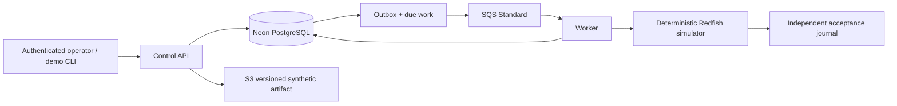

# v1 — Safe Simulator Rollout Demo

## Outcome

v1 delivers a small, authenticated, API-driven FleetForge demonstration: an operator registers deterministic simulated targets, registers a verified synthetic artifact, freezes a canary-and-one-wave campaign, starts it through durable queue work, and observes success or a conservative `NEEDS_ATTENTION` outcome in an immutable audit timeline.

The control plane runs against PostgreSQL, SQS Standard, S3, AWS Secrets Manager, Cognito, and an EC2-hosted deterministic Redfish simulator in a cost-capped development environment. It deliberately supports a small seeded demonstration fleet, not a scale claim.

## Scope and proof boundary

| Included | Deferred to later version |
| --- | --- |
| One AWS development environment with strict budget/teardown controls. | Staging/demo-production promotion and rollback rehearsal. |
| One frozen QEMU/OpenBMC capability decision before simulator contracts. | QEMU firmware update proof. |
| Simulator scenarios for a small fleet, healthy campaign, lost event, post-accept disconnect, and canary stop. | 1,000-target load/soak, broad fault matrix, and vendor claims. |
| Target discovery/preflight, immutable synthetic artifact identity, deterministic plan, queue-driven work, one supported firmware update path, and reconciliation. | Full selector language, signature formats, vendor extensions, and all long-tail policy options. |
| Cognito-authenticated API/CLI demo with target, artifact, campaign, attention, and audit endpoints. | Browser console, SSE, complete OpenAPI surface, and full Phase 10 authorization matrix. |

v1 must never take a retry shortcut after a possibly accepted update request. The independent simulator journal is the oracle for duplicate acceptance. A lost result must lead to adoption, independently proven absence with late-caller exclusion, or `NEEDS_ATTENTION`.

## Implementation order

| v1 phase | Source-phase mapping | Gate |
| --- | --- | --- |
| [V1-P00](00-bootstrap-and-capability-spike.md) | Phase 13-B01–B06 and Pre-04 | Provider boundaries and one QEMU update path are frozen. |
| [V1-P01](01-deterministic-simulator.md) | Phase 04 | The simulator is deterministic and exposes duplicate requests independently. |
| [V1-P02](02-inventory-and-artifact-trust.md) | Focused Phase 05 + Phase 06 | Target snapshot and exact artifact identity are immutable. |
| [V1-P03](03-campaign-planning.md) | Focused Phase 07 | Deterministic canary/one-wave plan can become `READY`. |
| [V1-P04](04-durable-orchestration.md) | Focused Phase 08 | Queue duplication/loss cannot erase or duplicate durable work. |
| [V1-P05](05-execution-and-reconciliation.md) | Focused Phase 09 | Simulator journal proves no blind duplicate submission. |
| [V1-P06](06-authenticated-api-and-demo.md) | Focused Phase 10 and v1 evidence | A reproducible authenticated demo proves the v1 boundary. |

Do not start a phase until its prior v1 gate and the corresponding numbered-phase prerequisites pass.

## v1 acceptance demonstration

Run one seeded 6–10 target scenario across at least two racks:

1. Register targets using only credential references and discover simulator capabilities.
2. Register a synthetic artifact stored at one exact S3 version ID and verify its SHA-256.
3. Create and validate a campaign with a deterministic canary and one later wave; record target snapshot and plan hash.
4. Start the canary. Show due work, queue wakeup, lease, admission, reservation, audit, and simulator journal correlation.
5. Inject a lost event; polling/reconciliation must still reach a correct terminal observation.
6. Inject a post-accept disconnect. Show exactly one simulator acceptance and either adoption or `NEEDS_ATTENTION`; no second submission is allowed.
7. Inject a canary failure. Show that no new later-wave admission occurs after the pause commit while earlier admitted exposure is reported honestly.

The release evidence records commit, image/config versions, scenario seed, synthetic environment, test output, cost limits, and known limitations. v1 is not complete if any manual step depends on unrecorded database edits or hidden credentials.
